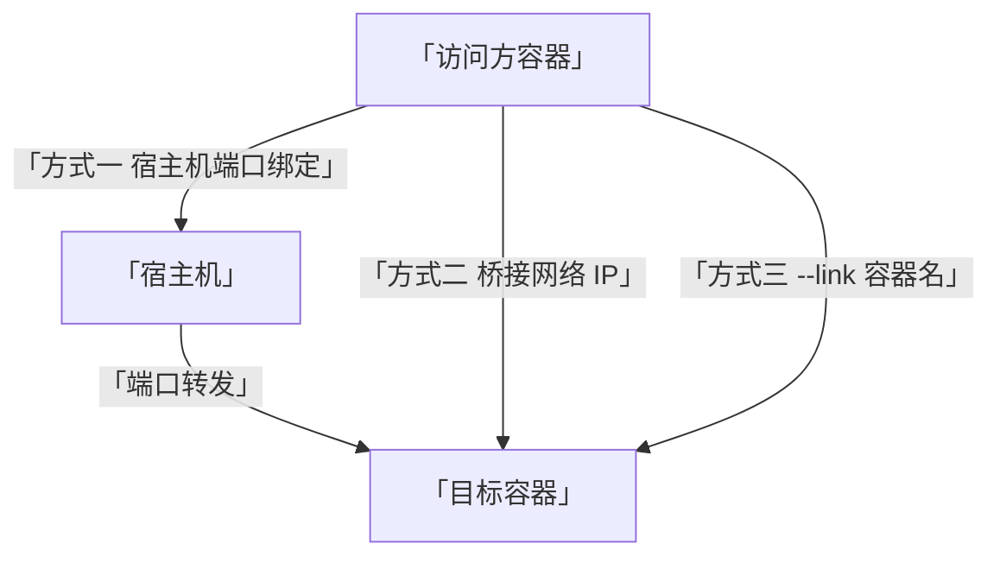

## 多容器应用的部署问题

前面基于 Dockerfile 构建了 GoZero 容器。但这个例子比较简单，只构建了一个 user-api 的服务容器。实际上在应用服务中，它包括了 user-rpc、Redis、etcd 以及 MySQL 等服务。这些服务在使用 Docker 的情况下，应该如何去部署应用呢？

本讲会从下面四个方面来进行讲解：

1. **容器网络模式**：了解这些模式分别有哪几种，以及它们是怎么工作的；
2. **容器间通信**：了解容器与容器之间是如何通讯的；
3. **实践容器通信**：基于容器网络模式及容器的通讯，把 user-rpc 服务、user-api 服务分别基于容器构建好，并且实现相互之间的通讯；
4. **统一编排**：通过 Docker Compose 进行统一的容器编排管理工作。

## 容器的三种网络模式

先来看第一个问题：容器网络模式。

在 Docker 中，容器的网络模式有三种：`none`、`bridge` 和 `host`。

**none 模式**：创建的容器会有一个独属于自己的网络，但是 Docker 并不会给容器分配 IP，也不会做分配网络设置等操作。使用这种模式，这个容器就是一个独立的存在，其他人无法加入到它的网络当中，它也不可以加入到其他网络当中。

**bridge 模式**：这是目前应用比较广泛的，也是 Docker 默认的一种模式。Docker 在创建的时候，就会默认创建一个桥接网络，所创建的容器在没有指定网络信息的时候，默认就会使用到这个桥接网络分配 IP。

**host 模式**：使得容器能够直接使用到宿主机的网络信息。

下面看具体的示意图，此图指的是桥接网络的。在桥接网络的下面有一个 `docker0` 网桥。Docker 在创建、重启等这些操作的时候，会在应用程序中创建一个虚拟的网络，每一次的启动、重启，这个虚拟网络段的信息都会发生改变，不是固定的。这个网络段采用的桥接方式，本身来说仍然还是使用到了宿主机的网络信息，但所创建的容器里面所具有的网络信息，是基于这个桥接的网络信息配置的。

具体来说，每个容器内部有一个 `eth0` 网络接口，通过 `veth` 虚拟设备连接到宿主机上的 `docker0` 网桥，`docker0` 网桥则作为容器间通信的共享网络媒介。因此容器在创建的时候，如果使用桥接模式，就会根据桥接模式所定义的网络段给它分配 IP。

然后是 host 模式。这种模式的特征主要在于容器的网络信息会直接使用到宿主机的网络信息。因此在容器中如果对外开放了一个端口，那么在宿主机中也会同样开放这个端口，因为它们两个网络是共享使用的。但一般来说不是特别建议使用，因为在这种模式下，宿主机所安装的其他服务的网络信息会有一定的冲突。

## 容器间的三种通信方式

再看在 Docker 中，容器的互通有哪些方式。Docker 的容器通信有三种方案。

**第一种是通过宿主机的端口绑定访问**。画一个视图：视图中有两个容器，可以理解为它们在一个宿主机中。这两个容器要相互通讯，怎么做？根据第一种方式，就是使用绑定的方式：宿主机与容器绑定端口，然后访问方直接访问宿主机的端口，再通过宿主机的端口访问对应的容器。要注意的是，在同一个宿主机中，不同的容器之间也可以采用这种方式来进行访问，这也是没问题的。

**第二种是基于桥接网络段**。在内部定义一个桥接网络段，使得两个容器都统一在这一个桥接网络当中。因为在同一个网络下面，直接可以根据 IP 的方式来访问。但这种模式只限于宿主机内部；如果想要被外网使用，仍然还是需要使得宿主机和容器之间能够进行访问，通过端口的方式绑定起来。

**第三种是通过 `--link` 的命令进行连接**。这种方式有一个前提，就是两个容器都应在同一个网络下面。在同一个网络下面的话，访问方式自然就是根据 IP；除了 IP 以外，在使用 `--link` 的情况下，可以使得容器可以通过容器名去访问目标容器，而不只是通过 IP。

以上是 Docker 中的三种访问方式。了解完 Docker 的通信方式后，接下来就实践这三种通信方式。

