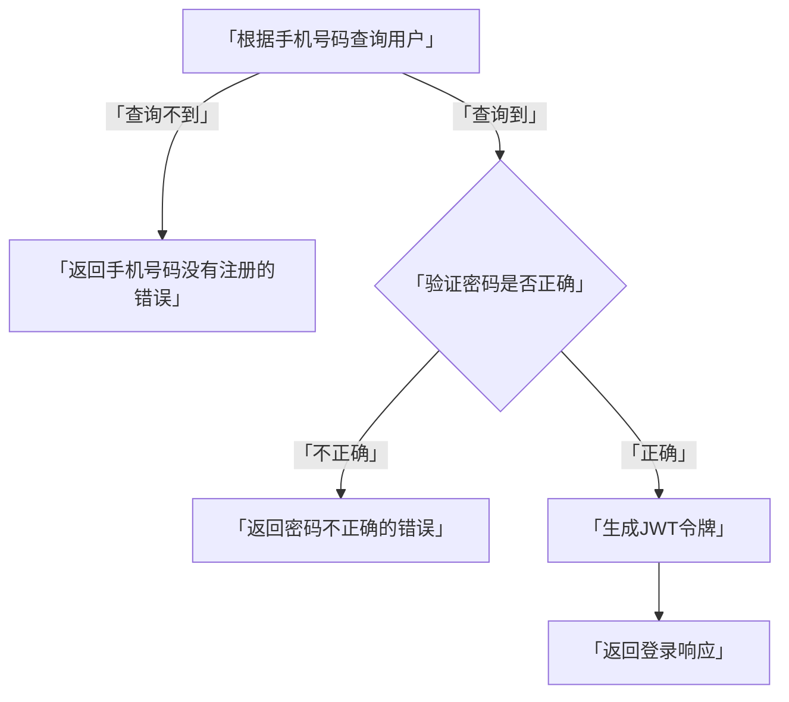

注册业务完成之后，接下来顺便把登录也完成。登录和注册两者之间差别不大，将整体这一块的业务复制一份，放到登录中。登录中它也同样会根据手机号码去查询，也会对密码进行验证。但是下面的加密密码是不需要的，所以将这两块业务移除。

在上面错误判断的地方，再增加一个错误。之所以要定义这个错误，是因为当前可能是根据手机号码查询不到用户，所以在这里定义一个错误，把这个错误复制一下，上面要改一下，不是手机号码已经注册的，而是手机号码没有注册。

第一段业务就完成了。这一段没问题之后，进行密码验证。调用密码验证的方法，第一个参数是用户输入的密码，第二个参数是加密后的密码。再给它定义一个错误，叫密码不正确，如果输入的密码是错误的，就返回这个错误。然后返回的结果与注册是一致的类型，把这一块复制过来，到此登录的业务就已经完成了。

登录业务的整体流程如下：



  ```go
  // 验证用户是否存在
  userEntity, err := l.svcCtx.UsersModel.FindByPhone(l.ctx, in.Phone)
  if err != nil {
      return nil, err
  }

  // 验证密码
  if !encrypt.ValidatePasswordHash(in.Password, userEntity.Password.String()) {
      return nil, ErrUserPwdError
  }

  // 生成 JWT 令牌
  now := time.Now().Unix()
  token, err := ctxdata.GetJwtToken(
      l.svcCtx.Config.Jwt.AccessSecret,
      l.svcCtx.Config.Jwt.AccessExpire,
      userEntity.Id,
  )
  if err != nil {
      return nil, err
  }

  // 返回登录响应
  return &user.LoginResp{...}, nil
  ```

登录跟注册其实差不多，两块业务准备好之后，就应该对整个程序做测试了。测试推荐用单元测试，在这里定义单元测试也并不难，可以定义一个简单的单元测试。

它做什么事情？首先是初始化，初始化的对象是 ServiceContext。之所以初始化这个 ServiceContext，因为每一个业务逻辑的方法对象在创建的时候都是传递一个 Context 和 ServiceContext 两个值，然后就可以去调用它的方法了。所以单元测试非常简单，把 ServiceContext 的创建过程复制过来，用一下包，这里是它的一个地址，从当前目录开始找，往上一级，再往上一级，找到 etc，下面 dev，在其下的 user.yaml，这样就准备好了。

定义完成之后，再给注册新增一个单元测试的方法。把创建这个注册的 Server 的属性值删掉，因为目前不用它来创建属性值，直接通过 New 的方法来创建，这样就创建好了。然后再改一下这里面的属性，因为它的返回值不止一个，写起来比较长，而且结果不确定，就用打印的方式来做验证，打印出来，并且它没有错误。之后再填写要输入的请求参数，就完成了一个测试。测试号码，注册一个 13788881112 的测试号码，名称木木老哥，密码 123456，头像以及性别，再接下来更改一下这个地方，把输出值给它打印出来，一个单元测试就写完了。

  ```go
  func TestRegisterLogic_Register(t *testing.T) {
      tests := []struct {
          name   string
          args   args
          wantPrint bool
          wantErr bool
      }{
          {
              name: 「1」, args: args{
                  Name: 「1」,
                  Phone: 「13788881112」,
                  Nickname: 「木木老哥」,
                  Password: 「123456」,
                  Avatar: 「png.jpg」,
                  Sex: 1,
              }, wantPrint: true, wantErr: false,
          },
      }

      for _, tt := range tests {
          t.Run(tt.name, func(t *testing.T) {
              got, err := l.Register(tt.args)
              if err != nil {
                  t.Errorf(「Register() error = %v, wantErr %t」, err, tt.wantErr)
                  return
              }
              if tt.wantPrint {
                  t.Log(tt.name, got)
              }
          })
      }
  }
  ```

执行之后，结果运行失败了。它报告的错误内容是 mysql 的配置信息被写错了，这里应该是一个冒号来分割用户名和密码。修改之后重新执行，这一次数据实际上插入成功了，但是又失败了，错误应该是在 JWT 的生成有问题，这里的一个方式写错了，要写的是 HS256。

  ```go
  func GetJWTToken(secretKey string, iat, secondsInt64, uid string) (string, error) {
      claims := make(jwt.MapClaims)
      claims[「exp」] = iat + secondsInt64
      claims[「iat」] = iat
      claims[「identify」] = uid

      token := jwt.New(jwt.SigningMethodES256)
      token.Claims = claims

      return token.SignedString([]byte(secretKey))
  }
  ```

将它修改完之后，在这里修改一下这个值，再执行，这一次就没有问题了，说明程序是正常的。

单元测试是一种测试方法，也是后期会经常用到的。在 go-zero 中，单元测试使用起来非常方便，推荐用单元测试来测试它的业务逻辑。当然整体的联调，还是可以通过 API 对 gRPC 发起测试。把服务启动起来，启动完成，就可以测试了，没有问题，测试成功。

最要注意的是这里的地址，如果写 127.0.0.1，它是访问不到的。这里和 go-zero 本身有关系：在 go-zero 中，它的配置需要定义的是 0.0.0.0 的地址。但是 go-zero 会将这个地址重新去重写一下，它会获取当前所运行系统的 IP 地址，然后来进行配置。所以这个地方值得注意，当前的这个地址是当前这台机器的 IP 地址，所以就可以成功了。

到这里，用户服务中的注册和登录功能就完成了，整体来说并不难，可以根据整理的课程内容去进行操作。
