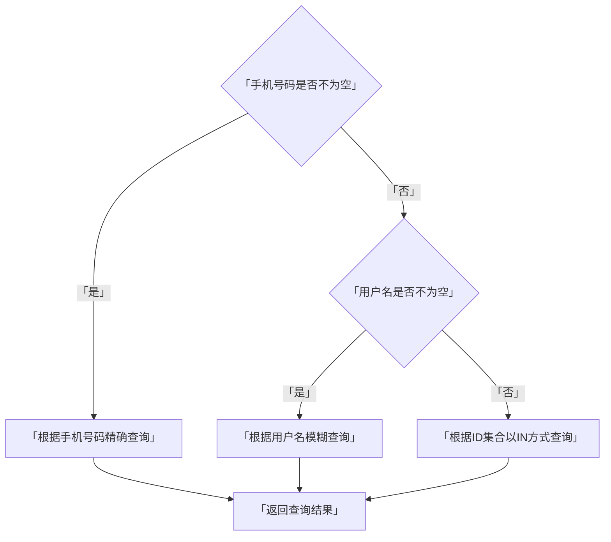

用户服务中的注册登录功能已经实施完了，接下来是用户服务中的搜索与详情。课程内容主要有三个方面：第一是用户详情，第二是用户搜索，第三是整个系统的错误日志处理。

## 用户详情

先看用户信息。对用户信息的查询，在 user-api 中，这里有定义一个 GetUser 的方法，可以通过这个方法来完成需求。在这个方法中，有一个 GetUserRequest 的消息体，它的请求参数是一个 ID，返回的是用户的实体模型，模型在上面。所以它的业务复杂度不高，就是根据 ID 去查找用户的详情，来完成下面的业务。

这里有个 GetUserInfo 的方法，只需要在这个 GetUserInfo 当前的文件中完成业务就可以了。根据 ID 查询，会得到一个用户的实体对象，同时也会得到一个错误。在用户模型中，有一个 FindOne 方法，这个方法就是根据 ID 去查询的，直接调用它就可以了。错误在这里是判断，如果它是因为查询为空抛出了错误，就提示用户不存在。在上面增加一个错误 ErrNotFound，表示这个用户没有找到。定义完错误之后，在下面再引用这个错误。

当得到这个信息之后，就可以去输出了。可以通过一个组件，把这里面的值，也就是把响应的这个用户模型，根据上面的一个实体结果，去给它填好。这是一个专门复制结构体、转换到另一个结构体的组件。定义响应的结果，就是 User 的一个实体对象。然后当下这个 User 是 gRPC 要返回的结果，第一个参数是设置的对象，第二个参数是数据的来源。设置完成，在这里就可以去输出，把包进行加载。到这里，用户详情就已经完成了，需求并不复杂。

    ```go
    func (l *GetUserInfoLogic) GetUserInfo(in *user.GetUserInfoReq) (*user.GetUserInfoResp, error) {
        // todo: add your logic here and delete this line
        userEntity, err := l.svcCtx.UsersModel.FindOne(l.ctx, in.Id)
        if err != nil {
            if err == models.ErrNotFound {
                return nil, ErrNotFound
            }
            return nil, err
        }
        var resp user.User
        copier.Copy(&resp, userEntity)
        return &user.GetUserInfoResp{
            User: &resp,
        }, nil
    }
    ```

## 用户搜索

接下来是用户搜索的功能。用户搜索功能主要有三个方面：可以根据手机号码去进行搜索，可以根据用户名进行搜索，也可以根据 ID 集合来去搜索。其中根据手机号码是精确查询，根据用户名是模糊查询，根据 ID 集合直接是采用 IN 的方式查询的，这样能完成它们的业务。

在这里定义了一个 FindUser 的方法，进到模型中，在模型中增加根据用户名及 ID 集合来进行查询，而手机号码这里已经有了，是个精确的，不动。先增加的就是根据名称，它返回的结果是一个用户的数组。首先先定好查询的字段、表名以及条件，模糊查询用 like。再定义要返回结果的字段和表名。接下来进行查询，把查询和参数放进去，做错误的处理，不为空的时候，以及为空的时候。当前这个方法就写完了。

    ```go
    func (m *defaultUsersModel) ListByName(ctx context.Context, name string) ([]*Users, error) {
        query := fmt.Sprintf(format, 「select %s from %s where `nickname` like ?「, usersRows, m.table)
        var resp []*Users
        err := m.QueryRowsNoCacheCtx(ctx, Grep, query, name)
        switch err {
        case nil:
            return resp, nil
        default:
            return nil, err
        }
    }
    ```

复制一份，更改这里，根据 ID 集合进行查询。因为当前 ID 是个数字，给它处理一下，strings.Join，把数字来进行拼接。这一段就写完了。把这几个方法复制一下，放到接口中。

再去完成它的业务。在这里定义两个属性，用于标记根据数据查询后的结果。然后去进行查询，先判断一下手机号码是否存在，它不为空，手机号码肯定是存在，就是根据手机号码的方式进行查询，把要查询的参数放进来，再把查询结果放到这个属性中。如果手机号码为空，再判断一下是否根据名称进行查询，因此要判断它是不是不为空，不为空的话，根据名称查询，把参数给它写上去。再复制一段，这里还有根据 ID 集合，方法改一下，这里就是去根据 ID 集合的方式进行查询，错误的处理，返回的结果，把数据处理一下。通过这个复制方法进行复制，返回，这里就定义完成了。

用户搜索的分支逻辑如下：



    ```go
    func (l *FindUserLogic) FindUser(in *user.FindUserReq) (*user.FindUserResp, error) {
        var (
            userEntities []*Users
            err error
        )
        if in.Phone != 「」 {
            userEntity, err = l.svcCtx.UsersModel.FindByPhone(l.ctx, in.Phone)
            if err != nil {
                userEntities = append(userEntities, userEntity)
            }
        } else if in.Name != 「」 {
            userEntity, err = l.svcCtx.UsersModel.FindByName(l.ctx, in.Name)
            if err != nil {
                userEntities = append(userEntities, userEntity)
            }
        } else if len(in.Ids) > 0 {
            userEntities, err = l.svcCtx.UsersModel.ListByIds(l.ctx, in.Ids)
            if err != nil {
                userEntities = append(userEntities, userEntity)
            }
        }
        if err != nil {
            return nil, err
        }
        return &user.FindUserResp{
            Users: userEntities,
        }, nil
    }
    ```

## 测试与调试

再运行，进行测试。启动之后，接着进行访问。看 FindUser 方法，当时可以根据 ID 集合进行查询。这里有一个异常，查看控制台，根据控制台是表名有误。看一下表名，这里少了个 %s，刚写的代码有问题，加了一个 %s，再重新访问，没问题。根据手机号码，也没问题。再根据名称，名称结果有问题，它在搜索的时候少了一个处理，直接把结果放上去了，它应该是把 % 添加上去的，这里少了一个 % 的添加。基本上大部分都已经没什么太大问题了。然后 GetUserInfo 也没问题。

## 错误处理

接着进行错误的处理。在项目中，难免会遇到错误的情况。一个系统无论怎么运行、怎么写，还是会有错误的，这些错误应该怎么去处理？错误的处理主要分为两个方向。

第一，是在内部中，内部可以通过中间件，把它记录到日志中，这样的方式有助于后期对系统的问题进行定位分析。还有一个就是返回给用户，返回给用户的话，就需要去进行细节化的处理，做好一些文案的描述，给用户一个良好的体验。所以在错误上来说，主要分为两个方向：一是对错误本身的返回数据做一个记录，二是给用户一个良好的返回结果。

现在来进行错误的处理。错误的处理，在 pkg 下面定义一个 xerr。因为每个项目都有自己的特点，不同项目之间可能会有自己的一些错误码和错误信息，这是根据项目的特点的，所以在外层定义。然后定义一个专门存放错误码的，当前就定义一下错误，比如目前定义系统公共的错误。错误码的定义也会有一定的要求，根据错误码的编号，前三位可以作为业务码，后三位可以作为功能码。现在定义一个请求错误的错误码，以及数据读取的错误码。错误码定义完之后，再对错误码定义一下它的描述，这是用来记录错误码的描述，通过 Map 来记录，根据这里定义的错误码，给它定义对应的描述，这里是服务器异常，然后是请求参数有误、数据库错误码。再定义一个方法，用于根据错误码来获取信息，如果它存在对应的描述信息，就直接返回这个描述信息；不存在，就把服务公共的错误作为默认的错误信息返回出来。

    ```go
    package xerr

    var codeText = map[int]string{
        // 错误码映射
    }
    ```

目前，错误码和错误描述定义好了。再定义一下错误的处理对象。

    ```go
    type FindUserLogic struct {
        ctx    context.Context
        svcCtx *svc.ServiceContext
        logx   logx.Logger
    }

    func NewFindUserLogic(ctx context.Context, svcCtx *svc.ServiceContext) *FindUserLogic {
        return &FindUserLogic{
            ctx:    ctx,
            svcCtx: svcCtx,
            logx:   logx.WithContext(ctx),
        }
    }

    func (l *FindUserLogic) FindUser(in *user.FindUserReq) (*user.FindUserResp, error) {
        // todo: add your logic here and delete this line
        return &user.FindUserResp{}, nil
    }
    ```
