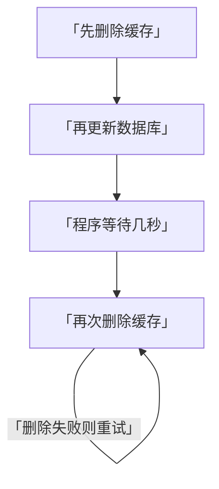

在前面的课程中，我们已经构建了 user-rpc 服务和 user-api 服务，并且完成了相关的业务。本节主要来讲一下数据与缓存的一致性问题。

之所以讨论这个问题，它和 go-zero 本身也有点关系，因为在 go-zero 中，在创建模型的时候，我们是有让它去使用缓存的，这里就会有一个疑问：go-zero 是如何去使用缓存机制的？缓存与数据之间，又是如何来保障一致性问题的？针对这么一个问题，首先我们先了解一下缓存与数据库的一致性问题，主要围绕这四个话题：先理解一致性有哪些级别，然后针对一致性的级别，弱一致性、强一致性、最终一致性，分别展开它们的实现分析。

## 一致性的级别

先看一致性的级别，在一致性中，它的级别总共有三种。

强一致性，这一种级别它要求多个节点之间，它们在处理数据和缓存的时候，要求是能够保持一致的。数据更新即更新缓存，它要保证这个节点在操作数据的时候，能够保持相同的数据。因此这一种情况，对于数据而言，它的要求是非常高的，一般主要用在像金融交易、在线支付这些场景。

弱一致性和强一致性的区别，主要是在于弱一致性它在操作过程中，可能在不同节点、不同时间段，会有不同的结果，数据在更新处理的时候，会存在延迟。这一种就适合在网络平台、社交平台等这一些应用中。

最终一致性，它其实可以算作是弱一致性的另一种方案。但是，这一种方案和弱一致性的区别，最核心的一点，主要在于数据随着时间的推移，最终来保证数据的一致性。这一种方案一般主要应用在于像数据同步、日志统计上面。

## 弱一致性

先来看一看弱一致性。弱一致性它的特点是在于，写入缓存后，数据到达不同的节点，可能会在不同的时间看到不同的数据，操作会有一定的延迟。

弱一致性在一致性场景下的读写情况：先更新缓存再更新数据，先更新数据再更新缓存，同理。如下就是先删除缓存再更新数据，或者先更新数据再删除缓存。对于缓存而言，它在实际操作的本质上来说，主要就在于是更新缓存，还是删除缓存，这才是真正讨论的一个话题。

为此在文章中做了一个总结。更新缓存的优点，在数据变化中能够及时更新，对于查询缓存不会容易出现不命中的情况。但是缺点就比较明显，就是在数据频繁的更新，就会比较浪费服务器的性能。而删除就没有那么大复杂度了，因为它只要删除就可以了。它主要是在查询的时候，可能会存在未命中的情况，这个时候会增大数据库的访问压力。

这是两种的特点。但是我们在实际业务中，往往主要以删除缓存为主。更新缓存虽然说它有它的优点，但是因为它的复杂度比较高，所以我们在业务上来说，往往会选择方案二删除缓存的方式。因此在后面的课程中，我们主要为删除缓存来展开章节。

而对删除缓存，我们先来看一看，是先删除缓存再更新数据库好，还是先更新数据再删除缓存好。

## 先删除缓存再更新数据

先来看第一个，就是先删除缓存。删除缓存的情况，我们来看一个流程图。写请求他先做的事情是先删除缓存，然后再更新数据。理论上来说，如果写请求他的一个访问是在写请求之后，这一个过程是没问题的，因为他在这里会查询数据，没命中，从数据库中读取，并同步到缓存中，这是一种正常的情况。

但是，往往就是有不正常的情况。如果写请求的更新缓存出现了失败，在程序中，如果对于这个操作他采用了重试机制，看两者的时间，这是写请求一执行任务的时间，这是写请求二执行任务的时间，此时这一段，他会等待一个错误的异常，他们就定时地重启一次。这过程中，他可能刚好写请求二要去获取数据，此时就会造成一个问题，写请求二会同步旧数据到缓存中，而更新数据已经更新了，但没有同步过来，因为更新失败，或者更新延迟，更新延迟也是一样的道理。

此时就会有一个问题，先删除缓存再更新数据，不是特别合适。因为在更新的时候，无论失败还是延迟，它都可能会存在另一个写请求，会比当前写请求先要执行，同步完数据的情况，或者旧数据然后进行同步的情况。

所以怎么办？为了解决这个问题，就提出了另一种方案，叫延迟双删。来看一下它的流程，在流程中就是四个流程：先删除缓存，再更新数据库，然后让程序等待几秒，再删除一次缓存。

延迟双删的流程如下：

回到图中，前面不是提到吗，无论是更新失败，还是更新延迟，它都可能会造成写请求二，在写请求一删除缓存之后，然后在更新数据前，它就会去查询到旧的数据。它都可能会有这么一个事情，因为它只有这两种情况会产生。所以，我在我自己操作了之后，我再删除一次缓存，也就是我在这里再增加一个操作，删除缓存。此时其他的写请求，它就能够获得新数据了。只是写请求二的这一次任务仍然还是旧数据，但理论上它这个过程还是合理的，为什么合理？是因为写请求一的这个删除及更新操作还没有完成，它是合理的。

但是如果是后续的写请求，他继续获取这个旧数据是不合理的。所以这里增加了一个延迟删除，就是让这个数据避免因为这种情况，导致仍然还保留了旧数据。所以这是延迟双删。

但是它也有缺点。第一，就是写请求需要在更新后还要等待几秒钟再去淘汰数据，这个过程可能会降低更新的吞吐量。但是也不慌，我们使用 go-zero 的协程，这就可以解决这个问题，我们将延迟双删的这个动作，把它通过异步去执行起来，是不是就能够很好地去解决这个问题。

除此之外的话，还有一个问题，就是如果第二次缓存删除失败了，这个旧的数据依然存在，还是会有不一致性的问题。怎么办？没关系，重试，用重试解决。此时，就已经将弱一致性改为了最终一致性。现在说我要去进行重试去删除它，但对于重试操作而言，我们往往也会去设置它最大的一个重试次数，如果实在是重试失败了没办法，我们只能把这个任务以异常的形式抛给开发人员或者运维人员，通知他们去手动地处理。这就是先删除缓存后更新数据。

## 先更新数据再删除缓存

我们现在看一下先更新后删除，这里是指先更新数据后删除缓存。先更新数据后删除缓存，这种方案在实际上，比起先删除缓存再更新数据会从效果上更优一些，因为我是先更新数据再删除缓存，这就是一个任务内，我在一个任务里面完成之后，下一个任务他就查询不到。

但是如果说我这一步过程没有完成，就是它可能在这个任务之后，会不会读取到不一致的数据？这是肯定会的，因为我的删除动作在实际上访问之后才完成，是不是也有这个可能。但是没关系，因为我们已经提到更新和删除，他们是一个任务，如果说这一个任务并没有执行，一开始应该是要去获取到旧的数据，因为这个任务他没有成功完成执行。所以实际上这里它能获得旧数据，认为这应该是合理情况，因为那个任务还没有完成。但如果说写请求一的任务完成了，现在还是获得的旧数据，这是一种不合理的情况。

所以先更新数据再删除缓存的情况，会比先删除缓存后更新数据好一些，从整体的结果上来说会更加接近一点。但是这种方案仍然会存在问题。这个地方是删除缓存，这是写请求一他更新完数据，但是我的缓存删除出现了失败，此时对于写请求二来说，他肯定能获得旧的数据，缓存没有删除，这个时候数据就不一致了。

因此写请求一他自己内部机制中，他可以通过开启一个协程的方式去执行删除，也可以将该次任务投入到异步队列中，通过异步队列去删除缓存。这样就可以解决了，只不过它确实会有一定的时间，会导致数据的不一致性问题。但是随着时间，最终仍然还能保持一致性。这就是先更新数据后删除缓存的情况。

但理论上来说，这种方法它有极端的一个问题。就是假设写请求二，他在进行读取缓存的时候，未命中，他就会从数据库中读取，这没问题。但是如果是写请求一的更新操作，就是在这一个时间点，然后他的缓存操作，在写请求二的这一个缓存同步前，此时会发生一个什么情况？写请求一的操作，在写请求二的后删除的旧数据及同步于缓存之间完成了。这个地方，它确实会造成不一致性，这也是先更新数据再删除缓存的这种极端情况下会产生的问题。目前来说，这种情况还没有得到一个比较好的解决方案。

## 最终一致性

这是关于弱一致性中删除缓存的情况的分析。再来看一看最终一致性。最终一致性它从本质上来分析，算是弱一致性的另一种方案，只是它最终能保证数据的一致性。

它的实现方式主要有两种方案。第一种是通过消息队列的方式，在更新数据的时候，将任务同步至队列中再去处理缓存。第二种是 binlog 监听，通过对数据库的日志监听去更新缓存。这两种方案在业务中都有用到。

我们先看第一种方案。从图中可以看到请求A先更新数据库，在数据库更新成功之后，他就将对缓存处理的情况交由消息队列来进行处理。而请求B在查询缓存时如果没有，就读数据库。所以这是整个处理的流程。它的特点主要在于最终一致性，从整体上来说会发现，当请求A更新完数据，即将任务同步到队列中之后，任务队列是异步执行的，对于执行的时间，往往来说会有一定的延迟。所以请求B在后期查询缓存时，可能仍然会得到旧的缓存数据，直到队列任务将缓存处理了，他才能得到新的数据。所以这是这种队列的情况。

然后另一种是 binlog 监听，Canal 这个工具就是一个典型的例子。请求A他只需要去更新数据库，他不需要去关注于缓存的处理。我们先了解数据库，无论你是用哪一个数据库，它们在更新的时候，都会有属于自己的增量日志。MySQL 就有一个典型的 binlog 的增量日志，MongoDB 它也有。增量日志中，它会记录所有的写操作，这些操作代表了他们对某一样的数据进行的某一些操作。所以在增量日志之后，就进入了这些信息，操作某个数据，得到一个什么样的信息，此时其他程序就可以监控到这个增量日志，然后获得这个结果，对缓存进行更新的处理。

这种方式比第一种方式有什么好处？消息队列的方式，它会在代码中有内嵌，就像我们在请求A中，我们需要去更新之后，然后来去发送一个 MQ 的请求，这个发送请求的时候，是不是会有一个代码的入侵，你是不是要编写一段对 MQ 发送请求的这个代码。而 binlog 监听这种情况，它不需要关注这种底层，它只需要关注在于数据有没有更新成功。所以它是一个零代码入侵的情况，维护和扩展性会更高一些。

## 强一致性

最后再来看一看强一致性。强一致性它的特征，和前面来说有点区别了。强一致性在实际上，我们可以有三种方式：第一种是串行化，第二种是分布式锁，还有开关的方式。

来看一看图，这里是表示的是串行化，就是将任务请求，原本在程序中它应该是基于并行去进行执行的，但是我们不这么做，我们把这些任务请求给它串行化。机制可以通过消息队列、任务队列的方式，消息队列其实推荐采用 Kafka，这样的话可以保证这些消息的有序性。通过队列将任务串行化就进行执行，这样就可以保证有序执行。

然后第二种，就是分布式锁，这种方案它主要用到的就是分布式锁，在程序开始的时候，会验证能不能获得锁。如果说有锁能获取成功，我就直接更新数据，删除缓存，再释放锁。但是，如果说这里的一个操作，它可能超时了，就是我去获取这个锁的这个情况，它可能超时了，或者它超过了最大的一个上限次数，我也会结束。如果说没有的话，我就等待一下，再去获取，毕竟它可能正在有其他的任务进行着，去做这一个操作。这是在写的时候，而读和写是一样的，它也是先获取锁，同样的，在锁这一块的处理是一致的。区别点主要是在后期这一段，和前面我们所分析的，先删除缓存，或者先更新数据再删除缓存，流程是差不多的，这里其实没有太大的一个影响。在当前的这个流程中，我采用的是先更新数据再删除缓存，对数据和缓存的操作来说，我增加了一把锁来进行处理。

至于开关的方式，就是将锁改为了某一个配置项，然后针对这个配置项就进行修改，如果别的程序进行操作，将这个配置项改为一个 true，或者一个 false，在操作完之后，再将这一项给它改回来，恢复成原来的一个状态。这两种之间，特别是第三种和第二种，在本质上是具有相似性的，所以我这里就没有去绘制。

## 总结

好了，在本节中，我们重点就是了解一下缓存一致性的情况，以及我们可以采用的几种方案。就来看一看，go-zero 他到底是如何去使用他的缓存。
