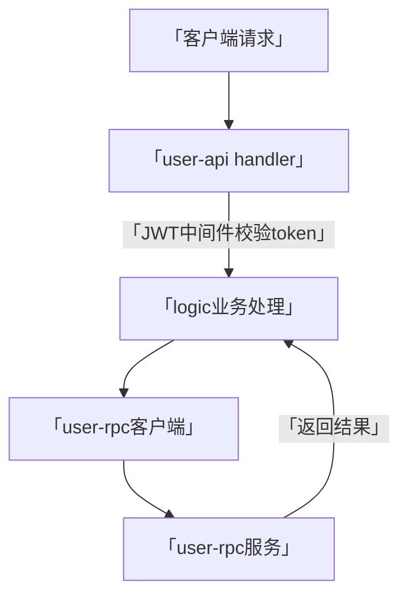

在前面的文章中，我们把 user-rpc 服务构建好了，并且完成了它的业务功能，也了解了 go-zero 内部的数据缓存机制，这一篇主要来构建 user-api，并完成服务的接口。

内容主要有三个方面：先构建好 user-api，再针对 user-api 去完成它的接口，在接口完成之后，对它的响应输出做处理。

进到 user-api 服务中，创建一个 user.api 文件，项目中我们会根据 user.api 文件，构建起整个 api，关于 user.api 文件中的内容，我已经在这里写好了。

我将它复制回来，这里还要创建一个文件，一个 types.API 文件，用于存储项目中会用到的一些数据结构体对象。

当然，这两个文件其实也可以合在一起。再来看一看 user.api 文件，在 user.api 文件中提供了四个方法：用户注册、登录以及获取用户信息的。在获取用户信息中，这里用到了一个 types.API 中间件，也就是 jwt 中间件，通过这个方式去配置，就给这一组服务加上了 JWT 鉴权，访问时需要先通过 token 校验。

现在我们需要对它去构建服务，命令我已经提前记录好了，就是构建 api 服务的命令。把这个命令粘贴进去执行，它就会把服务构建好。服务构建完之后，我们需要去完成它的功能。在完成功能之前，先看一下它的内容，进到 root.go 中，在这里我们能看到一段路由的注册。在路由注册中，这里会设置一个 jwt 的中间件，然后配置，在配置中它传递了一个 token 过期时间，把 token 过期时间给它注册。因为已经在服务中注册，它不需要我们手动注册 token 就可以了。

    ```go
    rest.WithPrefix(group: 「/v1/user」),
    rest.Route{
        Method: http.MethodGet,
        Path: 「/user」,
        Handler: user.DetailHandler(serverCtx),
    }
    ```

现在除了这个配置以外，还需要定义一个 user-rpc 客户端，因为它需要去连接 user-rpc 服务去完成功能，所以把 RPC 的配置贴过来。在完成 jwt 的配置信息时，可以直接从 user-rpc 服务中把这些配置信息复制过去，这是 user-rpc 的配置，只要在同级下创建一个 yaml 文件，把它放进去，修改一下这个地方，再调整一下 ServiceContext。

    ```go
    func DetailHandler(svcCtx *svc.ServiceContext) http.HandlerFunc {
        return func(w http.ResponseWriter, r *http.Request) {
            var req types.UserInfoReq
            if err := httpx.Parse(r, &req); err != nil {
                httpx.Error(w, err)
                return
            }
            l := user.NewDetailLogic(r.Context(), svcCtx)
            resp, err := l.Detail(&req)
            if err != nil {
                httpx.Error(w, err)
            } else {
                httpx.OkJson(w, resp)
            }
        }
    }
    ```

在 ServiceContext 中，就引用 user-rpc 的客户端，现在创建 user-rpc 客户端，创建完成，准备工作就完成了，现在我们就要去完成业务了。



服务的接口包括了 handler 和 logic，因为 handler 已经写好了，不需要我们处理，我们重点关注业务逻辑的完成，先从注册开始。

注册的过程，它会调用的是 user 服务中的注册方法，创建注册的请求参数，把接口传入的值做一个类型转换，然后调用 user-rpc 的注册方法，它会返回注册的结果，我们接受一下，接受完之后做一下错误的处理，错误处理直接输出就可以了。再定义一下返回的值，然后处理返回值，先给它赋值，再把它返回出去，目前就完成了。再处理一下登录，登录的过程和这里也差不多。

我们将代码复制一下，怎么改？这里需要的是登录的结构体对象，它里面主要是一个手机号和密码。这个地方也改一下，换成登录返回的处理结果，这样登录的业务就完成了。再做用户详情。

用户详情我们需要先获取 userId，这个 ID 怎么来？肯定不是传递的，它应该是在 JWT 解析之后，从 JWT 中获取的，所以我们需要定义一个方法来获取这个 ID。这个 ID 会从 context 中获取，因为在这里入口（main）会把请求的 context 传进去，Go Zero 在解析完 JWT 之后，会把 JWT 的信息传到这个 context 中。

所以我们就要从 context 中去获取。在这里定义一个方法，它的作用就是获取 userId，先传入 context，返回的结果是 string 类型。先从 context 中获取，它传递的 key 就是在 JWT 中设置的这一个值，得到之后要转换成 string，因为它默认是 interface{} 类型，所以要转换一下，看是不是成功，成功了就给它返回出来，不成功了就返回空。

再进到 Detail 的代码中，先获取 userId，从 context 中获取，获取完成。后面的过程就跟之前注册、登录的实现流程一样，我们将其复制一下，把参数换成 userId，这是复制的方式，就完成了这三个方法的业务。完成之后，我们现在就要去进行测试。

现在分别进入 RPC 和 API 服务中，将它们启动起来，先启动 RPC 服务，然后再启动 API 服务，启动时报了个错误。在 API 服务中，它说这个端口没有设置，我们的配置文件在加载时这个端口是不正确的，重新启动，目前启动成功了。进到 ApiFox，在这里要增加对 API 服务的访问，我们先添加一些环境配置，访问地址是 D 的方式访问，访问的端口四个，再定义一个变量保存。现在把它关掉，我们再创建一个接口，这个接口的作用，先用它登录。请求地址是登录 API 的地址，在 user-api 中就有定义了，它地址的方式有一个前缀 v1/user，然后再跟上去，就是这个登录地址。所以我们在这里再增加一下它的前缀，增加 v1 的前缀，保存。在填写好登录地址之后，我们再填写请求的手机号码以及 password 密码。这些用户在 RPC 服务里已经注册了很多，我们将它复制一下，密码也给它复制一下，请求。

保存时报了个错误，是 header 的问题，然后请求状态码、请求类型错了，调整一下，目前就没问题了，得到了 token 以及用户信息。说明当前我们的请求是没问题，业务里也没有错误，这是用户登录，用户的注册也是一样的，我们再创建下一个接口，来看一看用户的详情。用户的详情接口，我们需要一个 auth 的请求，这个请求需要 header。我们在这里填写一个后置操作，这是在接口请求之后的一个操作，把登录之后返回的这个 token，给它设置到这个变量中，注意一下写法。然后在这里就为它设置了这个 auth，这样的话，我们就不需要手动把这个 auth token 在这里去填写了。这样我们再重新登录一下，然后看一下这个 auth（header）就知道了，看看能不能获得用户信息，把请求地址给它放进来，请求。

当前是没有获取到任何信息，来看一下有没有抛出错误，没有抛出错误。现在看代码，这个结构体中它读了一个 info 字段，但是这个 Detail 的结果是不含有 info 的，它是直接 user 的一个字段。所以我们这里去改一下，把 user 放进来，这里应该是用它的 user。所以这里要改一下，我们在这里再改一下这个地方，这样就没问题了，让我们重启一下，再请求，这一次就没问题了。

至此我们就构建了 user-api，完成它的业务了。但是如果说我们的信息是有误的，在这里假设这个用户的密码错误，请求，它就会抛出这么一个异常，不太合理。来看一下响应的输出，响应输出会有两种情况：一种是请求正常的情况，第二种是请求异常的情况，服务端会将信息发送给客户端。在发送过程中，数据格式往往也需要约定好，要做一个 API 标识，它总会有对应的一个状态、描述还有数据，这三个值基本上是一个固定的写法。但是当前我们无论是响应的还是错误的结果，都没有根据图中展示的状态、描述、数据的格式进行标准化。

所以现在我们要做一下错误怎么处理。我们现在进到 user-api 服务中，进到 handler，它的响应输出统一都是通过 go-zero 内部的 httpx 来完成的。因此我们要处理，就是要看它的源码，点击看一下它里面的处理。在处理中，它这里有一个逻辑：先获取一个 OkHandler，如果说不存在，就直接执行了，但如果是存在，就会执行 ErrorHandler，然后把得到的结果改成数据格式。OkHandler 是一个方法类型，它现在提供了一个 ErrorHandler。我们再往下看，这里有针对 ErrorHandler 和 OkHandler 提供的设置方法，从这里其实可以看出来，我们怎么不动 handler 的代码去做文章，就是去设置它提供的 OkHandler 和 ErrorHandler，通过调用下面两个 set 方法去设置。

设置完之后，现在我们来编写代码，创建一个模块，这个模块就是专门用来处理响应的，我们当下是处理 HTTP 的响应。在处理中，响应里面有一个状态码、消息还有数据，data 用 interface{}。标准的格式定义完了，为它提供两个创建的方法：一个是在成功的时候，直接给 data 就可以了，状态码用 200 作为标识；还有一个是失败的情况，失败时传入它的状态码及错误的原因，状态码和错误信息这里我们用 string 的形式好一些，因为万一它要是为空的。所以我们再调用这个成功的方法传进去。这里我们再来看一下失败的情况，比如存在 ErrorHandler 的时候，它要怎么去做？在 ErrorHandler 里，它要求传递的是 context 和 err，返回的是一个 int 和一个 interface{} 类型的数据，int 是什么？int 其实就是做一个状态码。

所以我们现在主要是要完成它，添加里面的内容。ErrorHandler 传递一个 int 和 interface{} 类型，我们定义一个默认错误码，即默认的错误描述，然后我们再仔细地去分析它具体是什么错误类型。首先我们假设它是由我们自己当前 API 服务生成的错误，API 服务其实也可以直接用 RPC 服务中所用到的错误方式。因此我们先验证一下，是不是由 API 服务自己内部定义的错误类型，错误码在这里的定义是一样的。判断一下它的错误类型，因为自己的包内也有 errors，所以两者也会有冲突，我们把这个包名结合起来判断，如果是自己的错误，我们就直接将原本的错误编码改为自己的错误码及其错误描述。

但是如果说它不是，它有两种情况：第一种是 gRPC 的错误，第二种是未知的，未知的我们暂时就不处理了，因为未知的默认已经定好它的响应和输出的数值，所以就不做其他处理了。如果是 gRPC 的，我们就获取 gRPC 的状态码，获取之后，还有最后一段的消息，根据状态码就获取了。这个状态码是自他来的，它就是在这些拦截器里给它设进去的，消息也是在这里设置进去了，然后再更改一下这一段，把状态码和消息更改好。

最后再统一地做一个日志记录。这里我们可以把服务名引进来，怎么引入服务名？可以这样子做：把服务名也给它传进来，输出一个方法类型，这个方法类型就是 Handler 类型，这样的话，在调用方它就可以通过这个方法把服务名传进来，我们返回它就可以了，这就没问题，我们就可以得到服务名了。得到之后，再把错误写上来，把服务名放好，错误写好。

之后就响应了。响应的话，它这个是一个错误的定义，这个错误是自己项目的定义，因为它这个是针对请求的错误、是响应的错误，而不是业务的错误，我们这里也可以定义一下，改成一个 400 的错误，然后再来一个 msg，把这样的信息放进去，这里的就完成了。

    ```go
    func Fail(code int, err string) *Response {
        return &Response{
            Code: code,
            Msg: err,
        }
    }
    ```

最后我们就需要在代码中去使用它们两个，进到入口文件中，上面是启动的，到下面就是使用。用 httpx.SetErrorHandlerCtx 处理 context，然后再用 resultx.ErrHandler 处理，把当前的服务名给它传进去了，再 SetOkHandler，再把这个 OkHandler 也给它设置好，这样就完成了。

    ```go
    func main() {
        flag.Parse()
        var c config.Config
        conf.MustLoad(*configFile, &c)
        server := rest.NewServer(c.RestConf)
        defer server.Stop()
        ctx := svc.NewServiceContext(server, c)
        handler.RegisterHandlers(server, ctx)
        httpx.SetErrorHandlerCtx(resultx.ErrHandler(c.Name))
        fmt.Printf(「Starting server at %s:%d\n」, c.Host, c.Port)
        server.Start()
    }
    ```

启动完之后，我们再来访问。目前似乎并没有处理好这个错误，返回的结果并不对，应该是没有正确识别这个错误。这里在代码中我们其实不需要这么做的，因为在这里本来就是 gRPC 的错误，在拦截器组里已经给它设置到 gRPC 的响应结果中了，所以我们应该从 gRPC 的响应结果中设置。所以这个应该是不用的，我们应该是这样子，直接获取它，然后从这里获取错误码，就可以了。重启，请求，这次就没问题了。

到此，我们基本上就把整个 API 服务构建好了，并且也把它的业务和数据处理处理好了。本节课主要讲解 API 服务的构建、业务的开发以及响应输出的处理，相关代码已提交到仓库并推送上去。
