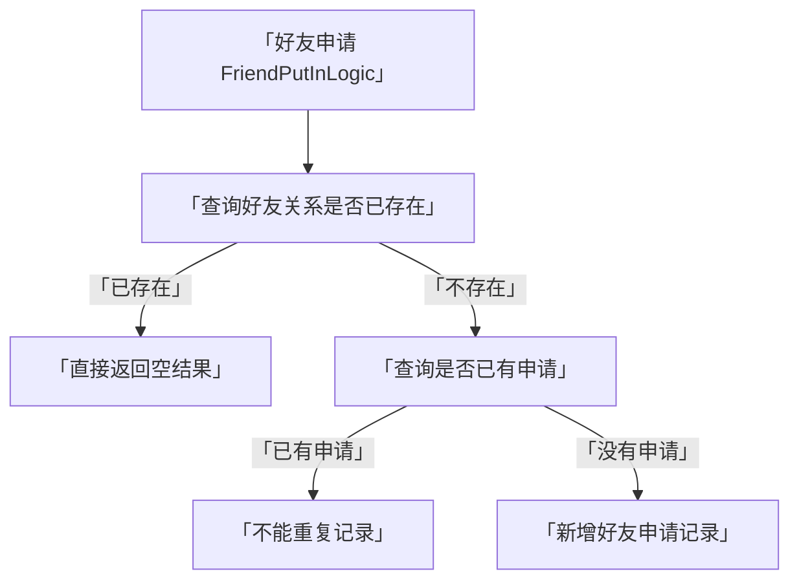

通过前面的课程，用户服务这一块已经开发完成了。本节课构建社交 RPC 服务，并且完成相关的业务。

课程内容有三个话题：数据表与模型、构建社交 RPC 服务，以及完成社交服务中好友与群的业务。

首先来看数据表与模型。在社交服务中，数据表与模型主要有这五个表：群相关的有三个，即群信息表、群用户关系表、群申请表，以及好友关系表与好友申请表。

在这些表中，重点谈一谈好友关系表。比如这里有两个用户 A 和 B，需要让他们建立成好友关系，那么在数据库中应该如何去存储他们的好友关系？从本质上来说，他们两个都存在于用户表中，都会有属于自己的 UID。现在的问题是好友关系表要如何建立。

关于好友关系表的建立，这里有两种方案：第一种是冗余的存储设计，第二种是计算唯一的 key。

先看一看冗余这一个方案。在冗余的方案中，数据表有 id、用户 UID、好友 UID，但是 A 和 B 之间的关系会用两条记录来记录，这就是冗余，也就是说要用两条记录来记录相互之间的好友关系。

这种方式的特点是：在优点这一块，它的设计比较简单，查询也比较简约快速，一眼就能看出来查询哪个人的好友，直接根据 UID 就可以查询对方的好友，非常方便。所以在设计这一块比较简单，查询的也比较快。但是它的缺点是会存在冗余，因为一个好友的关系要建立两条数据进行存储。

第二种方案是计算唯一的 key。这种方案在数据表中通过两个字段来分别存储用户与好友之间的关系，但是他们并不会根据 UID 去查询，而是根据好友的 user key 来进行查询。这个 key 是通过一定的算法去生成的，比如根据 UID 的信息进行排序，然后组合起来作为一个唯一的 key。

这种方式的特点是：首先好友关系只会存储一个 key，这样会减少空间占用；但是查询的复杂度会比前面的第一种方案高很多，同时还需要对这个 union 的处理，也就是查询的时候既要根据 user1 的 UID 查询，又要根据 user UID2，然后根据两个条件查询到的结果进行组装起来。

综合来看，我们主要采用方案一，就是冗余的方式，因为它会更加简洁快速。虽然说它会有冗余的数据，但是冗余的量对于整个程序而言，影响并不会那么大。

现在来构建一下社交服务。在 apps 下面创建一个社交服务，然后再创建 RPC 服务，那么在 RPC 中自然会有对应的 deploy 文件。现在来完成这个 social.proto 的内容，内容在文档中已经有写好的，直接复制进来。内容有点多，因为在里面要完成的业务主要包含好友这一块的申请、添加好友处理以及好友列表的功能；群这块也有群申请、群列表、群申请处理等相关的业务，所以整体来说业务是比较多的。上面的内容则都是会使用到的消息结构体对象。

在这里再创建一个 Shell 脚本文件，用于存储社交服务中会用到的一些命令指令，把指令复制下来放到这里，然后执行。

执行完之后，接下来去修改它的配置信息。在这里定义一个 dev 配置文件放进去，再进到它的入口文件，将这里指向 dev 中的配置文件。在配置文件中增加一下配置项，第一个要改的就是它的监听地址，监听地址要改为 0.0.0.0。目前来说监听的是 80，但是实际上默认服务创建都是 80，所以我们要改一改。来看一下 user-rpc 中它的监听地址，目前 user-rpc 中已经使用了对应的监听地址，将其设置为一致，这就是社交服务的监听地址。

然后就是 etcd，从 user-rpc 的这个配置中给它复制过来，因为它们是一致的，包括了 MySQL 和 Redis 的这些配置，也复制一份。配置项就定义好了，再把配置的对象修改一下，也一样复制过去，这样基本上配置就够好了。

配置定义完之后，接下来定义它的用户表和用户模型。数据库表文件已经提前放到 demo 目录下面，再创建一个 searcher 文件，这个文件中就是定义了社交服务会用到的数据表。接下来基于这个数据表去构建对应的模型，命令可以复制一份 user-rpc 中的命令，因为两者差不多，再改一下它们的目录，可以为这个 model 增加一个 social 的前缀。至于为什么这么设计，后面再解释。先将其复制，放到系统中执行。

执行完成之后，它会在这些目录下面创建对应的模型。现在进到 rpc 中，将应用到的模型在 ServiceContext 中加载：首先是好友模型，然后再是好友的申请模型，这个肯定是需要的。还有群相关的五个模型：一个是群的模型，然后是群的请求模型，然后是群用户关系的模型，以及群用户关系的请求模型。这样五个模型放到 ServiceContext 中。

在这里讲解一下：在 ServiceContext 中根据配置初始化依赖对象并获取数据库连接，得到连接之后，上面五个模型给它们创建出来，分别调用它们的 New 方法。下面是群申请、群用户关系，设置它们的配置信息、缓存对象和参数。这样模型的创建就完成了。

现在针对这些模型去完成它们的业务。业务主要有好友、群之间的申请，以及好友、群申请的处理，还有好友、群之间的查询及创建群，所以总的来说业务是比较多的，但其实它们之间都是具有相似性的。这里演示好友申请、好友处理与好友列表这三个话题，其他的内容安排在课后来完成，课件中也会提供对应的代码。

现在来完成好友的申请。这里是 FriendPutInLogic，就是处理好友申请的业务。

在这里会有什么样的业务？根据业务来说，申请好友会通过手机号码查询到用户，查询到用户之后就去给他发起一个申请，相当于就是在好友申请请求表中提交一个申请的记录。此外还需要注意，就是这个申请人是否与目标是好友关系，这个我们也需要知道，如果已经是好友关系，那肯定不能再添加。所以这是第一个要去验证的话题。

然后第二个，就是是否已经有过申请，并且申请是未成功、未完成的，这次也需要考虑。那已经发过申请了，肯定是不能再重复记录的，因为这个申请处理完之后，处理记录就只有一条，重复记录会有问题。所以这里会有三个业务：首先先来看第一个，就是是否存在于目标好友的关系。



那么这一条就是要根据申请人的 UID 及目标 UID 去进行查询，所以需要在好友模型中增加对该方式的查询的支持。好友表有冗余的关系，在好友表上会有两个字段，一个是 UID，另一个是好友 UID。所以针对这么一个话题的查询，在 Friend 模型中，直接根据 UID 作为申请方、好友 UID 作为目标方，都可以查询出是否存在好友关系，毕竟是两条数据，所以不需要去做其他处理。

现在我们就在这里增加一个根据该方式查询的方法。在 Friend 模型中增加 Friend UID、UID、好友 UID，根据好友 UID 和 UID 的查询，参数就是 UID、好友 UID，那么就会得到一条数据记录。查询的条件就是上面的这个搜索，改一下就可以了。下面的搜索是根据 UID 查询的，那么也根据对应方法去写。一定要注意看一下数据表，这里有 UID，有 Friend UID，我们将这两个字段复制过去，以免自己写错了。Friend UID 当前的查询搜索就写好了。

在搜索中，UID 和 Friend UID 的顺序其实是没有关系的，毕竟它们俩是冗余了这段数据，所以无论哪一种方式都可以查询到相关的这条好友记录。

现在我们进行查询。当前这个查询不使用缓存，所以要注意一下当前调用的方法，这里有一个不使用缓存的方式，所以要用这个方法。之所以不使用缓存，是因为当前这个方式在业务中并不常用，所以不需要用缓存，直接进行数据库查询，把查询条件放进去，再把 UID 和好友 UID 放进去，再处理一下错误，那么这里就写好了。把这个方法添加到结果中，目前 Friend 模型的这一块就处理完成了。

那么还要处理的是请求这一块的模型，我们要查询某一个用户是否存在请求记录，所以要在这里去处理一下，在其下写对应的方法。查询的条件就是根据请求 UID 以及 UID，因为一个人的请求记录可能很多，所以这里要查两个，一个是请求 UID，还有一个是用户 UID，也就是目标 UID，这两个信息都需要传进来，否则可能查询不到。返回结果就是这个。现在同样也要去写一下它的搜索，搜索也需要看一看它的字段，搜索条件这里有两个字段，分别是请求 UID 和一个是 UID，这是会用到的字段。搜索就写好了，后面的查询和这里的查询是相似的，复制一份放到这里，再给一下当前 UID 的使用以及返回的数据。目前就写好了，再把方法放到结果中，让其使用起来。

现在来完成正常的业务逻辑。此处要查询的是好友记录的关系，使用好友模型，然后进行查询，把 UID 放进去，看一下有没有异常，做一下错误异常处理。异常类型也不能为为空的情况，如果说这里它存在一些非正常的错误，那么就给它发布出去；如果异常不是正常的错误，那么就将它进行处理，使用统一错误处理的对象给它发布出去，抛出一个描述：当查询好友出现了异常，根据 UID 和好友 UID 查询是异常的，请求日志给它打印出来。然后再判断一下当前的好友关系是否存在，它不为空的话，那么说明是存在好友了，直接返回一个空结果就可以了。这是第一段的业务。

再来往上第二段业务，第二段业务会判断它是否已经有申请过。使用第二个模型，然后进行查询，第一个参数是请求 UID，第二个参数是请求的用户 UID。参数写错的话就会导致数据是不正确的，此处的查询我们也需要去验证它是否有错误，以及错误的情形是不能够为空的。现在如果它不为空，那么同样也要去给它发布出去。

那么这两个都没问题之后，接下来就是去新增请求，直接映射它，再把请求数据放进去，UID 不需要写。里面的内容主要来填写的是用户 UID 以及请求 UID，还有请求的信息，在请求体中已经有了，以及请求时间、请求状态。

状态这块，在项目中会有很多状态，是怎么定义的？简单来定义到 pkg 目录下。这里定义一个包，用于关联所有的状态，然后根据模块来创建各个模块的状态。首先定义的是处理的结果，因为这里需要的是处理结果，所以我们给了一个状态类型，就是好友请求处理结果的类型，是 int64 类型。处理的结果定义了几个状态：第一个是未处理，值为 1；第二个是处理（通过），值为 2；第三个是拒绝，值为 3。定义好这个状态类型之后，再定义好对应的常量：常量 1 是未处理的，常量 2 是通过，常量 3 是拒绝，我们还可以再增加一个就是撤销。目前常量就定义好了。

常量定义完成，那就要在这里去使用刚刚所定义的常量，大概是 int64 的一些转化，然后让它输出来，再做一下异常的处理，更改一下这个异常的输出。那么当前的异常输出属于请求错误，是我们在新增好友申请的关系时出现了异常。

其中，模型初始化与查询的代码如下：

```go
        func NewServiceContext(c config.Config) *ServiceContext {
            sqlConn := sqlx.NewMySQL(c.Mysql.DataSource)
            return &ServiceContext{
                Config: c,
                FriendsModel: socialmodels.NewFriendsModel(sqlConn, c.Cache),
                FriendRequestsModel: socialmodels.NewFriendRequestsModel(sqlConn, c.Cache),
                // ... 其他模型
            }
        }
        ```

```go
        func (m *defaultFriendsModel) FindOne(ctx context.Context, id int64) (*Friends, error) {
            // ... SQL 查询语句
            query := fmt.Sprintf(「select %s from %s where `id` = ? limit 1「, friendsIDKey, m.table)
            return conn.QueryRowCtx(ctx, v, query, id)
        }
        ```

生成社交服务 RPC 代码的命令如下：

```bash
        goctl rpc protoc apps/social/rpc/social.proto --go_out=./apps/social/rpc --go-grpc_out=./apps/social/rpc
        ```

好友申请的业务逻辑入口如下：

```go
        func (l *FriendPutLogic) FriendPutIn(in *social.FriendPutInReq) (*social.FriendPutInRes, error) {
            // ... 业务逻辑
            // 例如：检查用户状态，创建请求记录等
            return &social.FriendPutInRes{}, nil
        }
        ```
