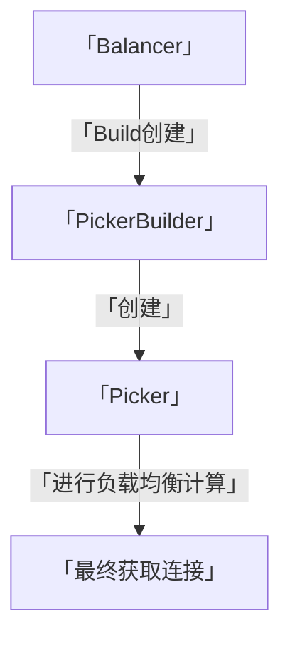

上一讲分析了 go-zero 中服务发现机制的实施过程，本讲来看 go-zero 对负载均衡的处理。内容主要有四个话题：理解负载均衡，负载均衡的实现方式，框架对负载均衡的设计，最后看源码。

理解负载均衡可以从两个角度入手：客户端与服务端。假设有三个做同样事情的服务，以集群方式部署。客户端通过服务发现能获取到这三个服务的信息，但随之而来一个难题：该用哪一个？为此就出现了新的机制，负载均衡：服务发现获取的服务列表，经负载均衡在客户端挑选出一个合适的服务去连接。从客户端角度看，负载均衡的作用是帮客户端挑一个服务。

反过来从服务端看：访问流量很大时，单个服务处理不过来，需要多个服务一起处理。怎么把这些流量均匀分散到各个服务器上？同样靠负载均衡。从服务端角度看，负载均衡就是把请求分散到各台机器分别处理。

总结起来，负载均衡的目的就是根据服务端的状态，均匀地为客户端提供服务。

了解完概念，再看实现方式，可以分为两大类。第一类是无状态的负载均衡：实现简单，负载相对均衡，缺点是无法根据服务的负载状态选择服务，适用于各服务性能较为接近的场景。第二类是有状态的负载均衡：机制中会记录服务端当前的请求数、CPU 等信息，经过计算选出合适的服务提供给客户端。有状态的优点是能根据负载状态选择服务，缺点是实现复杂。

无状态的常规方案有四种：轮询、随机、哈希、权重，这些方案无状态可用，有状态也可以用。而在有状态这边，go-zero 主要用 P2C 算法实现：记录服务器的运行状态、请求数、拥塞等情况，计算出负载率，选择负载率较低的节点完成本次请求。

再看框架中如何使用负载均衡机制。框架实现负载均衡同样需要可扩展。负载均衡的实现方式很多，也是一个需要注重扩展的点。下图复习了负载均衡的实现，流程本身并不复杂：无状态的实现是请求下来后获取服务信息，对服务列表做均衡，通过哈希、随机等方式选出一个服务给客户端完成请求，不关注服务状态，也就不需要存储信息。

右边的图是有状态的情形：同样从初始化开始，但初始化过程中会获取请求信息，记录请求完成的结果与状态，选择机器时计算负载率，选较低的返回给客户端。有状态相比无状态，多了数据记录与计算。

到这里概念已经清楚，接下来看 gRPC 和 go-zero 是怎么做的。示意图中包含两部分：服务发现机制（前面已分析过）和负载均衡机制。负载均衡有一个专门处理的包，包内定义了不少所需属性。

整体设计上，gRPC 对负载均衡机制的引用和使用方式与服务发现一致：两者的调度和设计实际上都调用 ClientConn 中的方法完成。因此 go-zero 的 ClientConn 作为被装饰的类，由 Balancer 装饰；Balancer 中同样定义了若干接口，由客户端实现，完成具体的负载均衡。

接口不止一个，主要有三个。第一个是 Build，作用是创建负载均衡的计算工具，即 PickerBuilder 对象；PickerBuilder 再创建 Picker，Picker 就是最终做负载均衡计算、获取连接的对象。整体这套机制的目的，就是创建出一个实现了 Picker 接口、用于负载均衡处理的对象。它的调度之所以显得复杂，就在这条创建链上：图中只拎出了核心，具体创建过程还要看完整的调度链。

负载均衡对象的创建过程如下：

再看 go-zero 的实现：通过 Builder 找到它的 Picker。gRPC 里的 Picker 就是实际创建的对象，由它最终获取连接并返回，这就是获取连接的算法。调度上最终也是拿到 Picker 去建立连接。

具体看 gRPC 的调度：找到 PickerWrapper，进入它的调度方法，调度链已在图中绘制。细分下去会得到 Picker，再往下就是调用 gRPC 实现的这个 Picker。整体复杂，但拎出关键点，每个方法的作用就清楚了。

总的来说，gRPC 在服务发现和负载均衡两块实现上高度相似，不同点在于负载均衡稍复杂：gRPC 用 Picker 作为负载均衡的计算方式，调用链中的 PickerWrapper 负责创建它，这与服务发现不同。相同点在于：对 Balancer 都使用了策略机制，更新则使用装饰模式。

至此 gRPC 负载均衡的实现已经清楚，实际源码还要更复杂。重点是理解思想与关键设计点（上面两处），课后可以结合文档和完整调度链进一步分析。
