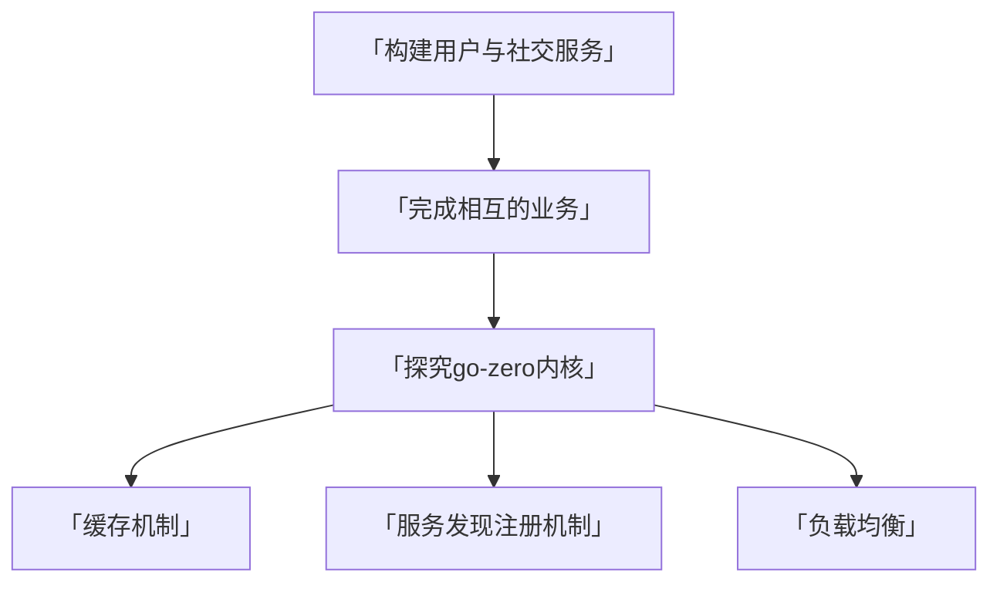

本节对整个第六章做一个总结。通过本章的学习，我们事先构建了服务，其中包含用户和社交两部分，各自都有 API 与 RPC 两层。构建完成之后，下一步是完成两个服务相互的业务；业务构建完，最后再去探究 go-zero 的内核。这就是本章的主线。

本章的学习主线如下：

先看构建服务。服务的构建从编写部署脚本开始，它的作用是把整个项目推送到服务器并部署起来，让开发中对系统环境的部署足够便捷。

然后是项目结构。除了应用层以外，相关层都是自己建的：apps 作为整体核心服务层，pkg 作为代码工具包，deploy 存放部署相关的事宜。对比 go-zero 生成的目录结构，它用 internal 作为核心业务层，API 服务中的核心事项都放在 internal 里；如果当前服务需要引用 RPC 客户端，客户端目录会与 internal 同级，以便 ServiceContext 使用，RPC 的定义方式就是如此。

客户端的命名也有约定：所有客户端默认都带 Client 后缀，目的是方便程序引用。以社交服务为例，引用时包的加载非常方便；如果直接定义成 client，引用处就要定义两个别名来支持包引用，影响开发效率。

开发之后是完成业务。用户这块业务并不复杂，以注册、登录、查询功能为主；社交以好友相关请求为主，同时包含群。群的业务逻辑已在代码中写好，可以在课后阅读代码了解。

最后是 go-zero 内核，主要包含三个方面：缓存机制、服务发现注册机制、负载均衡。

缓存机制的核心要从缓存一致性谈起。一致性方案主要有三种：强一致性、弱一致性、最终一致性。课程重点关注弱一致性和最终一致性，这两种方案在实际企业中应用较广，但强一致性并非没有应用场景。上面的图展示的就是弱一致性，也就是 go-zero 采用的方案：更新数据之后删除缓存，以此保证一致性。最终一致性在企业中更推荐基于日志的监听方式。这是缓存一致性上值得记住的两种方案。

服务注册发现机制的讨论包含三个话题。无论服务发现注册还是负载均衡，都属于源码层面，源码阅读往往不容易，复杂多变的调度过程是主要障碍。读源码的建议是：先站在设计的角度思考，如果要实现这个功能，参考业界主流方案，你会怎么设计；有了方案和设计，再设计流程；之后带着自己的思考去看源码就会轻松许多，至少能理解一些设计为什么那样走。

另外，读源码不必死磕整条调度链，调度链只是设计方案的一种实现，理解设计是关键。

负载均衡和服务注册在 gRPC 中采用了同样的设计方案，读懂其一就能了解其二，区别只在处理过程中的细节。以服务发现机制为例：gRPC 对外提供 Builder 支持扩展方案，自定义机制需要实现 Build 接口并注入到 Builder 中，gRPC 再通过 ccResolverWrapper 进行调度；最终处理时，客户端对象会传递到自定义机制中，调用其 Update 方法修改内部属性。这里用到了装饰器模式，而 Builder 用到了策略模式。负载均衡同理，只是更复杂一些：gRPC 无法预设负载均衡的设计方式，因此定义了 Picker 结构来做服务选择。更多细节和调度链可以参照课程提供的图示与文档深入了解。

本章到此收尾，下一篇开始进入 IM 服务的开发。
