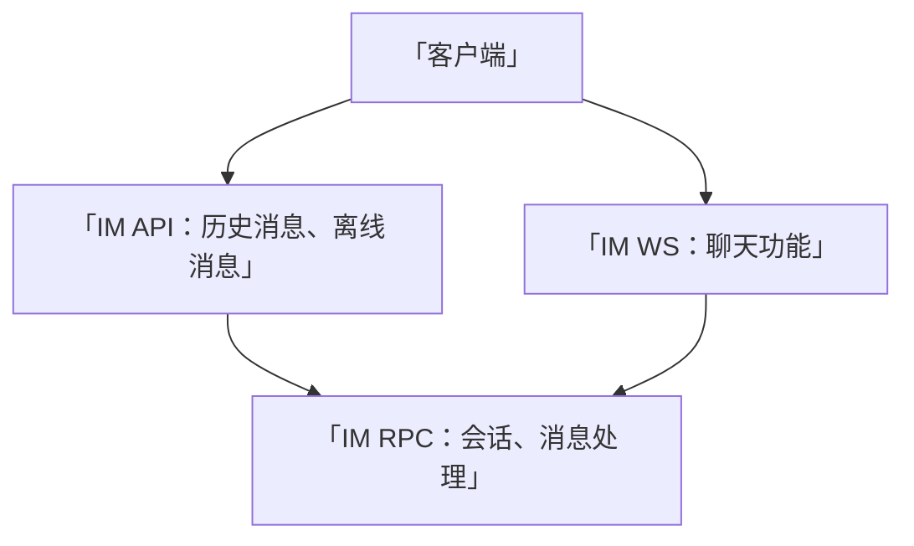

先了解 IM 服务的相关业务。IM 服务中聊天是整个服务的核心业务，聊天又分为私聊、群聊；针对聊天产生的消息，还有已读未读的阅读状态业务，消息随发送时间也会区分历史消息、在线消息等，此外还涉及用户的状态、在线履历状态。

这些都是 IM 服务中的核心业务。据此可以把 IM 服务构建成如下结构：最上层是客户端，客户端的连接分别指向 IM API 和 IM WS，由两者提供相关业务。

IM WS 提供的是聊天功能；IM API 主要针对聊天之后的消息，比如历史消息、离线消息这类信息的读取，都可以放在 IM API 中。

IM RPC 则主要处理 IM 聊天过程中会话、消息等相关信息。

所以架构上会分为三个服务：API 服务、RPC 服务和 WebSocket 服务。项目开发过程中，会先了解 WebSocket，再构建 IM WS，也就是 IM 的 WebSocket 服务，构建完成后实现聊天功能，最后再实现 IM 的 API 和 RPC。这就是整个 IM 服务的开发过程。
