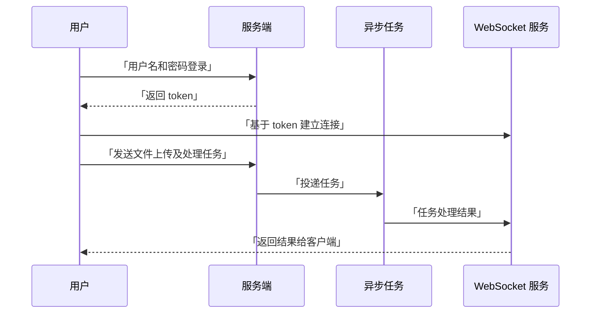

本节主要理解 WebSocket 协议：先了解 WebSocket 主要解决的问题及其特点，再看 WebSocket 与 HTTP 的关系。

WebSocket 同样是服务端和客户端之间的一种协议，但双方使用 WebSocket 之后可以进行双向通讯：服务端可以向客户端发送消息，客户端也可以反过来向服务端传输数据。

WebSocket 协议有如下特点。第一，它可以在浏览器中使用。以前浏览器中主要以 HTTP 或 HTTPS 协议为主，现在有了 WebSocket 协议并支持双向通讯，服务端可以直接向客户端发送消息，客户端通过浏览器就能接收到服务端发送的消息，而且使用层面也比较简单。

可能有人会问：既然已经有 HTTP 和 HTTPS，为什么还需要 WebSocket 协议？看一个业务场景：用户上传了一个较大的文件交给后端处理，但这个任务处理耗时较长。图中客户端向服务端发起请求，请求首先交给 Nginx，因为这是一个 API 请求，Nginx 把请求转发给服务端。服务端收到请求后要做的事情包括：先保存文件，再打开文件并读取数据，进行数据计算处理，甚至还要包含数据写入。数据比较大，这一趟流程走下来，任务的处理时间就会很长。而 Nginx 和浏览器对一个长时间未返回的请求都会抛出服务端超时错误返回给用户，客户端就无法拿到任务处理的结果。

在这种情况下，使用 HTTP 协议要如何解决？可以把任务交给异步任务处理。客户端仍然向服务端发送文件上传处理请求，服务端接收到请求后，将请求转发给异步任务处理。服务端此时无法同步完成这个任务，就把情况返回给客户端，告诉它「已经交给异步任务处理，不用等待了」。异步任务处理完之后再把结果返回给客户端。整体思路就是：把原本会因 Nginx 或浏览器超时而失败的任务交给异步任务，处理完再返回结果。

但此时就有一个问题：客户端如何知道任务已经处理完？做法是：处理后的结果放在数据库或缓存中。客户端把请求交给服务端之后，会定时做一个轮询机制，比如写一个 for，每隔几秒执行一次，去请求服务端「当前这个任务是否处理完成了」。服务端去看有没有这个数据，如果有，就表示处理完了；如果没有，就返回结果告诉客户端「还没有处理完」，客户端再每隔几秒请求一次。这就能解决客户端如何得知服务端是否完成任务的问题。

不过这个方案存在明显缺陷：过程中会产生大量无效请求，服务端压力也比较大。如果有很多客户端同时执行这种轮询请求，再加上其他请求，无形中增加了服务端压力，造成大量浪费。

这时就可以使用 WebSocket 作为解决方案。整个方案有三个环节：登录、请求发送、接收结果。用户登录时使用用户名和密码，登录目标是请求服务端；登录之后，客户端基于获得的 token 信息与 WebSocket 建立连接。登录成功且 WebSocket 连接建立之后，再看请求处理：客户端把文件上传及处理的任务交给服务端，服务端仍然投递给异步任务处理，异步任务处理完之后，把结果交给 WebSocket 服务，再由 WebSocket 把结果返回给客户端。明显不同的地方是客户端不再有大量轮询请求，而是被动等待结果，过程中减少了客户端的无效请求。由于客户端在登录时已经和 WebSocket 建立连接，异步任务处理完就能通过 WebSocket 把结果发送给对应的客户端。

这就是 WebSocket 的典型应用。通过上面的例子基本可以了解 WebSocket 的应用特点：利用了 WebSocket 能够从服务端向客户端发送消息的能力，除此之外，像聊天也可以用到 WebSocket。

再来看 WebSocket 与 HTTP 协议的关系。WebSocket 本身对 HTTP 有依赖性，它需要依赖 HTTP 的通道来建立连接。建立连接时使用的仍然是 HTTP 协议，连接建立完成之后，协议升级为 WebSocket，之后依靠这个通道保持客户端和服务端之间的通讯，不再使用 HTTP 协议。在协议层面，底层仍然基于 IP 和 TCP 这两个协议实现。

业务层面，有几类场景可以用到 WebSocket：第一是需要即时通讯功能的场景，比如聊天功能，本课程中实现的聊天（无论私聊还是单聊）就是用 WebSocket 实现的；第二是数据变化要求实时性较高的场景；其次是消息推送通知，上面所举的例子就属于消息推送通知。

本节主要介绍了 WebSocket 的特点及应用场景，下一节开始使用 WebSocket。
