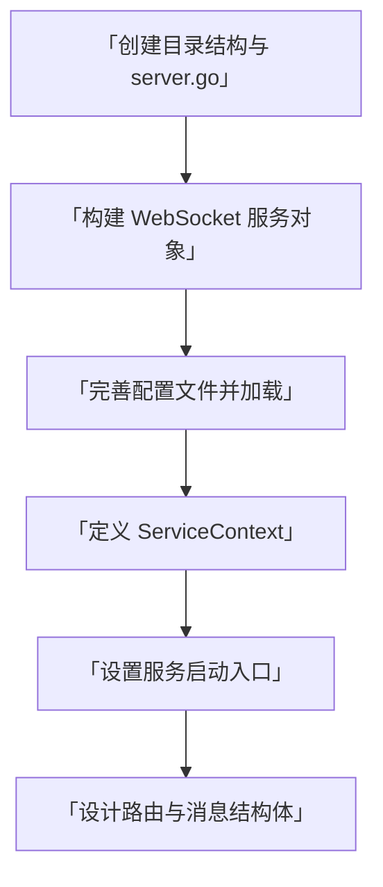

前面已经介绍了 IM 中的相关业务，本节开始构建 IM 服务。

课程内容主要有四个环节：先构建好 IM 服务，然后整理服务、设计好相关路由、存储连接对象并设置鉴权，之后对连接的服务进行消息的发送。



首先是构建服务。目录结构仍然采用 GoLand 所推荐的构建风格：进到项目中，创建 im，在 im 下创建 ws 作为 IM 的服务，在 ws 下创建 etc 作为配置文件目录，再创建 internal 作为整个项目业务的核心层。在 internal 中创建一个 server.go，作为 WebSocket 的服务。

        ```go
        type Server struct {
            addr     string
            upgrader websocket.Upgrader
            logx.Logger
        }

        func NewServer(addr string) *Server {
            return &Server{
                addr: addr,
                upgrader: websocket.Upgrader{},
                Logger: nil,
            }
        }
        ```

启动入口需要一个 main。

        ```go
        var config = flag.String(name: 「f」, value: 「etc/im.yaml」, usage: 「the config file」)

        func main() {
            flag.Parse()
            var c config.Config
            conf.Must(type 'config')
            ctx := sv.Import(「imoo.../rpcserver」)
        }
        ```

配置文件放在 etc 下面。internal 中会包含配置对象以及任务处理逻辑，包含业务处理的方法，定义 svc 与 svcContext。除此之外，还需要在 internal 创建一个 WebSocket 的服务对象，并定义服务所需的相关数据结构，到此服务就构建完成了。

接下来进入服务开发：先完成服务对象的开发，即 WebSocket 服务对象的构建，再定义相关配置并进行加载。

之所以要重新创建一个服务对象来做 WebSocket 的服务初始化，是因为 go-zero 本身没有 WebSocket，我们的 WebSocket 是通过第三方库加载使用的，所以需要引用第三方库再进一步封装，以支撑整个项目的运行。第三方库提供的是运行的基础框架结构，但还需要在这基础上进一步优化：连接对象接收之后，要根据什么方式判断这是什么业务逻辑、需要怎么处理，每一个逻辑处理过程中会涉及什么业务细节、怎么更好地扩展。

所以这里封装出一个 WebSocket，并定义一个 server 用于对整个 WebSocket 进行处理。服务对象中定义了服务地址、upgrader（前面讲过，它能将 HTTP 协议升级为 WebSocket），当然还有日志。一个服务基础所需的功能就定义到这里。

然后提供一个 new 方法，根据传递的地址进行创建，完成服务的初始化工作。日志的创建通过 withContext 进行，context 直接通过 context 相关的方法创建即可，服务初始化的准备工作就绪。

接下来为服务提供具体执行的方法：增加实际接收请求并运行的方法 serverWs，用它接收请求并处理请求，具体内部如何实现后面再讲解。

再提供一个启动方法，内容就是示例中的那一段：加上日志输出 info、请求的地址，地址在前面已经传递过了，请求信息就是服务对象信息。

再提供一个停止方法 stop，输出「停止服务」，该方法在服务停止之后调用。到此基本上一个服务就定义完成了。

接下来针对核心业务层面完善配置文件信息。配置文件中首先要有服务名 im ws，其次是监听地址，然后再描述服务对象。在服务对象中要创建 config，引入 go-zero 的 service.Config。之所以引入这个配置，是因为整个系统仍然需要依赖 go-zero 提供的日志处理、性能监听、系统运行指标监听等能力，配置文件中提供的 setup 正是针对这些事项进行设置的。配置文件包含名称、模式，没有监听地址，所以还要把地址加进去，配置文件就基本设置好了。

接着定义 ServiceContext。go-zero 为整个服务设计了 ServiceContext，作为整个服务使用的上下文，其中通常包含整个项目运行会用到的公共属性，配置就是一个典型，把配置传进去组成 ServiceContext 对象，目前没有什么复杂的地方。

然后设置启动，让程序能够运行起来，这是启动的配置加载。把 GoLand 中的相关代码复制过来后需要注意更改：这里的值改为 im；main 方法的运行也可以选择性复制过来，将不需要的删除，只保留需要的两段。导入包时应该导入第一个包，ServiceContext 暂时用不到可以先删除。整体流程是先加载配置，再初始化 ServiceContext。配置加载时需要执行一个操作：调用配置中的 setup 方法，它会设置 go-zero 中的日志、性能监听等处理，这一步必不可少。

再创建 websocket 服务对象，传入监听地址，然后 start 启动。在启动处增加一个输出描述：启动 websocket 服务对象及监听的地址。至此一个服务的基础雏形就构建好了。

服务雏形构建好之后，就要设置服务的路由。如果不定义好路由，就很难根据不同的请求特点去处理相关的业务。回到 websocket 服务的代码中：先处理运行过程中可能抛出的系统性 panic 错误，将其恢复过来，写服务时不能忘了异常捕获，这是服务处理过程中产生的错误信息。

重点是下面部分：通过 upgrade 得到连接对象，根据请求和响应的参数进行升级，第三个参数写一个空值，异常处理中输出 upgrade 失败并打印异常。这一行的作用是获取连接对象，得到连接对象之后，就可以根据连接获取请求信息。在信息中如何判断要做什么业务？最好的方式是在请求信息中传递一个方法标识，以此判断到底执行什么业务。

所以整个过程可以分为三步：第一步获取请求信息；第二步解析请求信息的对象，根据请求信息中传递的相关参数值调用对应的方法。对请求信息的接收、调度和解析，可以定义一个消息结构体 message。

        ```go
        type Message struct {
            Method string `json:"method"`
            FormId string `json:"formId"`
            Data interface{} `json:"data"`
        }
        ```

message 作为 IM 服务通信过程中传递的参数对象，其中 method 用于标识具体要处理的方法；formId 代表消息请求的来源，接收时其实用不到，因为接收方已经在 websocket 进行登录，系统中能获取到对应的 ID，它主要用于服务方发送给客户端时使用；data 定义成 interface，因为不确定会传递什么参数，interface 类型比较合适。消息结构体定义好之后，就要根据 method 设置相关的路由。

这里定义一个 router 结构的对象，描述哪一个方法对应要执行的具体事项。定义这个类型时要考虑参数：服务对象肯定需要；有了服务对象之后，可能是给请求方用户返回所需查询的消息，也可能是给另一个用户发送消息。因此第二个参数建议传递连接对象，这个连接对象就是当前请求的用户。

        ```yaml
        ListenOn: 0.0.0.0:10090
        ```
