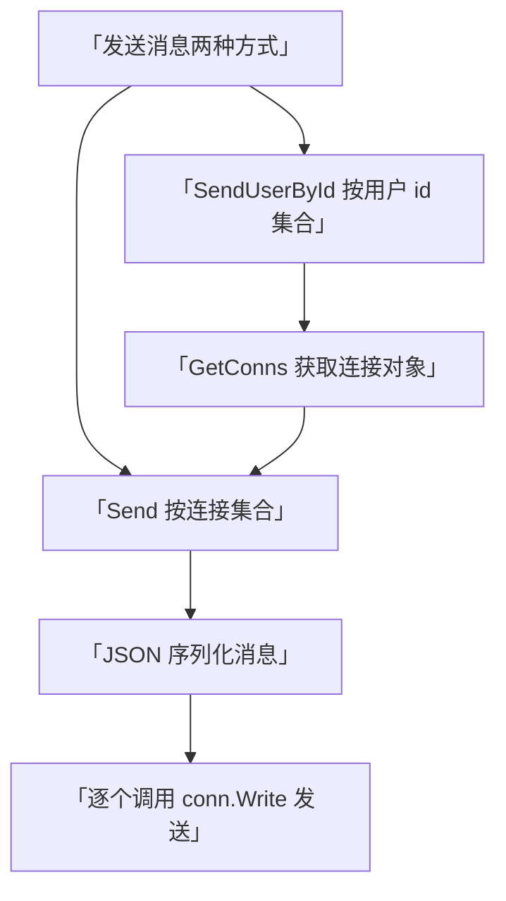

后面这些在前面已经有定义了：两个读方法，一个 getConn，一个 getUser，将其拆出来；还有一个是关闭的 close，关闭也不复杂，拿出来粘贴进去。一个是根据 UID 获取 conn，一个是根据 conn 获取 UID，然后是 close 关闭。先看 close 本身：立即获取到这个连接，然后进行关闭。

这个 conn 同样可以在上面使用，因为前面 handlerConn 里有一个需要关闭连接的业务，就在这里应用，再把这整块代码复制放到最后，这样就把连接对象存储起来了。

存储之后，接下来就要发送消息。发送消息有两种方式：第一种是根据用户 id 集合去发送消息，另一种是根据连接集合来发送消息。两者的区别主要是查询对象不一样，实际操作是一样的。

为此在下面提供发送方法 send。

    ```go
    func (s *Server) SendUserById(msg interface{}, sendIds ...string) error {
        if len(sendIds) == 0 {
            return nil
        }
        return s.Send(msg, s.GetConns(sendIds...))
    }

    func (s *Server) Send(msg interface{}, conns ...*websocket.Conn) error {
        if len(conns) == 0 {
            return nil
        }
        data, err := json.Marshal(msg)
        if err != nil {
            return err
        }
        // 发送消息的逻辑（未完全展示）
    }
    ```

按 UID 发送的方法，第一个参数是发送的消息，后面是发送对象，因为不确定发送的用户有多少，所以用不定传参的方式。再提供一个发送消息的方法，这个方法是跟连接对象发送的，参数同样是 conn，也是不定传参。做一个判断：如果连接对象为空，直接返回即可，不必报错。

然后对消息进行处理：序列化成 json，做异常处理，再逐个发送，直接调用 conn 的 write 方法，消息类型用 message，把 data 传进去，就完成了消息的发送，最后做错误处理。

消息发送的两种方式最终都落到连接对象上，流程如下：



    ```go
    func (s *Server) addConn(conn *websocket.Conn, req *http.Request) {
        uid := s.authentication.UserId(req)
        s.RWMutex.Lock()
        defer s.RWMutex.Unlock()
        s.connToUser[conn] = uid
        s.userToConn[uid] = conn
    }
    ```

    ```go
    func OnLine(svc *svc.ServiceContext) websocket.HandlerFunc {
        return func(ctx context.Context, conn *websocket.Conn) {
            // 处理在线逻辑
        }
    }
    ```

相比之下 SendUserById 就简单很多了：只需要判断当前的用户是否在线，有连接对象就可以发送。不管怎么发送，最终一定是根据连接对象去发送，所以直接根据用户 ID 去获取连接对象即可。这里的处理就是仍然用 Send 方法，把 message 传进来，用 getConn 方式去获取连接对象，就完成了。

还可以对这个服务做一点优化。目前的传参没有很好地定义，写起来很死板，从上至下都是固定的写法风格，这肯定不合理。

怎么更好地传参？可以用讲过的 Options 方式，用 Options 来定义对当前服务进行处理的操作。当前定义的是 server，因为后面还可能有更多选项，所以用 serverOptions 对象，其传参中包括 Authentication 这个实现以及请求的 pattern。pattern 指 server 中的路由前缀，目前是写死的，可以把它做成可自定义的。于是用 serverOptions 定义几个 Options，并给它们默认的属性。如果想写得更标准，可以在此处定义一个 struct，用来存放所有默认的属性，这里就不写了，只需要知道有更规范的风格就是这样定义的：一个个定义、一个个执行，设置完成后返回出去，并为其分别提供两个 With 的方法，再组合起来。

第一个 WithServerAuthentication 写好之后，再写第二个：请求的路径 pattern，这样就完成了，需要在启动入口中执行使用起来。

在启动入口中就可以使用它，创建出参数的结构体，第一个参数 Authentication 可以更改，这里就可以动态设置方式而不再是固定的了，整体就写好了。

还有一个小细节：连接对象的存储要在这里调用，因为这里是处理连接。在上面要记录连接，别忘了把连接传进来、把请求也传进来。然后在上面增加对连接的鉴权，如果鉴权不能通过，返回一个异常并写入信息：当前不具备权限，这样更合理。

现在开始发送消息。根据上面两个需求发送消息，自然要到 handler 中处理：先定义 router 来加载路由，再定义一个获取在线用户的方法，该方法获取所有在线用户，返回当前在线的用户列表。定义要发布的信息，取别名 use，返回一个 WebSocket 的消息，方法叫获取所有在线的用户。这个方法如果传递的参数为 0，就获取所有在线用户，这样就能得到所有的在线用户，然后再发送。

要发送的消息也需要更好地封装：在 Message 中增加一个 New 方法 NewMessage，方便用户使用。它的传参首先要传递消息来源是谁，其次就是具体的值 Data（interface{}），只需传这两个参数值，把两个值设置好就完成了。

回到刚才的方法，用 WebSocket 的 NewMessage，第一个参数传递请求的用户。用户怎么获得？这里有 getUserId 的方法，把 conn 传进来就能得到。得到用户之后，传递参数 sendIds 即 UID 列表。如果请求错误，用 info 打印出来，这个方法就写完了。

写好之后，需要把它注册到自定义服务的路由中。写法可以参考 API 的写法：把方法名复制过来，只不过服务是我们自定义的；第二个参数是 ServiceContext；在里面添加路由，定义每个路由对应的方法 use.only 作为 handler，再把 ServiceContext 传进去，一个路由的加载就定义好了。

这一组还需要加上所有路由，所以启动入口中还要做一点补充：把服务启动放在上面，增加对所有路由的处理，在这里得到 ServiceContext，把所有路由添加进去，把服务的启动以及 ServiceContext 传进去，到此就完成了。

整个 websocket 的服务差不多搭建好了，接下来进行测试，验证编写的内容是否正确、还有哪些异常问题。把服务启动起来，没有抛出错误，正常启动。复制端口，在 ApiFox 中增加一个测试 IM 的用例，在其下创建两个 websocket 用于测试。先填请求地址，发起连接，请求成功，两个连接都进入了。要发起消息，消息格式先定义好请求的 method 为 use.only，请求方法就定好了，再发送。

没有返回结果，再看代码，可以明显发现抛出了错误：这个方法中要指定发送对象是谁，这里只传递了发送的消息，没有指定哪个用户，所以要把 conn 传进去。重启之后再重新连接、发送，就成功了，说明目前的操作没有问题。整个 IM 服务就构建好了，服务中的一些关键性功能也设计完成了。

从服务的构建，到请求的处理、路由、鉴权的一系列流程就完成了。核心就是搭建起这个 IM 服务，以便后面完成 IM 相关的业务。课后可以跟着课程中的内容去一点点操作并实现起来。

    ```go
    func WithServerAuthentication(auth Authentication) ServerOptions {
        return func(opt *serverOption) {
            opt.Authentication = auth
        }
    }

    func WithServerPattern(pattern string) ServerOptions {
        return func(opt *serverOption) {
            opt.Authentication = auth
        }
    }
    ```
