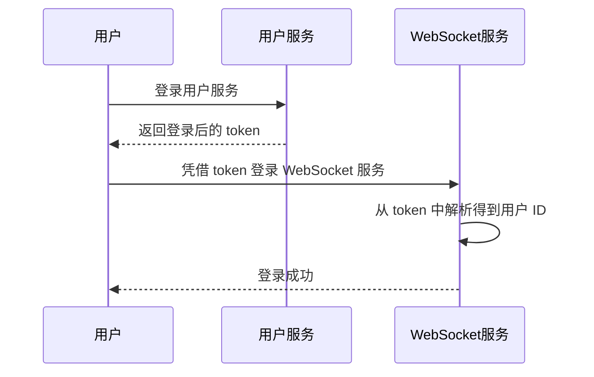

我们已经将 IM 中的 WebSocket 服务（进行）简易构建了。

        ```go
        func (s *Server) handlerConn(w http.ResponseWriter, r *http.Request) {
            conn, err := s.upgrader.Upgrade(w, r, responseHeader{nil})
            if err != nil {
                s.Error(「upgrade err %v」, err)
                return
            }
            if is.authentication.Auth(w, r) {
                conn.WriteMessage(websocket.TextMessage, []byte(fmt.Sprintf(「不具备访问权限」)))
                return
            }
            s.addConn(conn, r)
            go s.handlerConn(conn)
        }
        ```

在本期课程中，我们接下来完成 IM 服务中用户登录的功能，在课程的内容中，我们会针对用户登录来进行分析，到底该如何去进行实现，然后再了解 go-zero 中 JWT 的建立过程，最后在 IM 服务中去使用 go-zero 的 JWT 鉴权，来完成用户的登录鉴权。

先看用户登录鉴权的分析，对于客户端来说，它连接服务端之后，我们的操作分为两种：第一种是根据连接（对象），第二种是根据用户 ID，这个是我们（使）用的。而在于连接之后，如左图所示，用户基于 HTTP 协议（建）连接。

        ```go
        func Authorize(secret string, opts ...AuthorizeOption) func(http.ResponseWriter, *http.Request) {
            var authOpts AuthorizeOptions
            for _, opt := range opts {
                opt(&authOpts)
            }
            parser := token.NewTokenParser()
            return func(w http.ResponseWriter, r *http.Request) {
                tok, err := parser.ParseToken(r, secret, authOpts.PrevSecret)
                if err != nil {
                    unauthorized(w, r, err, authOpts.Callback)
                    return
                }
                if !tok.Valid {
                    unauthorized(w, r, errInvalidToken, authOpts.Callback)
                    return
                }
                claims, ok := tok.Claims().(jwt.MapClaims)
                if !ok {
                    unauthorized(w, r, errNoClaims, authOpts.Callback)
                    return
                }
            }
        }
        ```

这里会有服务端，会保持一个长连接，相互之间能够发送消息，能进行通信，在右图中，则就是它的一个登录流程。

用户首先会去登录用户服务，用户服务会返回出登录之后的 token。

        ```go
        func NewJwtAuth(svc *svc.ServiceContext) *JwtAuth {
            return &JwtAuth{
                svc: svc,
                parser: token.NewTokenParser(),
                Logger: logx.WithContext(context.Background()),
            }
        }
        ```

这个 token 会用于整个项目进行鉴权，然后用户凭借这个 token 去登录 WebSocket 服务，登录成功之后 WebSocket 会从 token 中解析得到用户的 ID，从流程来分析的话并不困难，我们主要的关键在于这一个 token 的生成及解析，所以这是整个 WebSocket 鉴权中的一个关键地方。

用户登录 IM 服务的整体流程如下：



因此我们就需要先了解 go-zero 中 JWT 的整体流程，进行鉴权过程，因为我们在课程中就是使用了 go-zero 的 JWT 来进行鉴权的，我们打开源码。以用户 API 为例，因为在用户 API 中，它是有 JWT 进行鉴权的，而 RPC 的话主要就是生成 token。所以我们不需要去分析 RPC，我们重点分析 API 中 JWT 是如何鉴权的。如果对某个路由需要使用 JWT 进行鉴权，我们只需要在其上添加一个 JWT 的（授权）标识，它就会使用到 JWT 的中间件。

在这里，就会有定义对于一个 JWT 的使用，在当前的这一段代码中，它主要做的事情是设置 JWT 相关所需要的属性值，并不是我们所关注的具体执行的代码，具体代码在执行中。我们打开源码来看一看，找到 go-zero 这个项目包，在这里有个 rest，在 rest 上面有个 handler，handler 中呢有个 auth-handler，这就是用于 JWT 鉴权的中间件，这里有一段代码，这就是整个 JWT 鉴权的核心代码。

在鉴权中，首先它会得到一个 token 解析对象，再基于 token 解析对象去解析 token，解析的时候它会要求传递相关的密钥证书等信息，然后在解析之后，它会返回出 token 和一个错误，并且，在下面就会去进行验证，而在这里，它会得到 JWT 中的数据信息，并把这个信息设置到 context，从整体的过程来说并不复杂，关键在于引入这个 JWT 解析的对象，然后调用它的方法去进行解析就好了。

现在我们来试试看，先（复制）一下，再到 IM 服务中，在 IM 服务中，我们在 handler 中增加一个 jwtAuth，用于自定义对整个 WebSocket 进行鉴权，定义一个结构对象 jwtAuth，它要的参数就是配置文件，肯定要有。所以 ServiceContext 我们就必须得给它加进来，以及解析 JWT 的解析对象 token.NewTokenParser()，之后我们再给它增加一个日志，一个基础结构就定好了。定一个创建的方法，然后把 ServiceContext 给它传进来，然后把 JWT 的对象返回出去。首先把 token 的对象来创建好，然后再创建好日志、Context，初始化就完成了。

初始化完之后，我们现在还要做什么？我们要使 jwtAuth 实现一个接口，实现的接口对象是谁？就是这个 jwtAuth，我们前面所定义的是一个结构（体），把这个方法我们放到下面了。在里面我们要怎么去写？在写之前，首先我们需要对配置文件去做一下处理，配置文件中，我们肯定是需要去定义 jwtAuth 的配置的，因此在这里面需要定义一个结构体，用来接收 JWT 的相应的配置。

然后在配置文件中，要去引用它，我们可以从这里给它复制过来，配置完成之后，再回到 jwtAuth 的过程中，在这里，就需要去借助 JWT 中间件进行鉴权，具体的鉴权过程的话，我们可以参考这个中间件的写法就好了。所以，我们可以把这一堆代码可以复制过来，然后改一下引用的参数，把配置给它传进去，这里写一个空（值），解析，这个方法就写好了。

（调）用 unauthorized（方法），再把这个错误给它记录一下，这是解析 token 的时候，发生的错误信息，然后再把这一段给它复制过来。然后拷贝下面的（代码），这也是需要的，因为上面的代码是验证这一个 token 是否生效的。然后（处理）这个 token 的（错误），我们再获取里面信息，这段代码到下面是引入 jwt 的包，此处就得到数据，得到数据之后，接下来就要把数据放到这个 request context，怎么去设置？我们可以这样子，在它的里面有个 WithValue，WithValue 就是根据我们传递的 context 进行设置。

然后再调用 context 的 WithValue 方法，把 request 的 context 放进来，再给它设置值，我们还是用 context 包中（定义的方法），这样就比较清晰了，这样就可以完成了。为什么这么写？首先，这里设置的是 request 中的 context，然后（WithValue 的）参数中，它的第一个参数是 context，也就是父 context，选择它之后，然后再给它设置一个 key，为刚刚我们所持有的这个 id，这个 key，然后再写进它的 value，就是从解析中获取到的数据，它会返回一个新的 context，我们把这个新的 context，作为这个 request context，把它放进去。

所以这里的写法要注意，此处就完成了 jwt 的鉴权，并且把（用户）id 放到了 request 中，在下边设置的数据，就简单很多了。我们只需要（通过）context（就）可以（获取），然后 get（用户）id，把 request context 给它传进来，就可以获取到（用户）id 了，整体就不复杂。

最后我们只需要把当前定义的其他的 Options，让其能够在 websocket 中去使用。怎么用？我们之前在这里有一些（传参的）方式，有个 serverOptions，我们可以把它放到这个 serverOptions 中（传）进来，进行（在）websocket（中）使用。然后引用 serverOptions，再把 handler 放进来就可以了，它的参数需要引入这个 serverOptions，把 serverOptions 放在上面，就好了，这样就完成了 jwt 的一个设置，之后我们需要在代码中，去进行鉴权。

因此，我们需要来启动好服务，服务启动成功之后，再打开 ApiPost，先登录一下看一下。它会跑出个错误，不具备访问权限，说明当前它确实在访问 websocket，但是没有通过，因为我们这里的鉴权是不通过的，进入了 jwtAuth 的鉴权，然后在这里会跑出个错误，解析 token 存在错误，不存在 token 的解析，说明我们刚刚设置的 Options 是生效了。

在这里，我们登录个用户，登录用户之后，获取了这个 token，把这个 token 复制一下，我们要放到请求头，然后再设置请求头的参数名，参数名我们在这里复制过来，放进来，连接。它虽然说不具备访问权限，但是它也连接成功了，说明我们的程序还是不太完善，我们进到程序中，进到 websocket，在所有的 handler 中，应该在上面。这里，我们也把连接断开的逻辑补上，加上 closed，重新将服务启动，现在我们关闭（连接），重新建连接，是没问题了。

然后我们发起消息，可以看到获取到了当前这个登录用户的 ID 信息，说明我们刚刚所有的操作是没问题了，用户也成功地登录到 websocket 服务中了，也进行了一次鉴权了。我们可以再来一个连接测试一下，这个连接是没有携带请求头的。访问，可以看到跑出个错误，因为不具备访问权限，然后（断开）连接了，我们就到这里了。

内容不复杂，主要是去了解 go-zero 的 jwt 的鉴权，然后我们再（做）鉴权（的设置），把它放到 websocket 中，然后去进行用户的登录鉴权，课程我们就到这里。
