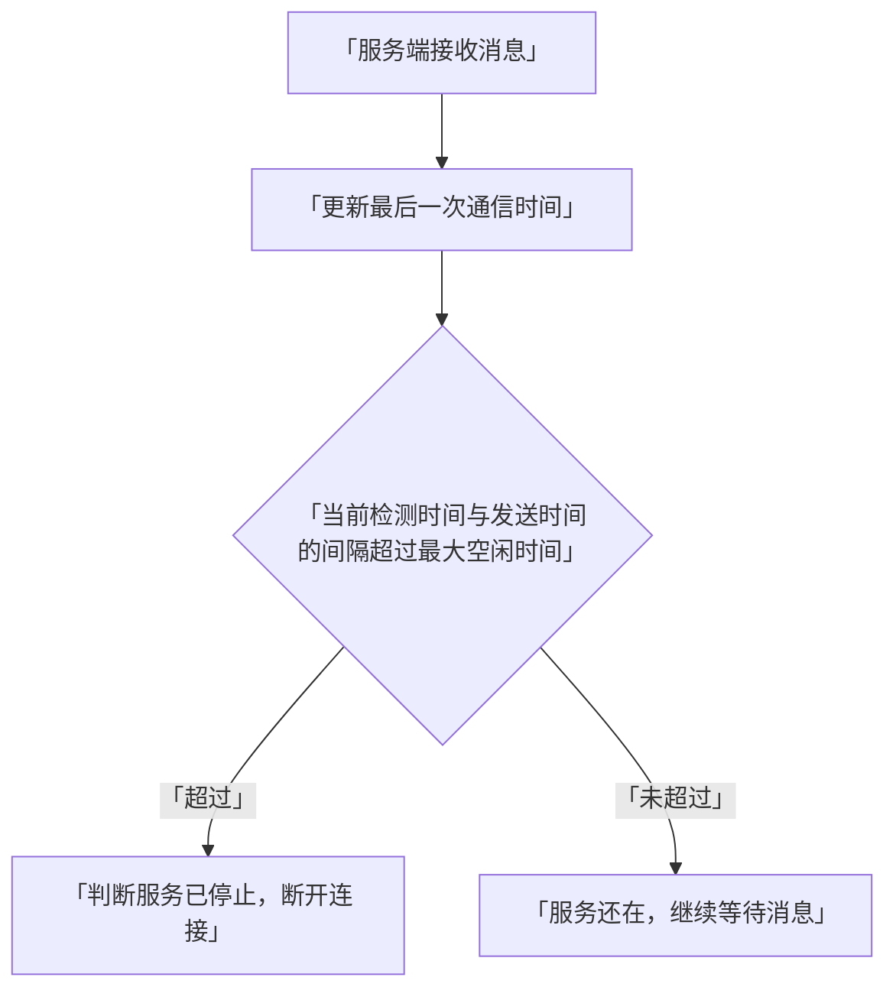

前面的课程中，我们已经实现了用户登录到 IM 服务，接下来要讨论的问题是：如何检测用户是否在线？心跳检测机制又应该如何实现？为什么谈这么个话题？对于心跳检测，我们主要有下面这四个话题：

第一，为什么需要心跳检测？心跳检测功能的主要目的是做什么事情？第二，在 gRPC 中又是如何去实现的？第三，结合刚刚所分析的内容，我们项目中又应该如何去实现？下面带着这些问题逐一来看。

首先探讨一下为什么需要心跳检测。

第一，长时间 Web 通信，服务端会断开与客户端的连接，默认时间是一分钟。这一项并不是空穴来风，而是服务端默认配置中的一个选项。

第二点，客户端或者服务端会存在意外的情况，可能会突然断开。大多数情况下，我们可以通过 close 事件接收到断开的消息，但是也有一些极端的情况可能接收不到，在服务端中，它可能会保留客户端仍然还在线的这个连接对象。

存在这两个问题的情况下，我们应该如何去知道客户端是断开的？特别是第一种：长时间未连接。如果一个客户端连接服务端之后，长时间没有发送消息，对服务端来说，你无法保证对方一直在线、一直能等待你的消息。就像两个人打电话，你一直跟对方说话，对方一直没跟你说话，你就会怀疑对方有什么事情、是否已经不在电话旁边，这是一个类似的道理。

所以我们需要通过新的验证机制，来验证对方是否在线。心跳检测功能最重要的两个作用：第一，保持存活；第二，检测死灭。这两者是相辅相成的关系，有其一就有其二。在前面提到的例子中，你和朋友进行电话沟通，如果长时间未通讯，对于双方来说，都不能够知道对方是否还保持通信的状态、是否还在电话旁边。所以我们就需要让两方之间能够保持通信的状态，对方也能够放出消息，此时我们就能够知道双方之间都是存活的。如果只是你放出消息，对方一直没给你回消息，我们就认为对方已经不在了，可能有事情在忙。

在心跳检测机制中，主要就是这两点功能：保持两者之间的通讯。客户端与服务端两者之间能够去通讯，如果我们要实现，肯定是能够持续地保持通讯，但实际上业务来说不会一直有消息往来。因此我们需要有一个进一步的定时机制，能够去保持两者之间的通讯，这就是实现心跳机制的关键所在。

现在我们，在 gRPC 中，对于客户端的心跳，它是如何去做的。这里有一张图，这是 gRPC server 的链路图。链路并不复杂，从上它会去得到一个 server，这里做的事情就是 new server，然后再往下是对 server 中具体的方法代码。值得注意的是，整个链路只是告诉你们是如何调用的，我们最终关键性的地方是在最后这里一个 keepalive 的方法，这个方法就是真正对于心跳解决的核心方法。

现在我们进到代码中来看一下。找 gRPC 的一个包，在其下会有一个 server.go。我们找到它的初始化的地方，内容很多，就是在这个地方，这一个方法就是 gRPC 启动的方法，如果不记得可以回顾一下。gRPC 启动的方法就是调用这个方法来进行启动的，启动的时候它要去传递一个监听的对象，然后再往下会绑定监听的记录。我们重点看下边，这里会等待几秒之后得到一个连接，得到连接之后，在这里才是真正的处理，所以我们要从这里来看，也就是下面的这一个方法。

然后注意这里，大部分是创建与客户端的连接，所以我们需要点进去看。在这里有一个 newServerTransport，它就是创建服务端与客户端连接对象的，我们重点看它下边有一个 keepalive。在这里，这个 keepalive 就是服务端对客户端的心跳检测机制，这就是整个心跳检测机制的核心，它创建了几个定时器。

我们先来看上面的代码。定时器中，第一个是空闲定时器（idleTimer），其目的就是检测一个连接是否处于空闲状态。它在触发的时候，会先判断这个连接是否空闲：如果连接是非空闲状态，就重新设置定时器，把它设置为最大的连接空闲时间，等待下一次检测；如果连接是空闲状态，就认为这个连接有一段时间没有保持通讯了，此时它会计算当前空闲时长与最大空闲时长的时差，如果没有超过，就重新等待，直到达到这一个指标的时候发现还是没有消息，就可以断开，进行优雅的断开。

简单来说，它会定义一个最大连接空闲时间 MaxConnectionIdle：

        ```go
        for {
            select {
            case <-t.idleTimer.C:
                if t.mu.IsZero() { // The connection is non-idle.
                    t.mu.Unlock()
                    idleTimer.Reset(t.kp.MaxConnectionIdle - time.Since(idle))
                    continue
                }
                val := t.kp.MaxConnectionIdle - time.Since(idle)
                t.mu.Unlock()
                if val <= 0 {
                    // The connection has been idle for a duration of keepalive.MaxConnectionIdle or more.
                    t.Drain(debugData: 「max_idle」)
                    return
                }
                idleTimer.Reset(val)
            case <-ageTimer.C:
                t.Drain(debugData: 「max_age」)
                select {
                case <-t.idleTimer.C:
                    // ... (省略部分代码)
                }
            }
        }
        ```

我们可以用一个场景来理解：假设最大空闲时间是三个小时。现在三个小时到了，它要去检测一次，发现这个连接是 idle 状态，此时就要判断。第一种情况是没有超过 MaxConnectionIdle 的最大时间，也有可能刚好等于或超过了，这是两种可能性。第一种可能性的话，我们要计算当前时间与最大空闲时间的时差，看它还有多久能达到最大的时间，然后我们就在那个时间去给它检测一次，直到它超过或等于这个最大的空闲时间，就认为这个连接已经可以关闭了。所以这就是第一个定时器的作用。

第二个定时器是有效时长定时器（ageTimer），它的作用是连接的有效时长，主要是约定一个连接在系统中能够连接多久。前面第一个空闲定时器只是定义你在一定时间内如果没有发消息，就认为你出现了故障；这个定时器则是约定你在这里能够最大连接多久，它的时间肯定会大于最大空闲时间。一旦发现已经达到了这个时间点，比如最大只能连 10 个小时，但你已经到了 11 个小时，你就应该关闭了。所以一旦超时，它就会向客户端发送一个关闭的消息，然后继续优雅地关闭。

在后面还有一个定时器，这个定时器的作用主要是去判断在一个时间段内是否和目标发送过消息，也就是在一定时间内有没有用户发送消息。前面已经有一个判断连接是否空闲的定时器，还有一个最大有效时长的定时器，现在又来了一个针对连接在一定时间内是否有通讯的定时器。为什么还有一个定时器？这个定时器主要是指服务端向目标发送消息，看目标是否存活，所以它的目的是以服务端向目标做一个心跳检测：如果目标能收到这个消息，说明当前服务端是存活的。

所以这个定时器和前面的空闲定时器是不冲突的，它们是相辅相成的关系。在过程中它会先获取最后一次通信的时间，然后在规定时间内，如果说有消息，它会重置定时器并更新时间。这个定时器如果在规定时间内没有消息，它会去检测曾经有没有给这个用户发送过消息：如果说有，它就会去验证是否已经超时了，它有个 ACK 的机制，ACK 机制超时了，就可以关闭，说明用户已经不在了；如果说没有发送过，它就会发送一个 ping，并更新 ping 发送的超时时间，然后重置定时器再次进行检测。直到有用户能够连接了，上边的这一系列事件都会重新更新，因为它会重置定时器。

主要这三个定时器的具体代码在这里也有体现：在这里会定义三个定时器，并且会寻找三个定时器的相关配置，然后会停止。上面的这一段就是空闲检测，在空闲的时候，它会去得到下一次空闲时间，并判断是否是一个空闲的状态：如果连接是非空闲状态，就重置定时器；如果已经超过了最大的空闲时间，直接优雅地关闭，否则就重置。而下面这里是一个有效时长的定时器。

最后这个会显得复杂一点，它的作用就是判断一个连接在一段时间内是否还有进行消息发送。这三个定时器是相辅相成的关系。在 gRPC 中，我们已经了解了三个定时器，但了解的时候我们会有一个疑问：这三个定时器为什么一定要有三个？这个其实很容易理解，主要是上面的这两个。这个是用来检测连接的空闲时间，这个是检测连接是否会有通讯、起到定时作用的。它会检测，如果一个连接在一段时间内没有发送消息，它就会触发。为什么会有这两个？从理论上来说，如果是检测连接是否可用，用空闲定时器就可以了，用它确实可以。而 ping 定时器的作用是会向目标发送一个 ping 消息，这个定时器的时间会小于空闲定时器的时间。之所以这么做，主要是因为它可以更加精密地检测到这个连接是否存活、是否在线，因为它的触发特点就是：当一个连接接收了通讯之后，它会判断下一个时间点是否有通讯，此时就会发送一个 ping 去访问目标，这个时间一定小于空闲时间。发现目标处理了这个 ping、处于存活状态时，它一定会向当前的服务端返回消息；但如果说没有返回，说明目标已经掉线了。不过，只要根据空闲时间就能判断出这个服务已经不在了，就可以断开。

所以这两者既然是相辅相成的关系，就能够使程序更加精密地检测目标是否存活，同时也能够让目标知道我是存活的，因为我向目标发送了 ping 消息，目标自然能够收到我的 ping 消息，自然也知道我还是存活的，所以这两者是不冲突的。了解完 gRPC 的实现之后，接下来讨论我们的项目中应该怎么做。

有一个图，在图中左边是客户端，右边是服务端，中间是心跳检测机制。客户端会与服务端进行连接，客户端就可以去发送消息，这里的消息类型分为两种：一个是心跳消息，一个是普通消息。但是对于服务端来说，它收到消息的时候，无论是普通消息还是心跳消息，都可以记录为最后一次通信的时间并更新，心跳消息本质上就是一个正常的消息，只是它们发送的内容不一样。对于客户端来说，它也会去检查这个连接是否有一段时间空闲了，如果有那么就发送消息，如果被响应了，此时它也会更新自己的最后一次消息，普通消息也会更新最后一次消息。注意这个地方，它会保持这么一个流程，直到服务端没有发送消息，就重新连接。

而服务端这一边的心跳检测机制也并不复杂，关键在于它收到消息之后，去更新最后一次消息，并判断是否超过一定的空闲时间，如果有就断开，如果没有就等待。所以关键的信息就在于，接收到消息之后，要更新消息发送的时间，然后再用当前检测时间与发送消息时间去计算，有没有超过这个心跳的最大空闲时间，如果超过了，认为这个服务端停止了；如果没有超过，这个服务还在。所以这就是整个程序的关键所在。关于心跳检测这一块的基础，我们就讲到这里，下一节课会在 im-ws 服务中引入这个心跳检测机制。

项目中服务端的心跳检测流程如下：


