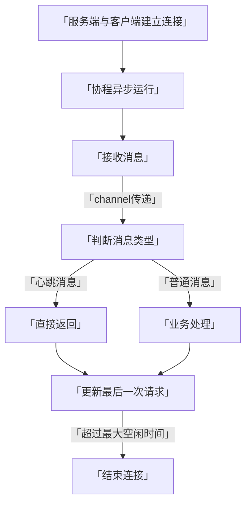

前面已经介绍了心跳检测的机制与思路，这一篇来落地 IM 中的心跳检测。内容分两部分：先回顾心跳检测的具体流程，然后实现心跳机制，并对服务以及消息的细节进行优化。先回顾流程。

在之前绘制的图中，整体流程并不复杂，核心在服务端。服务端与客户端建立连接之后，心跳检测应该以异步方式运行，否则无法做到边接收消息边更新检测，因此需要由一个协程来跑。协程运行起来后就能接收消息，此时实际有两个协程在运行，需要通过 channel 来传递消息，传递的就是接收到的消息，并根据消息类型判断是心跳消息还是普通消息，然后更新最后一次请求。更新最后一次请求最好的位置在消息的回复处：心跳消息和普通消息都会返回消息，直接在这里回复即可。



接下来写代码实现这个心跳检测机制。动手之前，需要在 websocket 服务（connection.go）中重新定义连接对象，因为目前的连接对象已不符合业务需求：心跳检测要基于连接来做，应该在建立连接之后就创建一个机制，对连接的消息做心跳检测。而目前的连接对象是第三方库提供的 websocket.Conn，承载不了这个需求。因此这里要再建立一个连接对象：定义一个 conn，第一个参数是 *websocket.Conn，再把 server 加进来，使用 server 时可能会用到它的一些方法；再定义一个 idle，用来记录空闲的时间以及最大的空闲时间；还要提供一个关闭用的 channel，因为这里必然要用到协程，必然涉及服务的关闭，所以要定义一个 done。

        ```go
        type Conn struct {
            *websocket.Conn
            idle time.Time
        }
        ```

定义好结构体对象之后，再分别为它设置参数属性。这里定义一些默认属性，即默认最大空闲时间，取 math 中最大的 int 类型。默认情况下不做空闲检测，给最大的 int 类型就可以了。

定义完成之后，自然要提供一个构造方法用来创建 Conn 对象。参数除了 server，还有 websocket 连接，以及其中会用到的响应和请求，最后返回一个对象。方法里根据响应和请求得到一个 websocket 的连接，错误也做处理。接着初始化一个 Conn 对象，把参数一一设置好：server、当前空闲的时间、最大空闲时间，再把结束服务的 channel 创建好，并把这个连接对象返回出去。

准备就绪之后，就要为它定义对应的检测。写法会相当简单：只判断这个连接是否超过了最大空闲时间，超过了就结束。再仔细定义一个 qn，用来检测连接。里面的内容可以直接把 gorilla 的实现整合过来，前面已经分析过 gorilla 的源码，它本身在一个方法中、没有额外的依赖，整合过来很顺手。找到它的 qn 方法：先对空闲的定时器做初始化，这一步必不可少；上面的参数要改成当前 conn 自己的，最大连接参数和结束的 done 都复制过来；定时器不需要那么多，只留第一个即可；再把下面的 for 循环挪过来，删掉上面两个定时器；它用到的锁机制当然也需要加进来。加进来之后更改参数的引用，基本就可以直接使用了。

        ```go
        val := c.maxConnectionIdle - time.Since(c.idle)
        ```

此处是优雅的关闭，直接用 Conn 中的 Close 来关闭，把 conn 传递进去。当前这个 Close 的引用对象也要更改，不再是 websocket.Conn，而是当前的 conn。整体来说到这里就完成了。

完成之后，接下来要对所有的 conn 引用做调整，并为这个 conn 提供写和读两个方法，也就是对上面的接收和发送在下层做优化。为什么要优化？这段代码移过来之后只是获取空闲时间，空闲时间的设置目前只在创建时完成。但读和写没有操作显然不符合需求：无论普通消息还是心跳消息，在读和写的时候都应该更新最后一次时间，所以需要重写读和写这两个方法。读方法返回的内容第一个是 message 的消息类型，然后是具体消息内容以及异常，理论上就是第三方组件包中的读取内容，这里没什么问题。主要区别在于读的时候要把空闲时间重新清理，现在就把它清空，因为它已经不空闲、有任务了。

        ```go
        func (c *Conn) ReadMessage() (messageType int, p []byte, err error) {
            c.idleMu.Lock()
            defer c.idleMu.Unlock()
            c.idle = time.Now()
            return
        }
        ```

再来是发送。同样把发送重写一下，参数仍与第三方库一致，即消息的类型和数据。发送时会得到发送的错误，再把空闲时间重新设置一下，最后把错误返回出去。

        ```go
        func (c *Conn) WriteMessage(messageType int, data []byte) error {
            c.idleMu.Lock()
            defer c.idleMu.Unlock()
            err := c.Conn.WriteMessage(messageType, data)
            c.idle = time.Now()
            return err
        }
        ```

读和写的方法写好之后，还有一个小细节要考虑：并发问题。第三方库中的并发写是线程不安全的，需要加一把锁才合适。因为后面还有一些其他的锁，为避免冲突，把锁的名称改为空闲操作的锁。设置处也需要加锁，写成线程安全的，整体上就没有问题了。

最后再为这个 Conn 添加一个关闭的方法，封装调用第三方库的关闭方法。关闭时要注意用一个 select 来做判断：协程有可能多次执行了一次关闭，所以要设置一个 channel，判断这个 channel 是否已经关闭，如果是就 return nil，否则调用 conn 的 Close。

        ```go
        func (c *Conn) Close() error {
            select {
            case <-c.done:
                return nil
            default:
                return c.Conn.Close()
            }
        }
        ```

到这里 Conn 已经重写完成，接下来把 server（websocket_server.go）中的 Conn 也替换掉，否则会报错。这里不再用 websocket.Conn，而是当前的 conn，把 conn 传进去，先暂时改到这里，程序就不会报错了。

        ```go
        func NewServer(addr string, opts ...ServerOptions) *Server {
            return &Server{
                routes: make(map[string]HandlerFunc),
                addr: addr,
                pattern: opt.pattern,
                upgrader: websocket.Upgrader{},
                authentication: opt.Authentication,
                connToUser: make(map[string]string),
                userToConn: make(map[string]*Conn),
                Logger: log.WithContext(context.Background()),
            }
        }
        ```

Conn 对象重写完成、心跳检测机制实现之后，接下来要做的是对服务接收系统消息的优化。目前系统消息没有做判断处理，而按照流程，应该会有心跳消息和普通消息两种：心跳消息不需要进行业务处理，直接返回；普通消息则要进行业务处理。

怎么实现？参考 gorilla 的写法。gorilla 中有处理服务的方法，即整个服务具体执行的方法：在上面先得到一个消息体，再往下根据消息的类型去判断，什么类型就做什么样的处理，比如数据类型，以及关闭和 ping 等等。这些类型怎么得到的？在 gorilla 的服务中，它会根据各类型读取消息，然后根据消息再做类型转发，并且为每个类型定义了各自的常量。可以按照它的写法风格挪到我们的代码中使用。

为此，把它复制一下，进到 message 中使用。它的类型很多，先把不用的注释掉，目前能用到的就是一个 data、一个 ping 这两个消息类型，注意这里定义完成后值分别是 0 和 1。接下来要增加一个标识作为类型的记录标记，默认请求类型给它设置为 data。

类型定义好之后，现在调整整个系统，让整个系统支持自定义的 conn，再完善相关的业务。把这里的 conn 调整一下，调整完之后会有很多地方报错，需要逐一调试。服务中处理完之后会得到 conn，这里要把 conn 取出来，把服务以及请求参数传递进去。此处先判断 conn 是不是为空，为空是有问题的，因为错误已经被记录起来，这里会被影响。

然后在下面的方法中要对这个 conn 提供支持，注意应该引入的是指针类型，把上面这些地方都改为指针的引用。接着找到 heartbeat，它是订阅的一个路由，代码中的 heartbeat 也没有问题。再往下，返回的类型应该改为自定义的 conn，这里的类型也要从 gorilla 中的 conn 引用改过来，把最后一个替换完，替换就完成了。

代码替换完成之后，业务的引用中也要更改，因为业务中还是用之前的服务，会报错。这里应使用 websocket 中的 conn，改好即可。

刚才做的事情是让整个服务支持自定义的 conn，有利于后期的服务扩展。这里给一个建议：后续代码中如果要基于第三方库或第三方组件进行封装（比如这里基于第三方的 websocket 组件构建自己的 websocket 服务），上层代码的引用应尽量以自己的封装为主，在自己的封装里面集成并完成对第三方组件的依赖处理，而不是在上层再调用第三方组件再传进去，那是一种不好的风格。把 conn 这样优化之后，后期需要对连接做什么设置和处理，扩展性都很高，上层代码不会有大的变化，这也是一种代码设计。

回到 server 中接着完善。上面已经确定会获取请求，获取请求之后就是解析消息、得到消息的内容，因此在其下应该根据消息进行处理，需要一个 switch 来判断消息的类型。如果类型是 ping，就需要回复，回复的也是一个 ping 的消息：把这个 ping 消息回复出去，再指定连接对象和具体的数据，还是用这一段代码，放在上面。

整体上并没有什么影响，不过这一段要改一下：代码中要保持统一的风格，所以改为 send 的方式统一返回，返回一个 data 和消息的描述，目标是当前的连接。同样把这段描述复制一份放到下面，作为信息传递出去。

之后再对整个服务消息做细节性的优化。第一个是 close，把关闭放到上面。关闭时应该先得到连接对象，但它有可能已经不存在了，设置了心跳检测之后，连接可能已经关闭，而 close 有可能被重复调度、执行下面的操作。为避免出问题，在此处判断 userId 是不是为空，如果为空说明已经被关闭了，直接返回即可，不再往下执行。

同理，添加连接中也要注意。可能有一些用户会重复登录，按当前代码重复登录是存在问题的。暂时让程序不支持重复登录：如果已经有登录，就把之前已经登录成功的那一个连接踢掉，换上当前的这个连接。也就是把之前的连接关闭掉，然后验证用户是否已经登录过。

到这里基本上就写好了，接下来在程序中增加对刚才操作的测试。设置之前，先进到 options 中，把 opts 改名称为 serverOpts 会更准确。在 serverOpts 中增加一个属性，用于设置最大连接的空闲时间，其下增加一个 With 相关的方法，并做一个判断：值大于 0 才进行设置，不大于 0 就不设置。

设置完之后要在连接中使用，连接中的使用不再是默认值，而是从服务中的 opts 获取。但 opts 目前没有记录，在服务中增加一个 opts 的记录，在记录前把这个 opts 参数设置进去。记录完成，连接中就可以用到 serverOpts 的 opts 中最大空闲时间的配置。

最后在入口中应用。最大空闲时间给它 10 秒钟：连接 10 秒钟没发送消息就断开连接，这样也方便测试。

编好之后就要测试了。启动服务、编译系统，没问题。进到 apps 中，清除一下这些信息，目前都是断开连接状态。在客户端增加一个标记，就是 message 中这一段，标记的参数内容是一个 1，因为 1 就是 ping 的消息。连接地址为 127.0.0.1:10000/ws，发送的消息内容为 {「frameType」: 1, 「method」: 「user.online」}。

连接之后观察超过 10 秒它会不会停止结束掉。10 秒过去了，但是它没有断开。看代码：还少了一件事，没有把 keynan 调用起来，少了一个协程来调用 keynan，所以没有效果。重新将服务启动起来，再重新连接。

这次 10 秒过去之后它断开连接了，客户端这边已经显示断开，说明生效了。重新建连接，给它发出消息，看一下时间点：现在是 54，然后 58。再给它发送几个消息，重新连接，从发送消息的时间来看应该已经过了 10 秒钟，但仍然还可以发送消息，说明检测成功了，从发送消息的时间看，已经过了 10 秒钟，从 54 开始到 55，连接一分钟已经过去了。最后因为这里没有发送消息，断开的时间与发送消息的时间正好相差 10 秒钟，证明现在检测是成功的。

客户端中的实现其实就是 jpc 中的这个定时器的实现。到这里内容就讲完了，重点就是实现这个心跳检测机制。难点也还是会有一些，这一篇里其实有两大核心：第一就是重构这个 conn，让写的 conn 能够被整个项目去使用，这样的好处在于可以更好地扩展自定义的业务需求；其次是在 conn 中引入了心跳检测机制，具体实现是引入了 jpc 的实现。其二是在引入 conn 之后，对整个服务及整个程序提供了支持，当然还包含了对业务的处理，这里有一个选择的分支去进行判断。
