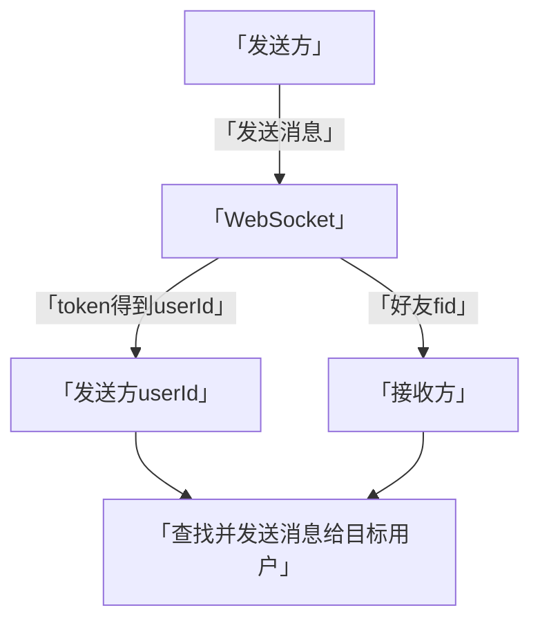

在前面的文章中，已经构建了 IM WebSocket 服务，并且也将用户登录到了 IM WebSocket 服务中。这一篇来讨论 IM WebSocket 服务中的一个核心话题：私聊该如何实现。

内容主要有下面三个话题：先了解私聊这一个功能实现的过程；然后讨论推与拉这两个话题，因为之后的工作中都可能涉及，这里先提一提；最后讲读扩散与写扩散，这是私聊中会用到的两个非常关键的方案。先聊单聊这一功能的实现。

单聊功能的实现其实并不复杂，主要的事情就是发送方要将信息推送给接收方。过程中，消息会发送到 WebSocket，由 WebSocket 转发给接收方。WebSocket 可以通过 token 得到 userId：发送方肯定登录了 WebSocket，token 在 WebSocket 的服务中就能取到，也就知道了发送者是谁。接收方则由发送者在界面中的会话来选择并传递过来，因此这里会有一个好友的 fid，用来表示接收方。这样 WebSocket 就可以根据发送方和接收方的信息，推送给对应的接收者。

在其中 WebSocket 要做些什么事情？第一，要判断各个类型的消息，因为消息类型不一样，会涉及不同的处理；其次，需要根据消息的会话 id 来进行消息的记录，并发送给目标用户。所以它要做的事情主要有四个过程：消息类型、会话 id、消息记录、查找并发送消息给目标用户。整体而言并不复杂。

了解完之后，再看推与拉。推与拉是业务中经常会提到的两个话题。推，就是将消息推送给接收方，是一种主动发送给目标的方式；而拉，就是接收方主动向服务方发起请求获取消息。这两者在前面的例子中有讲过：客户端可能会有一个耗时的任务需要服务端处理，服务端将消息推送给异步任务，异步任务处理完之后，由客户端主动向服务端询问消息处理好了没有。这种方式就是拉的方式：由客户端向服务端请求消息处理的结果，客户端作为接收方，对消息的获取采用了拉。而推，则是后面将消息推送给接收方：流程改用 websocket 之后，服务端主动向客户端推送消息，接收方仍然是客户端，但它接收消息的方式从主动改为了被动，这就是一种推的方式。

这里不讨论这两种方式的优劣，两者都有一定的缺点和优势，放到后面慢慢讨论，这里先了解即可。之所以讲这个话题，主要是关系到后面会讲到的接收方到底如何接收消息的方式问题。这两个概念就讲到这里，继续往后看。

接下来讨论读扩散与写扩散。这两者实际上与前面提到的推与拉一样，重点也讨论方式。首先会有一个疑问：客户端和服务端之间保持通信，自然会有消息，这些消息应该如何记录？记录完之后又如何被读取？前面的例子中讲过消息可以存在本地客户端，但如果存在服务器中，该如何设计？发送者要获取消息，接收者也需要获取消息，而且获取完之后还需要保持消息的顺序以及相互之间发送的关系。那么应该如何存储私聊的消息？往后看。

先看读扩散。对于读扩散，如图所示，假设这里有四个用户和一个群。如果采用读扩散，用户A和用户B通讯的话，那么每个用户之间都会生成一个会话，这个会话用来记录两者之间通讯的消息内容。这样的好处是写的时候很轻松：用户A和用户B通讯时都是以 A-B 的会话来进行相互之间的聊天，用户A只需要向这个会话中写入信息，用户B也只需要在这个会话中写信息，读起来其实也不复杂。之所以叫读扩散，是因为在有群的时候，消息只会写入一次，所有用户都从这里读取消息，后期就会有一个问题：哪些消息已读、哪些消息未读，如何解决？并且只有一条消息时，如果群里有很多人，对这条消息的读取就很重，所以就形成了读扩散。

这种方式的主要问题在于：用户相互之间读取到消息的节点以及拉取新的消息，不能根据用户去单独维护，需要再用另一个记录来维护用户对于消息的读取信息以及读取的节点，这是读扩散。上面提到的就是它的优点和缺点。

再讨论写扩散。写扩散的特点是每个用户都有属于自己的会话，这个会话中会收入他自己能够收到的所有来自用户或者群的消息，但这个会话只属于他自己，其他人都不会对这个会话有任何操作。对用户来说，自己的消息有自己的会话，维护起来非常方便，读的时候比较轻松，只要读这里就可以了，也能很快定位到自己要的数据内容。但有一个缺点：一条消息要写入多份，所以在消息的写入操作上呈现了写扩散的趋势。写扩散的主要弊端在群中体现：一个群有二百个人，这二百个人都有自己的会话，一条消息就要向二百个人各写入一次，压力就很大；而前者是一条消息被这二百个人各读一次，这是这两种方式的区别。

不讨论这两种方式到底好与坏，它们各有优点、各有缺点，在实际运作中根据自己的情况选择，并解决好它们所带来的问题，就是一个好的方式。那么课程中要使用哪一种方式？会采用读扩散。读扩散主要需要考虑解决：在读取之后，每个用户自己的已读会话以及已读节点。因此可以在已读记录表上面再创建一个会话表，将用户会话的已读情况记录下来，这就是课程中所应用的方案。

这一篇就到这里，重点讨论了推与拉、读扩散与写扩散这两个话题，以及私聊功能的实现。
