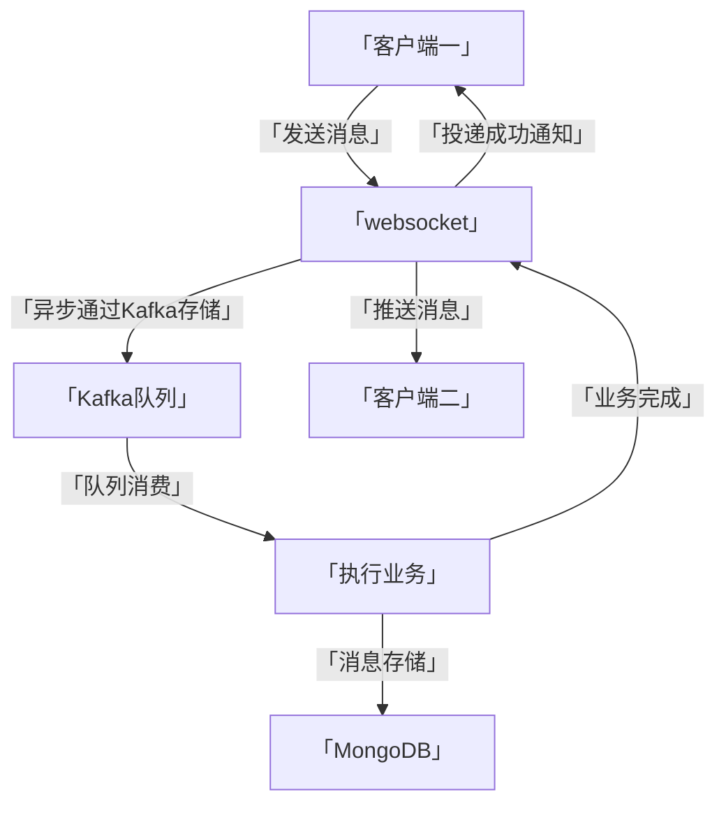

目前消息更新还没有做，主要做的是消息的记录和消息的推送。那么这个过程有什么问题？有什么值得优化的地方？

主要有下面这些问题。首先是阻塞及延迟：如果将消息的收和发放在同一个业务逻辑中处理，那么在收这里处理的延迟，肯定会影响发送的过程；或者在写入数据库的时候发生延迟，对整个程序也会造成影响。

其次，消息可能会存在丢失，发送出去的消息客户端不一定能收到。同时在同一个逻辑中处理时，如果某一条消息在处理中，因为数据库缓慢的问题或者一些特殊因素导致超时，这条消息也发送不出去，这也是会成为问题的。

扩展性和灵活性就更不用说了，因为收和发都在同一个逻辑中。用户量不断增加时，对整个服务的压力是比较大的：它要收很多消息，又要发很多消息，而且收的消息就要立马发出去，所以同一个服务在收和发的时候同时存在比较大的压力。扩展性上只能通过集群的方式来缓解压力，但仍然不能做到比较灵活的方式进行扩展。

再者，对于一些特殊因素，收的消息并不好处理：有一些消息可能是通知类型的消息，需要让所有用户都可能收到，这一类消息在发送的时候如果有优先级的话，目前的情况是无法实现的。所以整体而言会有这些问题。

当然，最重要的是前面三个问题：收发都在同一个逻辑中处理、消息丢失的可能性，以及扩展性和灵活性。这里在代码中做一个演示。

进到 IM WebSocket 中的会话，选择它的业务，这里也是业务逻辑。在业务中假设给它耗时一分钟，然后对整个服务进行重启，重启完成之后再分别与它进行连接。但接收方还是没有接收到消息。为什么？因为业务中已经有一个耗时的任务，结果就影响了发送的结果。

如果客户端发送了消息之后，它需要知道发送的结果，即发送是否成功。业务上会有这么个判断：发送一个消息不成功，可以点击重新发送，所以业务上需要支持，也就是客户端需要知道自己的消息发送是不是成功。但目前因为这么现实的情况，客户端不知道自己的消息发送是不是成功，可能要很久才能得到结果，这是一个比较突出的问题。

在一分钟过去之后，可以看到它收到消息了。收到消息之后，理论上这边也会有相关的结果。

了解完问题之后，就需要思考如何优化。课程中讲一个模型，就是消息的收发模型。看图：上方大致有两个客户端，客户端一向客户端二去发送消息，这是业务的需求。在发送的流程中增加了一个 Kafka，消息存储用的是 MongoDB，重点就是这里增加了一个 Kafka。

它做的事情是这样：客户端将消息发送之后，通过 websocket 接收完，将消息异步地通过 Kafka 来进行存储，并在队列中进行消费。消费的时候，把原本在 websocket 的业务放到这里来执行，消息的存储、消息的更新等相关内容都在这个队列中完成。此时对于 websocket 来说，它只需要关注消息是不是投递成功了：如果消息成功投递，就告诉客户端它的消息发送是成功的。对于客户端来说，整体的发送动作就不会有太大的阻塞问题。

换言之，队列中完成了这一部分业务，完成之后它就会把消息推送出去，仍然还是要通过 websocket 推送给客户端。这就是一个比较典型的收发模型。整体上，收和发因为 Kafka 的存在而进行了解耦，这就是整体上流程的设计。

了解完收发模型之后，再看第二个问题，叫消息的可靠性。在 IM 中，除了消息的收发模型以外，消息的可靠性也是非常关键的：消息是不是真的发送成功了。消息的可靠性主要有下面四个话题：传输性的保障、确认机制、重试机制及消息信息的保障。把这四个话题解决了，消息的可靠性就得到了保障。

传输保障基于 TCP 的协议，这一项没什么大的问题，本身就已经解决了。重点是确认机制：当用户发送了消息之后，需要返回给对方告诉它发送成功了，对方也要收到这个消息，给目标回复。其实这个过程就是 TCP 的三次握手，与相互确认对方是否可以通信是一样的过程。

重试机制也很容易理解：如果对方没有回复消息，就要重新给对方发送消息，请求一下对方看是否存在什么问题。

消息的信息保障也是需要考虑的，因为消息发送之后，实时性信息必不可少。看一个图：对消息的确认，业务中提到的是 ACK 的确认，刚刚也提到了，其实就是 TCP 的三次握手。但实际上也可以简化，左图是简化的，右图是一个 ACK 的确认。左图：客户端先向服务端发送消息，客户端进入 ACK 的等待，等待服务方发一条消息过来，告诉它已经接收到消息。但等待超时了，没有发回来，所以它要重新握手、重新发一次，发送的消息是一样的。服务端接收消息之后会发一个消息，这样就完成了一个确认。

另一种是依据 TCP 的三次握手的过程来实现。上面这一段很容易理解，不解释了，重点在下面：客户端还要多一次给服务端发送一次消息，多这么一个过程。之所以多这一次，是因为服务端也不知道客户端是否接收到它的确认消息，这一步是让服务端知道客户端确实收到了确认消息的信息，一直到服务端确认不需要再等待。当然它也会设置一个超时，不会一直给客户端发送。设计上是多了一次回复的机制，即服务端会等待客户端回复一个确认。

总体而言，两种方案都是在解决可靠性的问题：左边的只是单纯地回一次，右边这种相当于两者之间都能够保持相互之间的可靠。实际中可以根据业务而去进行实现。

刚刚讲到了 ACK 机制，但 ACK 有个问题：可能对方没有返回出消息。比如图中这一段，如果客户端没有给服务端返回出消息，那么服务端要一直等待客户端给它回消息吗？客户端又要一直等待服务端给它回消息吗？针对这个问题有一些方案：一是超时重发，超过时间重发一次；二是次数限制。实际上，超时重发和重试次数限制这两个应用比较多，在机制中就可以设置好。

后台监听告警本身是一种通知的手段，而非真正在处理过程中实际执行。它是给开发人员提示程序设计可能存在的问题：存在大量类似 ACK 机制的没有返回消息的情况，需要去看代码是不是有问题。

而异常逻辑和高可用，主要是针对消息发送之后出现的异常。重点的核心是前面两个话题。

再看整体的模型。前面一开始提到的是收发模型的设计，然后是消息的可靠性及实现。现在回到之前的模型中：在之前的模型中，怎么保障收的可靠性？可以用两种方案：第一是基于 ACK 的机制去进行确认，第二是基于拉取的方式来解决。看图。

图中是 websocket 的服务和客户端。第一种方案就是刚刚提到的基于 ACK 的机制：websocket 主动向客户端2去推送消息的时候，客户端再给服务端发送一个 ACK 的确认，以保证客户端成功收到消息。这样就能呼应前面所提到的收发模型的可靠性问题。

另一种是由客户端主动向消息 IM 服务中去拉取有没有新的消息，有新的消息就去更新。这种模式的好处是不依赖 websocket：它是自己主动地向消息服务器拉取消息，所以总是能够获得新的消息，不会存在丢失的可能性。这两种模型在业务中用得也比较多。

那么用哪种？这里用第一种方案，第二种也有用，了解一下即可，两种方案都是可以的。使用拉取方案就不需要考虑 ACK；使用 ACK 方案就需要考虑 ACK。这里只是指客户端收的时候。如果客户端发送消息，要不要考虑 ACK？要的。客户端向服务端发送消息的时候，服务端要向客户端返回一个 ACK，否则客户端不认为服务端收到成功了。所以收和发都是要保持 ACK 的。而目前的图中，主要针对收怎么保证可靠性，发就直接通过 ACK。

这一篇重点讲的就是 IM 消息的收发模型、消息可靠性。重点提一下：在收发模型中，客户端向服务端发送消息，需要保障消息的可靠性。因此在客户端向服务端发送消息的时候，服务端向客户端回复一个 ACK 的确认；而客户端收到一个 ACK 的确认，再收到 websocket 发送消息的时候，就可以通过 ACK 的确认，或者客户端主动地向服务端去拉取消息，来保证消息的可靠性。
