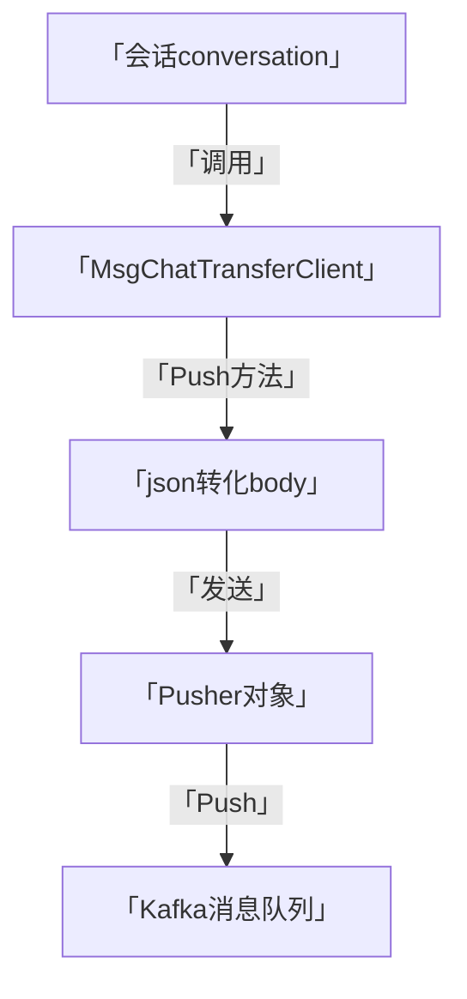

Push 写完之后，此处就没问题了。接下来回到之前的会话处理文件（conversation.go），要更改一下，让它能够将消息推送到消息队列中。推送也需要一个客户端，所以要在此定义一个客户端，即消息聊天转化的会话客户端（MsgChatTransferClient），供 WebSocket 的服务使用。

先定义好客户端的接口，里面提供一个 Push 方法，传输参数就是 message，即 `*mq.MsgChatTransfer`。

```go
type MsgChatTransferClient interface {
    Push(msg *mq.MsgChatTransfer) error
}
```

再定义好实现。在这个文件中定义一个 Push，使用 go-zero 提供的第三方库中 Kafka 的 Pusher 对象来完成消息的发送。再提供一个创建方法，创建出这个消息对象，传输参数是地址以及 topic，当然还有一些 Kafka 扩展组件的设置。对象通过 `mq.NewPusher(addr, topic)` 创建出来，传输参数即完成创建。

```go
type msgChatTransferClient struct {
    pusher *mq.Pusher
}

func NewMsgChatTransferClient(addr string, topic string, opts ...mq.PushOption) MsgChatTransferClient {
    return &msgChatTransferClient{
        pusher: mq.NewPusher(addr, topic),
    }
}

func (c MsgChatTransferClient) Push(msg *mq.MsgChatTransfer) error {
    body, err := json.Marshal(msg)
    if err != nil {
        return err
    }
    return c.pusher.Push(string(body))
}
```

这里可能会报错，因为接口还没写，把接口写上就没有报错了。里面做的事情就是把消息转化一下，连接上再发送，把 body 写进去就完成了。

起完客户端之后，需要在 WebSocket 的服务中使用。使用前先订好配置信息，这一段配置可以从 MQ 服务中复制过来，更改之后是 topic，配置就定好了。在配置对象里面复制标签进行使用，这是消息类型，这里是输出消息类型，配置就定完了。

再回到 ServiceContext 中，定义 MQ 的客户端，用 mq 客户端中的创建方法，传递好参数。服务创建完之后，就要完成最后的转化动作，进到会话中继续优化，之前整体注释掉的内容其实已经可以不用了。在此处给到一个错误，通过 ServiceContext 中的客户端来进行推送，并把这个错误进行处理。

```go
err := svc.MsgChatTransferClient.Push(msg *mq.MsgChatTransfer) // 调用推送方法
```

推送的内容就是这里要推送的结构内容，把参数调好即可。

```go
type Msg struct {
    SendTime  int64  `json:"sendTime"`
    MType     int    `json:"mType"`
    Content   string `json:"content"`
}
```

这样一个消息的推送就完成了。至此，WebSocket 服务端以及 MQ 所需的内容都编写完成。



接下来进行测试验证。启动各个服务：先启动 WebSocket 的服务，因为 MQ 服务需要引用 WebSocket 服务，它没启动是不行的；再启动 MQ 服务。两个服务确定启动成功之后开始测试。

现在有两个服务端，直接连接并发送消息。可以用 Postman 工具模拟 WebSocket 消息的发送，测试消息体如下：

```json
{
  「frameType」: 0,
  「method」: 「conversation.chat」,
  「data」: {
    「chatType」: 2,
    "recId": "0x0000000000000000000000000000000000000000000000000000000000000000000000000000000000000000000000000000000000000000000000000000000000000000000000000000000000000000000000000000000000000000000000000000000000000000000000000000000000000000000000000000000000000000000000000000000000000000000000000000000000000000000000000000000000000000000000000000000000000000000000000000000000000000000000000000000000000000000000000000000000000000000000000000000000000000000000000000000000000000000000000000000000000000000000000000000000000000000000000000000000000000000000000000000000000000000000000000000000000000000000000000000000000000000000000000000000000000000000000000000000000000000000000000000000000000000000000000000000000000000000000000000000000000000000000000000000000000000000000000000000000000000000000000000000000000000000000000000000000000000000000000000000000000000000000000000000000000000000000000000000000000000000000000000000000000000000000000000000000000000000000000000000000000000000000000000000000000000000000000000000000000000
```

发送消息之后没有接收到消息。消息服务是接收消息的，但接收方没有收到消息，这不是正确的处理，需要看有没有异常。在 im-ws 的错误中可以看到错误信息，错误提示当前解析的 token 有误。这个错误由 WebSocket 抛出，根据错误可以看到是 token 解析的问题。是不是 MQ 服务中 ServiceContext 的问题？ServiceContext 为空（nil）导致这一项为空是有可能的。目前只将用户服务编译了，还没有重新部署，token 自然是空的，所以还要部署一下。

单独部署用户服务即可，不需要部署所有服务。在部署中增加一个对单独服务部署的命令，将目标从 rest 改为用户服务的 user-rpc，即 `make user-rpc`，上传之后执行新的 make 命令部署，部署完成。进到 Redis 中，里面就有一个名为 root 的 token，没有问题了。

重新启动这个消息链路，再看部署中有没有错误，没有错误，再重新发送消息。发送后查看它的 topic，一开始还没接收到，多发送几次，因为服务的启动加载会有一点连接延迟。接收到了。消息接收到之后，再看推送成不成功：错误中提示连接是一个关闭的。进到 WebSocket 的服务中查看代码，这里创建了一个连接对象，把这个连接对象传进去，再重启 WebSocket 的服务就可以了。

前面定义的 MQ 服务需要重启吗？可以不用。因为重启的话，理论上客户端需要重新连接，但当前提供的客户端提供了再一次发送的功能，如果前面保持错误，它也是可以执行的，所以没问题。

重新把所有服务连接之后，发送消息。可以看到客户端收到了消息。清空后再发送，就有消息了。

回到代码中，有一个地方需要注意：在客户端中更改一下，此处返回空的时候要返回一个空的错误，有错误时才能重新创建连接。基本功能已经实现。最后再验证一下：连接，发送一个消息，再发送两个消息，客户端收到三条消息，功能就完成了。

本节篇幅内容比较多，仍然有很多细节值得注意，可以查看相关文档。从整体实现流程来看，目的就是实现这个收发模型。实现时要注意：WebSocket 服务向 Kafka 发送消息的数据格式，以及 Kafka 向 WebSocket 发送消息的数据格式；同时还要注意 Kafka 连接 WebSocket 的连接方式，以及连接时的验证。也就是实现这个收发模型。
