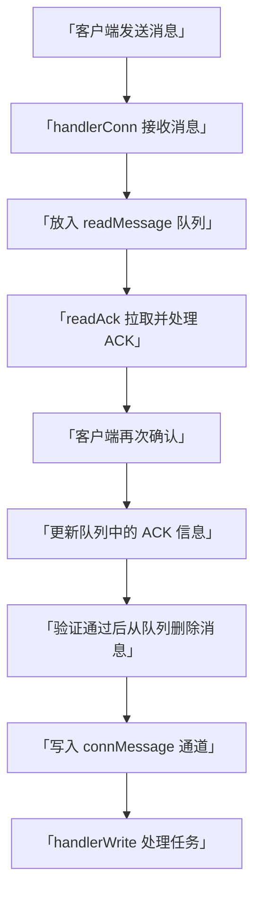

接下来使用消息收发的 ACK 机制。看图，这一图与前面的图有一些差异，主要在于此处把连接对象放进来了，并在里面分别记录了连接消息的队列及消息的通道，能够更加细节化地分析代码的执行与整体的业务执行。

先看第一条。这一条属于没有使用 ACK 机制时的执行方式：客户端向服务端发送消息，服务端中的 handlerConn 接收消息，因为没有 ACK 的确认关系，handlerConn 会直接通过连接的通道把消息发送给 handlerWrite。这是没有进行 ACK 确认时的流程。

在有 ACK 确认的时候，会进行下面的流程：首先客户端把消息的 id、消息体及消息序号发送给服务端，服务端接收消息之后，把消息放到连接的队列中。读取 ACK 确认机制的 readAck 从队列中拉取一条新的消息，比如刚记录的消息就会被它拉取出来，然后进行 ACK 的处理。处理完成，把消息发送给客户端，客户端接收之后又会将消息再进行一次确认，再把消息发送给服务端，服务端又再一次进入这个队列中，但这一次记录有点不同：它还会去更新 ACK 的信息。此时在 readAck 中，它就能收到第一次发送的 ACK、自己更新后的 ACK 及客户端再一次发送的 ACK，三个消息都得到了，就能验证出来。三个都合理，ACK 确认通过，就会将消息从队列中删除，它已经确定可靠，从队列中删除，把消息写入通道中，最后由 handlerWrite 处理当时的任务。

这就是更加细节化的具体做法。其中 handlerConn、readAck 和 handlerWrite 三者都是通过协程运行的。handlerConn 与 readAck 通过 readMessage 队列通讯；readAck 和 handlerWrite 通过 connMessage 这个通道通讯。

了解实际细节之后，接下来实现整体的 ACK 确认机制。从哪里着手？可以从 readAck 开始，因为此处是 readAck 处理的关键，它的数据来源于 readMessage 队列，由 handlerConn 进行新增。但新增的时候有一点细节要注意：第一种情况是里面没有这条消息，第二种是有消息的记录。所以在里面执行的时候，要验证消息是否存在：存在则更新 ACK，不存在则记录。

接下来实现这里。进到代码中，找到连接对象，肯定要在连接对象中处理，所以要修改连接对象。在连接对象中增加一个新的方法：进行读取队列，然后发送消息 message，做好写锁的处理，再释放锁。进到读的队列中，做一个 if 判断：判断之前是否在队列中已经存在消息。怎么判断？根据消息的 id 是最好的。这里没有定义消息 id，没关系，定义一个消息的 id 就有了。有了消息 id 之后，根据消息 id 查数据记录。如果真的有消息，说明已经有消息的记录，也就是消息已经有 Ack 的确认过程，先给它标记一下：这里是已经有 Ack 了；那么此处肯定是没有 Ack 的确认数据，是还没有进行 Ack 的确认。因此下面的这里要这么写：在此处可以先判断一下当前的类型，看有没有可能它还会重复发送 Ack 的确认消息，队列中没有了，但它是否还有可能重复发送？有可能。所以此处再做一次避免：避免客户端重复发送多余的 Ack 消息。

重点是后面：记录消息，将消息记录到队列中，记录之后再记录好 Ack 的序号，这个序号一定要记录好。此处应该怎么处理？也可以在此做一次判断，判断当前验证的是序号中有没有记录。但有没有可能队列中已经不存在这个消息了？有可能。所以还可以简单地判断一下：队列中没有该消息，因为队列中已经没有记录了，就可以进行执行。接下来是正常的情况，它是有消息的。

在有消息的情况下，要考虑的是：最新的这条消息中的 Ack 序号（AckSeq）一定大于当前系统记录的 Ack 序号。为什么要注意这一条？因为在流程中，Ack 其实就是对当前的序号做加一的动作处理，如果它比前面要小，或者等于前面的序号，就说明它没有进行 Ack 序号的更新。所以流程中要注意，此处应该做一个再判断：如果当前要记录的 Ack 序号大于或等于新的 Ack 序号，说明它没有进行 Ack 确认，可以 return。但也可能是重复发送，所以它有两种情况：一种是没有进行 Ack 确认，第二种是重复了。都没问题之后，最后只需要进行序号的更新即可，其实就是更新最新的消息。

此处就完成了对消息队列的新增。完成之后，对于整体流程来说，handlerWrite 相对更简单，因为没有进行 Ack 的时候，它就是将消息传递给通道进行通讯，关键因素在于这个通道。接下来完成 handlerWrite。

完成 handlerWrite 要进到 server 的构造中，方法其实已经定义了。在里面会得到一个连接对象，然后通过 for select 来进行。先在第一个分支中判断当前连接是不是已经关闭了，关闭了就 return。第二个分支是存在最新的消息，最新消息通过连接的通道来得到，再根据消息来进行处理，处理就是这一段内容，复制一下，下面没有太多的更改。处理完之后进行最后的处理，消息更新完了，handlerWrite 就写好了。

怎么让它运行起来？可以把它放到这里，通过写一个协程给它运行起来，此处就是处理任务，没问题了。

还有一个小细节要注意：readMessage 队列的新增是有了，那么删除在哪里比较合适？在任务处理完成之后去删除更合适。目前 handlerWrite 已经写好了，并且在这里调用了。

接下来再优化一下。流程中，可以先通过代码 handler 中的参数及 ack 的模式判断当前是不是启动了 ack：如果它启动了 ack，并且需要的类型不等于 NoAck，那就需要 ack 的确认。在里面调用连接中的方法，把消息放到队列中，进行 ack 的确认；倘若不进行 ack，就把消息直接传递到通道中。

handlerWrite 写好之后，接下来要判断当前是不是要进行 ack。定义一个方法，专门验证是否进行 ack，传入消息。在判断中：当前 ack 模式不等于 NoAck，并且消息的帧类型不等于不进行 ack 的格式（FrameNoAck），就进行有效的判断，再进行 ack match 的判断。如果它返回 true，就是要进行 ack；否则不进行 ack，将这个消息交给任务处理。这是关于 ack 的判断。

再增加一个 info 日志，描述当前消息需要进行 ack，打印它所发送的消息内容。此处就完成了。

在 ack 的这个方法中应该传什么参数？一样把连接传进来。运行时判断是不是开启 ack：如果是开启的，就要进行 ack 的机制，做这样的判断。

可以对这个方法再做一个调整：当前 message 队列要等待，为空就直接判断它的 ack 机制是不是严格模式，持续更改。

在 readAck 中怎么写内容？里面只需要考虑两种：第一种是应答只进行一次；第二种是要进行两次的情况。不进行的情况其实已经不用处理了，因为上面直接就通过通道过来了。所以只需要考虑进行一次应答还是两次应答。第二，它对队列中的消息读取时，每次都只读取第一条数据，按照顺序来进行 ack 确认。

现在编写代码。它肯定是一个协程的事情，然后判断连接是不是关闭，连接关闭了，就关闭消息的 ack 机制。第二，还要给它一个默认的分支，因为此项是一个阻塞，有个默认分支，默认就往后走。

现在它需要做的事情，是从队列中读取新的消息。怎么读取？先开启锁机制，判断当前队列中是不是存在消息：不存在可以跳过去；等于 0，没有消息，就释放锁，结束当前的执行。但结束的时候注意一下，增加一点点睡眠。为什么要增加睡眠？主要是让任务更好地切换。

这是消息为空时的处理。但还是需要读取消息，不为空就读取第一条消息，所以它永远只会读取第一条消息，要按照顺序来，只能读取第一条。从中获取第一条消息之后，接下来判断 Ack 的方式，用 switch。方式一只进行一次性的应答；方式二是严格模式，需要双方再进行确认。一共两种模式。

在里面怎么写？先写只进行一次的：只需要直接给客户端回复，回复完之后就可以直接进行任务的编写。所以它只需要直接进行一次性的发送，发送一条最新的 Ack 的消息。发送的类型是 Ack 的类型；其次是消息的 id，要决定好；即消息的 Ack 序列号，要进行加一，其他可以不用动。此处就完成了 Ack 的消息发送。

注意，发送之后就标记了这是 Ack 的，此时只需要进行业务处理。业务处理中它要做什么？首先将消息从队列中移除，因为已经确定 Ack 确认完了，把消息从队列中移除。移除之后就可以释放锁，然后再进行业务的处理。为什么释放锁之后就可以这么做？因为此处已经得到了结果，不影响。

这只是应答的一种情况。如果是严格模式，就是需要先回，然后再验证，它会有两个过程。什么时候去回？当 Ack 的确认是为 0 的时候，它还没有进行任何的确认，在没有确认的情况下就可以去给它发送消息。所以此处要对 Ack 中的消息进行加一，这是第一要做的事情；第二，记录好时间，记录好当前要发送的时间。此处让它做的事情就是：已经对消息进行了确认，记录好确认的时间，再进行发送。发送还是上面的代码，把重发次数还有序号也带上，因为已经加一了。完成发送，再释放掉锁，记录当前的发送时间。消息 Ack 在严格模式下，注意是严格模式，把它的发送内容、序列号以及发送时间这三个信息记录下来，方便后期调试。

三个信息就记录好了。记录完成，要注意此处是一条分支，所以跳过了，后面就不能进行了。

如果接收的消息 Ack 不为 0，即此处它已经回复了结果，又进行了确认，那么此处就要进行验证。验证的时候会有哪几种情况？情况一是客户端回复了结果，即客户端已经再一次确认；还有一种情况是客户端没有确认，有可能。因此要考虑是否超过了最大时间，超过了 Ack 的确认时间，如果超过了就结束；未超过，是不是可以给它再发送一次消息？也可以。所以要根据实际情况判断：第一种情况是未超过，重新发送；另一种情况是已经超过了。
