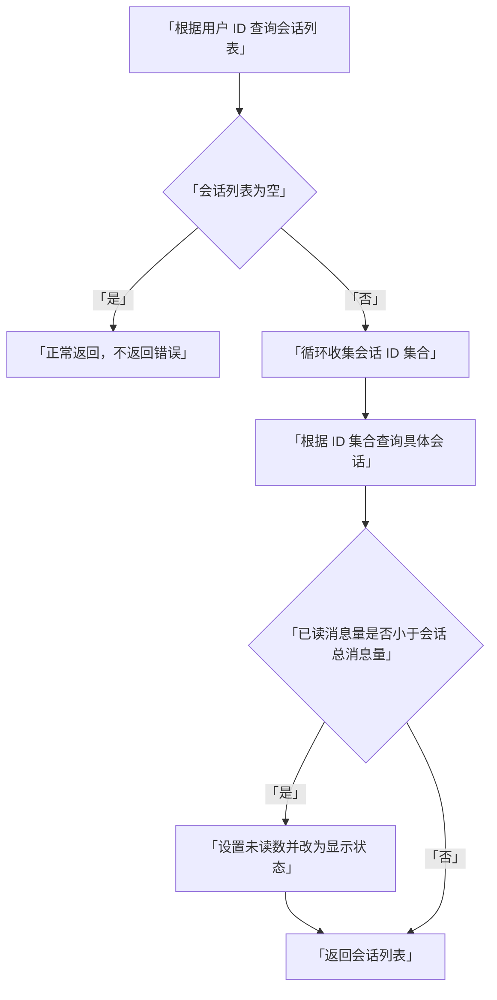

在业务中先获取消息的记录。消息记录的查询方式可以有两种：第一种根据消息 ID，这个方法本身就是获取消息记录的，如果传递的是消息的 ID，查询某一条消息，理论上也要支持；第二种则根据前面所讲的，按时间段来分段查询。理论上会有两种方式，Logic 的初始化如下：

```go
        func NewGetChatLogic(ctx context.Context, svcCtx *svc.ServiceContext) *GetChatLogic {
            return &GetChatLogic{
                ctx: ctx,
                svcCtx: svcCtx,
                Logger: logx.WithContext(ctx),
            }
        }
```

然后通过一个业务判断，判断传参中的 Message ID 是否有传递进来。不为空，就证明是查询某一条消息，此处根据传进来的消息，采用 FindOne 的方式，传递对应参数，做好错误处理，把数据库查询的错误、错误的描述、查询条件都输出出去，再把结果返回出去：

```go
        func (l *GetChatLogic) GetChatLog(in *im.GetChatLogReq, out *im.GetChatLogResp, err error) {
            if in.MsgId != 「」 {
                chatLog, err := l.svcCtx.ChatlogModel.FindOne(l.ctx, in.MsgId)
                if err != nil {
                    return nil, errors.Wrap(xerr.NewDBErr(), format: 「find chatlog by msgid err %v, req %v」, err, in.MsgId)
                }
                return &im.GetChatLogResp{ChatLog: chatLog}, nil
            }
            // ... 其他逻辑
        }
```

在结果中它是一个切片，因此定义一个切片返回出去。内容中把所有的字段编写好，最后一个字段先删除，目前还不用，这一点改为 int32。第一个查询的内容就写好了，根据 ID 查询整体来说并不复杂。

第二段就是根据查询的条件来进行查询，即根据查询的时间配合 ID 来查询：第一个参数是会话 ID，第二个是起始时间，第三个是结束时间，即分页。做异常处理，异常处理完之后再做数据处理。这里会得到一个 Data 的集合，给出所有的消息，就要把它输出出去。它肯定要和这个结构挂钩起来，用这个变量接收该集合，把结果填写上去，或者这一段内容，更改一下变量名，之后再返回出去。第一个业务就写好了，即获取消息。

写好之后，接下来是获取会话列表。获取会话相对来说会有点点复杂。它的主要业务是：首先根据用户查询用户的会话列表：

```go
        func (l *GetConversationsLogic) GetConversations(in *im.GetConversationsReq, out *im.GetConversationsResp, err error) {
            data, err := l.svcCtx.ConversationsModel.FindByUserId(l.ctx, in.UserId)
            if err != nil {
                return nil, errors.Wrap(xerr.NewDBErr(), format: 「ConversationsModel.FindByUserId err %v, req %v」, err, in.UserId)
            }
            // ... 处理数据并返回
        }
```

得到自己的会话列表之后，接下来根据会话列表要做什么事情，查询具体的会话，在这一段内容里面计算是否存在已读、存在未读的消息。接下来完善它的具体业务。

第一段获取会话，根据用户的会话列表来进行查询，做异常处理。得到数据之后，处理时还有一个小细节：它自己的会话列表可能为空，它本身还没有和任何人创建会话，有可能。所以还要处理这个查询数据为空的情况，它理论上是一种正常的情况，所以不返回错误。

得到会话列表之后，接下来获取相关的具体会话。获取具体会话前，先对这些会话做一点处理：返回的数据中相关字段基本上与它一致，可以先做一点处理，把数据复制好：

```go
        var res im.GetConversationsResp
        copier.Copy(&res, &data)
        // ... 转换为 Protobuf 格式
```

再复制一下，接下来查询会话列表，它主要是根据 ID 集合去查询的。定义一个 ID 集合，通过循环将所有的 ID 都填进去，填它们各自的会话 ID，这一段就能得到一个 ID 集合的列表。再根据 ID 集合列表查询会话，先用这个方法查询对应的会话，做好异常处理。得到会话列表之后，第三步就要计算是否存在已读或者未读的。

迭代的对象选择了会话列表。之所以选择会话列表，因为上面这一段本身是一个 MAP 集合，直接根据它的 key 就可以查询到对应具体的会话，所以此处采用这个切片去迭代。迭代的时候先把它取出来，迭代到的会话有可能为空，所以此处做一个判断。不为空的话，接下来就要计算了。

首先得到原本的用户已经读取的总的消息量，这是用户读取的消息量。得到之后再判断：用户读取的消息量是否小于会话的实际消息量。如果小于，说明有新的消息没有被用户读取到，可以称之为离线消息。此时就要告诉他实际总的消息量有多少，重新设置这一个总的消息量。注意，这里设置总消息量只是去写，不会更新数据库，只是告诉前端这个事情，同时告诉前端有多少消息是未读的。此处还有个字段叫 toRead，即未读数，它根据总的消息量减去用户已读的消息量，等于未读。之后更改目前的状态为显示的状态，也就是当前的会话。之所以有这个动作，是因为可能有些用户把自己的聊天会话删除了，设置为隐藏的状态；如果已经有新的消息，就把它设置为显示状态。之后把结果返回出去即可。

到此，获取会话就完成了，一共分为三个过程。



接下来去更新会话，也不难。在业务中主要是更新消息序号、已读量和显示问题。这个方法怎么触发？是定时的，也可以说是在用户操作的时候，这里定义为定时的。定时的情况下，用户端会推送一个集合。回到这里，这里就是更新会话。更新会话中，先要查询用户的会话列表。此处要将其删掉，因为它不可能为空，用户在更新的时候，其实已经和目标建立了会话，无论是主动还是被动都会建立。所以将这项判空删除：建立用户会话的时候，两者之间都会有对应的会话记录列表，它不可能不存在。接下来要判断，可能存在会话但会话列表可能为空，所以给它一个初始化的动作，把会话初始化出来，再去设置其值。

设置其值也很简单：它虽然说传递的是一个集合，但它是一个 MAP 集合，key 肯定是会话 ID，所以只设置它的值。同时先记录历史的已读消息，如果用户最早的时候这个会话已经读取的消息量有记录，即存在会话，就记录用户最早读取的消息量。再把结果设置进去：会话 ID 以及消息的读取类型。再往下是消息类型，此处是已读消息量，它的计算应该是 int：传递的已读记录加上原本读取的量，就是实际用户读取的量。后面的字段就不用设置了。到此就完成了，只需要往下更新就可以了。
