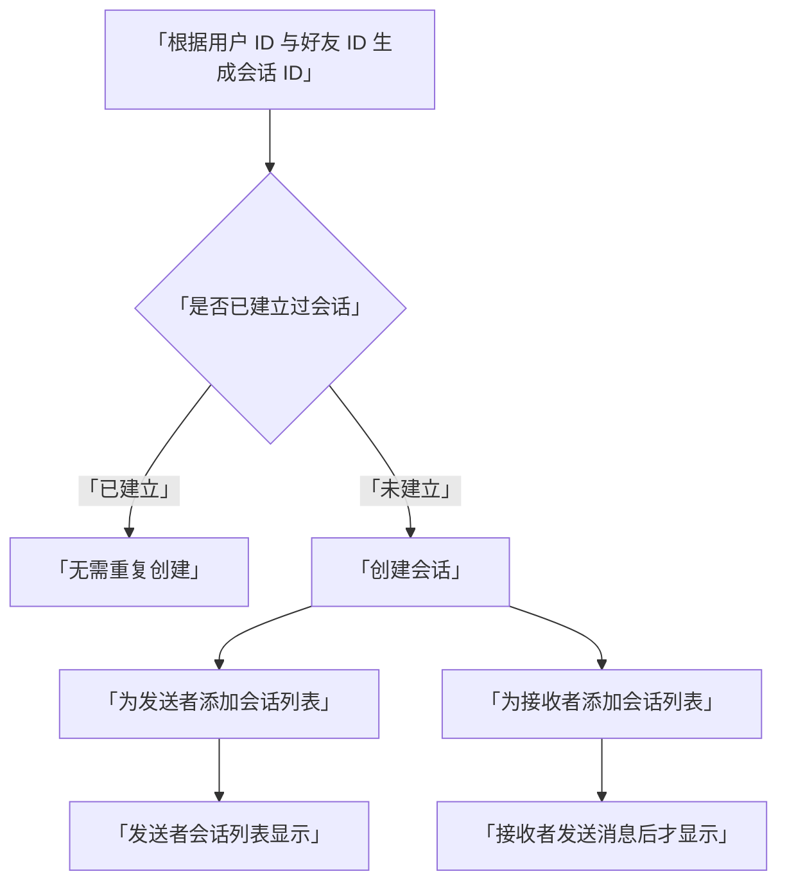

再做一下错误的处理，一个会话的更新就写好了。接下来去建立会话。会话的建立并不难，主要区分它的类型：类型分为群聊与私聊，这一点需要注意，对应的类型常量如下：

```go
    const (
        SingleChatType iota + 1
        GroupChatType iota + 1
        MType iota + 1
    )
```

目前的课程中只有私聊，所以先实现私聊的会话建立。

会话建立的时候会有什么业务？第一步是生成会话的 ID，根据用户 ID 与好友 ID 来生成。生成之后，接下来建立两者的会话。建立前肯定要验证一下这个会话之前是否建立过：如果没有建立，就去建立好会话；如果已经建立了，说明两者之间已经存在会话关系，理论上就可以结束了。所以要做如下判断。

接下来写代码，首先是 Logic 的初始化：

```go
    func NewSetupUserConversationLogic(ctx context.Context, svcCtx *svc.ServiceContext) *SetupUserConversationLogic {
        return &SetupUserConversationLogic{
            ctx: ctx,
            svcCtx: svcCtx,
            Logger: logx.WithContext(ctx),
        }
    }
```

第一步是得到会话的 ID，根据用户 ID，用所提供的会话方法来生成即可。生成之后，再根据这个 ID 查询是否存在对应的会话记录，验证一下错误。没有错误其实已经查询成功了，但最好的判断是判断返回的结果是否不等于空：不等于空，说明会话已经建立过，不需要重复建立；没有建立，自然就需要建立会话。因此判断的时候，还需要判断当前的错误类型是否等于一个空的错误，等于这个空的错误，说明没有建立会话，此处就建立会话。接下来是会话中的消息，其他不用完善。到此就是建立一个会话，处理一下错误。此处已经完成了会话的建立，完整的建立会话逻辑如下：

```go
    func (l *SetupUserConversationLogic) SetupUserConversation(in *in.SetupUserConversationReq) (*out.SetupUserConversationResp, error) {
        switch constants.ChatType(in.ChatType) {
        case constants.SingleChatType:
            conversationId := muid.CombineId(in.SendId, in.RecvId)
            conversationRes, err := l.svcCtx.ConversationsModel.FindOne(l.ctx, conversationId)
            if err != nil {
                return nil, errors.Wrap(xerr.NewDBErr(), format: 「ConversationsModel.FindOne err %v, req %v」, err, req)
            } else if conversationRes != nil {
                return nil, nil // 会话已存在，无需重复创建
            }
            // 创建会话的逻辑
            conversations.ConversationList[conversationId] = &immodels.Conversation{
                ConversationId: conversationId,
                ChatType: constants.SingleChatType,
                IsShow: isShow,
            }
            err = l.svcCtx.ConversationsModel.Update(l.ctx, conversations)
            if err != nil {
                return nil, errors.Wrap(xerr.NewDBErr(), format: 「ConversationsModel.Update err %v, req %v」, err, req)
            }
            return &out.SetupUserConversationResp{}, nil
        }
    }
```

另外对刚才的这个分支，再做一下其他错误的处理。

会话已经建立完成，再建立两者与会话之间的关系，也就是需要在这一个模型中分别为两者添加对应的会话列表。这个过程把它封装一下，因为在群聊中它也需要记录。这里涉及的数据模型结构如下：

```go
    type Conversations struct {
        ID        primitive.ObjectID `bson:"_id,omitempty" json:"id,omitempty"`
        UserId    string             `bson:"userId" json:"userId"`
        ConversationList map[string]*immodels.Conversation `bson:"conversationList"`
    }

    type Conversation struct {
        ID        primitive.ObjectID `bson:"_id,omitempty" json:"id,omitempty"`
        UserId    string             `bson:"userId" json:"userId"`
        ConversationId string        `bson:"conversationId,omitempty" json:"conversationId"`
        ChatType   constants.ChatType `bson:"chatType,omitempty" json:"chatType"`
        IsShow     bool              `bson:"isShow,omitempty" json:"isShow"`
        Total      int               `bson:"total,omitempty" json:"total"`
        Seq        int64             `bson:"seq,omitempty" json:"seq"`
        Msg         *ChatLog         `bson:"msg,omitempty" json:"msg"`
        UpdateAt   time.Time         `bson:"updateAt,omitempty" json:"updateAt"`
        CreateAt   time.Time         `bson:"createAt,omitempty" json:"createAt"`
    }
```

在这个方法中传递什么参数？首先第一是会话的 ID，然后是用户 ID 及目标 ID，这里选择接收者 ID。这是必传的三个重要参数。除了这三个以外，还有聊天类型，这个也肯定是需要的，以及是否显示。总共就这么几个参数，根据这几个参数为双方建立会话。

首先会得到一个会话信息，即用户的会话列表，根据 ID 查询，将异常返回出去。但这里的异常还有一种情况，就是它为空，这种情况也可能。为空的时候，理应也要创建对应的会话。这是用户会话列表的 ID，然后是用户。这一步是创建用户的会话列表，然后再更新会话记录。此处更新会话记录，就是根据上面的条件去新增一个会话。新增前可以先判断一下是否有过该记录，根据会话的 ID 来判断：存在就证明已经有了，不需要重新建立，直接 return；再建立、添加会话记录，执行更新，做好异常的处理。

值得注意的是，这里是在更新，需要做一下设置：新增的这个会话可能不存在记录，所以实际上需要设置它的 option，让它在不存在的时候也能够新增，存在就更新，不存在就新增。要设置这么一个操作，这是需要注意的。更改一下修改的值，这里设置为 true，此处修改为 upsert。到此就可以了。

再回到代码中，继续引用。在引用中，需要根据发送者和接收者分别做一个事情：建立两者之间的会话。如果要建立的对象是用户本身，即他点击了某一个用户的头像，此时那个用户应该在他的会话列表里面展示为一个显示的状态。所以此处增加了一个传递：传递是否显示。这样就可以显示出来，这个用户应该在会话列表中展示。但作为被动的目标要不要展示？不需要。因为我是被动的，因你而去建立会话的，但你还没给我发消息，为什么要展示出来，是这么一个逻辑。这是需要记得注意的地方，所以这里会传递这两个参数。


