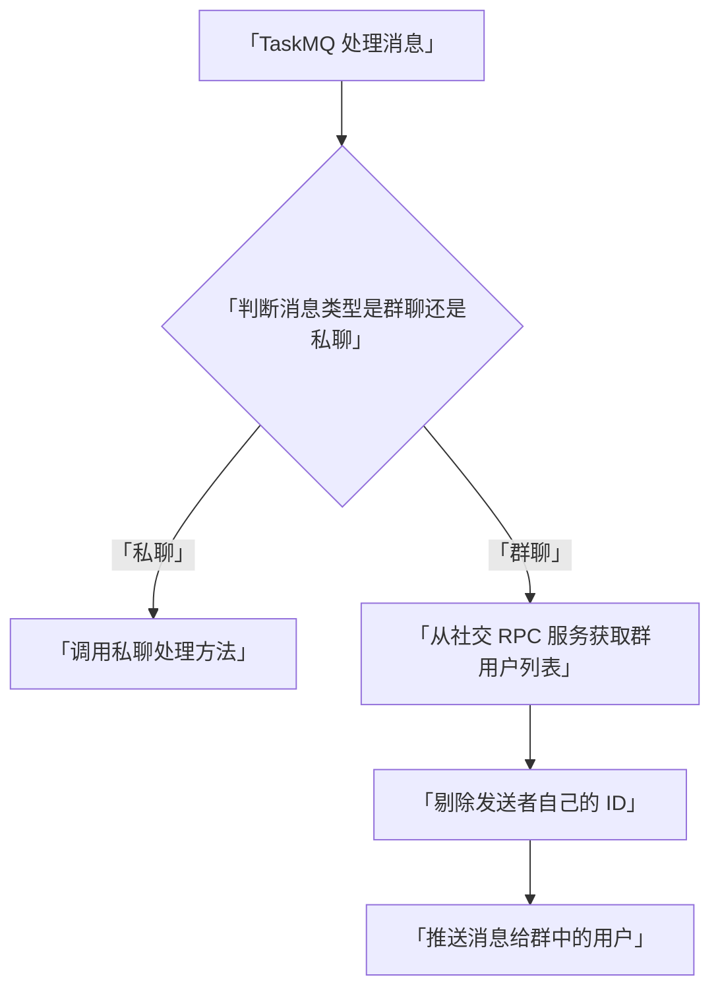

前面已经对用户与群的聊天功能有了基本理解，本节实现用户的群聊功能。内容主要分三个部分：先创建群聊的会话，也包含用户与群的会话关系；然后实现 WebSocket 的并发发送，因为一个群的消息发送对象很多，通过并发方式传输消息更合适；第三，对消息队列进行处理，增加对群聊功能的支持。

首先是群聊的创建。创建群聊主要涉及两个环节：一是创建群的时候，会创建群的会话，同时记录群与用户的会话关系；二是用户加群时，也会记录用户与群的会话关系。核心功能就在这两处。

接下来完成用户群聊的创建。在 IM 的 RPC 服务中，proto 已经定义了群聊创建的方法，对应的逻辑在 creategroupconversationlogic.go 的 CreateGroupConversationLogic 中。方法要求传递两个参数：第一个是群 ID，第二个是创建者的 ID。

现在来完成它的业务。先定义一个返回结果的变量。方法中首先要验证群的会话是否已存在，只需判断错误：如果错误为空，说明能查到数据，直接返回；如果有错误，再判断错误类型，如果它不等于数据为空的错误，说明是其他错误类型，做错误处理并记录错误信息。这样就完成了对群会话的验证。验证确定没有会话之后，就要添加该群的会话。会话中主要添加两个字段：一是会话 ID，群的会话 ID 就是群本身自己的 ID；二是类型，即会话类型，当前选择群的会话类型。再做异常处理，一个群的会话就创建好了。

但业务还没有完成，因为只创建了群的会话，还没有对创建者记录他的群会话，也就是在创建的会话列表中要记录该群的会话记录。所以还需要设置用户的会话列表。这里已经定义了对用户会话列表的设置方法，直接调用 IM 业务设置用户的会话并传递参数即可。参数列表中总共有三个字段：发送者，即创建者的用户 ID；接收者，即群 ID；以及聊天类型。它会返回异常及响应的结果，到此群的创建会话就完成了。

再去完成这个设置的方法，让它能够支持群会话的建立，也就是更新用户群会话列表的增加。处理很简单，就是对用户群会话列表的赋值：会话 ID 是接收者，因为接收者就是群 ID，群 ID 就作为会话 ID；用户是发送者，目标群 ID，类型为群的聊天类型。这样就完成了用户与群会话的建立。

关于更新及获取离线消息，两者没有什么特别的区别，不需要额外处理。

接下来是 WebSocket 的并发发送。之所以要考虑并发发送，是因为一个群的用户很多，支持消息的并发发送是有必要的。回到代码，进入 server 的 Options，在其中定义一个变量，作用是指定并发的量级：既然要并发地发送消息，就需要指定并发的量级，如果不指定，则可以随意填写。为这个属性值提供默认值，在创建的时候设置好默认值，一个 Option 的配置信息就定好了。

回到 server 中，需要支持并发的发送。这里可以使用 go-zero 提供的一个扩展：在它的核心功能组织中有一个针对并发处理的包，里面有一个 Task 对象，是任务处理的核心对象，它内部并发地执行某一项任务，方法中传递的就是要执行的任务，其处理是通过 Channel 的方式来控制的，可以直接使用它来并发地发送消息。

回到 server，引入刚刚提到的对象进行创建。创建完之后，再回到消息结构中，对推送也要做一个处理，推送时要考虑多个用户的接收。消息传输的结构体 MsgChatTransfer 中定义了 ConversationId、ChatType、SendId、RecvId、SendTime 和 Content 等字段。到这里 WebSocket 基本处理完毕，接下来完成它的业务。

目前只处理了私聊，现在让其增加对群聊的支持。先封装一个处理私聊的方法，方法中传递要发送的数据以及接收者的 ID，可能返回异常。方法内容就是上面发送私聊的那段逻辑，复制过来返回，并对发送时出现的异常做一点处理。然后在其上定义一个 switch，通过 switch 处理私聊与群聊的发送：私聊调用私聊的方法，发送值从 data 中获取。私聊就处理好了。

私聊处理好之后处理群聊，再定义一个处理群聊的方法，传入要发送的数据。群聊本质上还是属于私聊，只是一个一个地向用户发送，所以通过迭代数据中指定的要发送的用户，再利用并发的方式给这些用户发送消息。定义一个方法让它并发地调用，把 ID 传进去，本质还是调用私聊的处理，注意发送的 ID，这样就完成了。然后在其上调用该方法，用户群聊、私聊的推送就都完成了。

再进入会话中完成对群聊的支持。群聊与私聊在将消息推送给消息队列这一步，本质上只有一处存在区别，其他信息没有区别。所以把这段挪出来，在其上判断当前的会话 ID：如果数据中传递了会话 ID，直接发送；如果没有传递，则根据聊天类型分别创建会话 ID。会话 ID 存在两个参数，一个是发送者的 ID，第二个是接收者的 ID。发送者的 ID 可能没传递，从连接中获取，而群的会话 ID 其实就是接收者。这样异步消息的推送就处理好了。

最后针对消息队列做群聊的支持。打开 TaskMQ，在 Task 中主要是在原有基础上增加对群聊的支持：先判断当前的消息类型是群聊还是私聊，再分别处理。此处显然属于私聊，针对私聊定义一个方法，方法中传递聊天的数据再发送，往上调用私聊的处理。重点在群聊：添加一个群聊处理的方法，传递 Data 参数，除 Data 外还传递 ctx，返回异常。方法中要查询群的用户，把这些用户处理一下，推送给对应的服务。这些用户不是从数据库中读，而是从社交 RPC 服务中获取。社交 RPC 服务提供了获取群用户列表的方法，调用该 RPC 方法就可以获取群中的用户。

进入 ServiceContext，增加对社交 RPC 服务的支持。先处理配置，将社交 RPC 服务的配置复制过来定义好，在 Config 中增加对该配置的支持。回到 ServiceContext，创建社交 RPC 服务的客户端，把配置信息传递进去。创建完成之后调用该方法获取群中的用户，传递群 ID 参数，群 ID 从 data 中获取。再定义一个接收者的数组类型，对 data 进行处理，在 data 中增加对多个接收者的支持，然后迭代，就能遍历所有的用户。

判断当前要发送的用户是否是他自己，不能给自己再推送一次，所以过滤一下，把他自己的 ID 剔除，添加其余 ID。然后推送，还是上面那段方法，没有其他调整，因为 data 中已经定义了多个用户的接收。在其上调用，就能支持群聊了。

消息队列中群聊消息的处理流程如下：

功能实现之后就要测试。测试中已经提前创建了一个群，并在群中添加了相关的用户，也为每个用户定义了 token，可以直接登录。先让用户加入群聊的会话：选择一个群，先创建群会话，传入群 ID 和创建者的 ID 执行。把 token 贴上，调用地址。执行中出现异常，异常是数据库错误。检查代码，发现这里判断异常写错了，应该是判断它不为空才对。重启服务重新测试。重启后进到数据库，其实上一次已经新增成功了，将其删除重新执行，这次没有问题，可以看到新增了一个会话，同时也为该会话增加了对群的会话记录。再去添加其他用户对群会话的记录：复制发送者的 ID 逐一调用，均没有错误。再查数据，已经增加了对该群的会话记录。

接下来测试聊天，建立多个会话的连接，重点验证发送一个消息之后其他会话能否接收到。当前的消息类型属于聊天，需要更改一下；接收者改为群 ID，发送。发送完成后查看其他会话，发现没有接收到。分析代码中哪些环节可能存在异常：消息是通过 WebSocket 推送的，im-server 打印的信息显示接收者是群的 ID，会话 ID 也是群的，说明此处没问题；消息的记录也没问题。那么问题可能出在推送上，具体是在 push 这里，因为当前使用的是 data 的接收，而不是这个接收者。重新启动服务，让所有用户重新建立连接，发送消息，现在可以看到接收的消息了，说明群聊没有问题，整体功能已经实现。

本章课程的重点是实现群聊，实现时注意细节即可，整体并不是很难。
