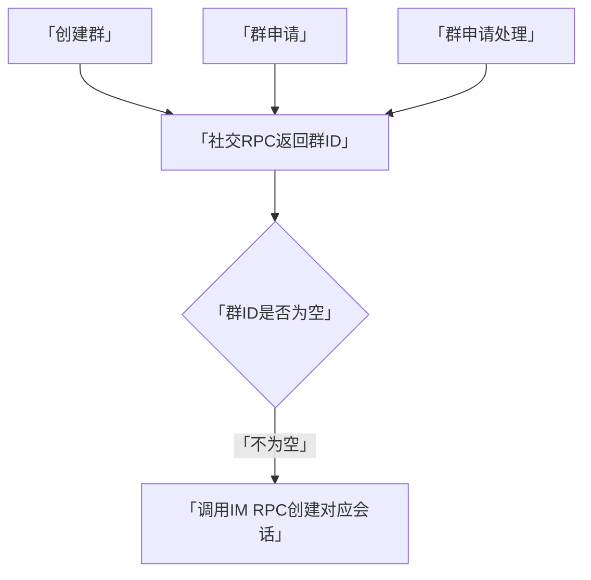

IM 的群聊功能已经实现，本节针对群聊进一步完善相关业务。先回顾相关流程，并在社交服务中添加 IM 的群聊业务。

先回顾流程。前面已经实现了用户与群的会话建立，可以在创建群时添加会话，也可以在进群时添加会话。但这两个动作是在 IM 的 RPC 服务中实现的。RPC 服务里完成了创建群聊的会话以及设置用户与群的会话，设置用户与群会话的逻辑如下：

```go
func (l *SetUpUserConversationLogic) SetUpUserConversation(in *types.SetUpUserConversationReq, out *types.SetUpUserConversationResp, err error) {
    var res types.SetUpUserConversationResp
    switch constants.ChatType(in.ChatType) {
    case constants.SingleChatType:
        // 单聊逻辑
    case constants.GroupChatType:
        err = l.SetUpUserConversation(in.RecvId, in.SendId, in.RecvId, constants.GroupChatType, isShow: true)
        if err != nil {
            return res, nil
        }
    }
    return res, nil
}
```

这两个 RPC 的功能虽然实现了，但存在一个问题：这两个方法在哪里触发？触发动作发生在创建群和加群的时候，而这两个动作是在社交 API 服务中调用的。所以需要在社交 API 服务中，在触发这两个动作的同时调用 IM 的 RPC 服务去创建相应的会话。现在要做的事情，就是在社交 API 服务中添加对群会话的记录。

进入社交 RPC 服务，它的方法中提供了创建群、群申请、群申请处理三个方法（群申请又包含群申请的方法及群申请处理，所以实际是三个）。分别看这三个方法的返回结果：创建群会返回群 ID；群申请也会返回群 ID；群申请处理同样返回群 ID。也就是说，创建群、群申请及群申请处理这三个动作处理完之后，最终都会返回群的 ID。

再确认 RPC 服务的业务是否如此。先看创建群：此处并没有返回群 ID，所以在这里增加对群 ID 的返回，ID 用上边这个。再看群申请：申请通过之后会返回群的 ID，这个没问题。而群申请处理中，最后确实没有返回群的 ID，所以也做一个处理：如果是拒绝的（不通过）就直接返回；如果是通过的，就返回得到的群的 ID。

社交 RPC 服务处理完成之后，进入社交 API 服务。API 的业务主要落在创建群、群申请及申请群处理这三个动作上，它们在成功之后会得到对应的 ID，得到 ID 之后就需要创建对应的会话。因此要增加对 RPC 服务的支持：更改配置文件，在配置文件中增加对 RPC 服务的支持；配置定义完之后，到 ServiceContext 中添加并创建对应的客户端。



现在完成业务。先看创建群：创建群的业务中会得到创建者的 ID，方法会返回 RPC 的结果，因此这次要接收 RPC 的结果，然后判断结果中的 ID 是否为空：为空则直接返回；不为空说明已经创建成功，需要建立会话，调用 IM 中创建群会话的方法，传入群 ID 和创建者 UID，接收返回的结果和异常。创建群的逻辑代码如下：

```go
func (l *CreateGroupLogic) CreateGroup(req *types.GroupCreateReq, resp *types.GroupCreateResp, err error) {
    uid := ctxdata.GetUID(l.ctx)
    res, err := l.svcCtx.Social.GroupCreate(l.ctx, &socialclient.GroupCreateReq{
        Name: req.Name,
        Icon: req.Icon,
        CreatorUid: uid,
    })
    if err != nil {
        return nil, err
    }
    if res.Id == 「」 {
        return resp, nil, err
    }
    return resp, nil
}
```

再完成群申请的逻辑处理。同样接收 RPC 返回的结果，判断 ID 是否为空，不为空就建立对应的会话：发送者 ID 是 UID，接着是群 ID，类型为群类型（做类型转换）。群申请的逻辑代码如下：

```go
func (l *GroupPutInLogic) GroupPutIn(req *types.GroupPutInReq, resp *types.GroupPutInResp, err error) {
    uid := ctxdata.GetUID(l.ctx)
    res, err := l.svcCtx.Social.GroupPutIn(l.ctx, &socialclient.GroupPutInReq{
        GroupId: req.GroupId,
        ReqIds: req.ReqIds,
        ReqTime: req.ReqTime,
        JoinSource: int32(req.JoinSource),
    })
    if err != nil {
        return nil, err
    }
    err = l.svcCtx.Im.SetUpUserConversation(l.ctx, &imclient.SetUpUserConversationReq{
        SendId: uid,
        RecvId: res.GroupId,
        ChatType: int32(constants.GroupChatType),
    })
    if err != nil {
        return nil, err
    }
    return res, nil
}
```

申请群处理的过程与群申请一致，同样得到 UID 后建立会话。这样社交服务就支持了对 IM 业务的调用。

启动服务进行测试。先启动 IM 的 RPC 服务，再启动社交 RPC 服务。注意：要关闭本地已启动的社交 RPC 服务，否则会影响测试结果。然后再启动社交 API 服务。

进入测试。此处测试创建群的处理。先登录一个用户，没有问题；更改 API 请求地址，保存，发送创建群，没有问题。此时应该建立会话，检查是否建立：在数据库的 conversations 集合中可以看到有增加，说明这一项没问题。

再测试加群。加群要换一个用户，重新登录。然后加群，把群 ID 放进来，这里的群 ID 是 06，发送，没有问题。检查数据，记录没有变化，正常。另一个方法就不测试了，整体来说 IM 的群业务功能已经完善。
