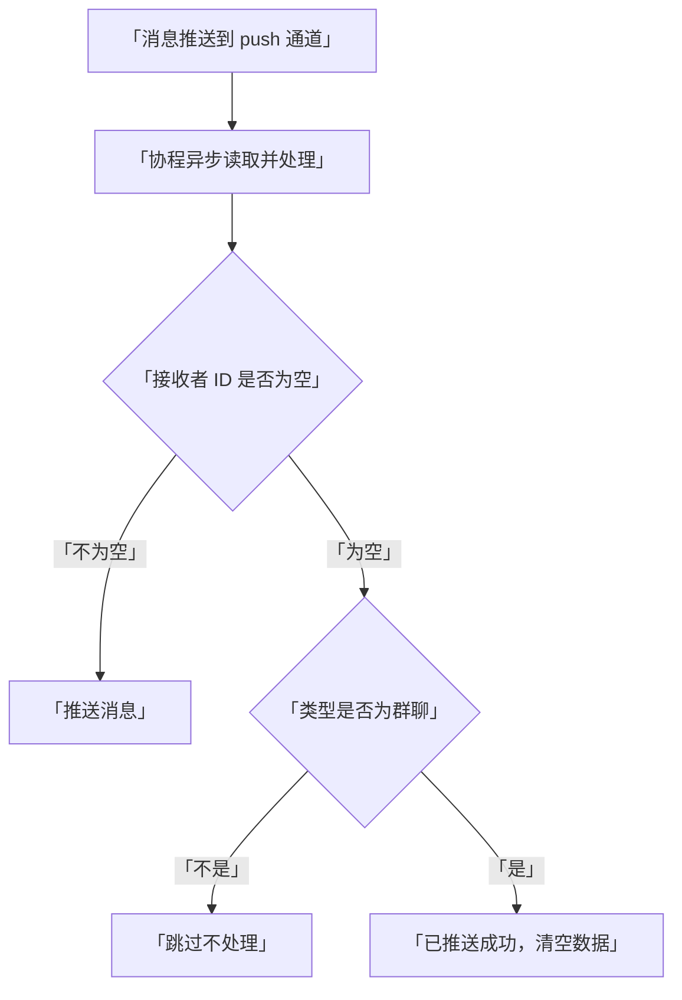

接下来具体实现这个合并。合并这一段业务如何编写？回到此处。因为合并属于群的操作，目前定义的这个对象就是属于群的：

    ```go
    type groupMsgRead struct {
        push    *ws.Push
        pushCh  chan *ws.Push
        count   int
        pushTime time.Time
        done    chan struct{}
    }
    ```

如果对它还不太理解，可以把它看成 IM 的连接对象，相当于定义这个连接对象中的心跳检测机制。理解了这一点，就知道它在当前的 Task 中、在 MessageReadyTransfer 中是一个怎样的角色：它相当于 WebSocket 中的连接对象，要编写的就是这个长连接。

接着完善它。定义一个方法，主要用于合并推送：得到推送的消息，加上锁（因为内部有并发的冲突问题），把消息记录下来，然后对消息进行合并。Key 就是 MessageReady，第二个是已读的记录，只需要迭代它，如果存在共同的消息，进行替换就可以了。为什么选择替换？因为这项已读记录的处理是在原有基础上做更改，所以只需要记录下来，这就是合并消息。

方法定义完之后，下面属于更新的部分暂时不动，而是处理下面这一段，它属于发送，把发送的信息提取出来：

    ```go
    func (m *MsgReadTransfer) UpdateChatLogRead(ctx context.Context, data *mq.MsgMarkRead) error {
        // 业务处理 — 更新
        readRecords, err := m.UpdateChatLogRead(ctx, &data)
        if err != nil {
            return err
        }
        // map[string]string
        return m.Transfer(ctx, data.ConversationId, data.ChatType, data.SendId, data.RecvId, data.ContentType, readRecords)
    }
    ```

提取完之后判断发送类型：如果为私聊，直接推送；如果是群聊，就不能直接推送，要判断是否开启合并消息的处理。

那要怎么推送呢？前面已经分析过它是异步执行的，既然是异步执行，就应该有一个协程来接收消息。所以理论上要在这个方法中增加一个协程处理的部分：先把消息推送给 push 通道，然后定义一个异步任务，用协程处理该事情，读取 push 中的内容。

里面可以做一些判断：比如 RecvId 不等于空（接收者 ID 不等于空），或者接收者 ID 列表不为空，就可以让它推送这个 push，并做异常处理。

如果不推送，则判断当前类型：如果它不为群聊（比如是单聊），说明类型可能有问题，不处理；消息类型属于不处理的类型，直接跳过。如果两个判断都没问题且接收者 ID 结果为空，这种情况下可能已经推送成功了，就要清空数据。当然也有可能推送之后没有问题，也会进入下面的环节，所以在此处清空数据。

异步协程对 push 通道消息的处理分支如下：



先判断当前这个数据是否在群中有记录。如果在群中有记录，并且要推送的内容为空，即它不处于活跃状态，那么定义一个 IsIdle 方法来判断是否处于空闲状态：

    ```go
    func (m *groupMsgRead) IsIdle() bool {
        m.mu.Lock()
        defer m.mu.Unlock()
        return m.isIdle
    }

    func (m *groupMsgRead) isIdle() bool {
        pushTime := m.pushTime
        val := GroupMsgReadRecordDelayTime * time.Since(pushTime)
        if val >= 0 && m.push == nil && m.count == 0 {
            return true
        }
        return false
    }
    ```

IsIdle 方法里的判断主要做这么个事情：先获取当前上一次推送的时间，再结合当前定义的超时时间，可以给它乘个 2，来计算。为什么要乘 2？因为可能刚刚到这个时间点还没来得及推送，由于阻塞的关系，给消费者再延长一定的时间，作为它检测的空闲时间。

结果在这个方法里判断：是否等于空闲状态，并且 push 内容是否为空、count 是否等于 0，这些条件都满足，说明它是空闲状态，否则就不是。此时不应该被删除，必须判断成空闲状态才可以，这一段就是在前面要判断的原因。如果为空，就要删除了。给它提供一个清理的方法，用于清理自己的内容：

    ```go
    func (m *groupMsgRead) clear() {
        select {
        case <-m.done:
            close(m.done)
        default:
            close(m.done)
        }
    }
    ```

这个分支有两个情况：一是它可能本身就已经关闭了；二是没有关闭，那么就关闭它，然后再设置这个空闲状态。接着用它的清理方法进行清理，再 delete 删除。

那这里怎么调用？可以在它创建的时候调用，也就是在 newGroupMsgRead 创建实例的地方调用：

    ```go
    func newGroupMsgRead(push *ws.Push, pushCh chan *ws.Push) *groupMsgRead {
        return &groupMsgRead{
            push:    push,
            pushCh:  pushCh,
            count:   0,
            pushTime: time.Now(),
            done:    make(chan struct{}),
        }
    }
    ```

注意要协程运行。这样的话，私聊通过这一段、基于下面的方法就可以完成处理，以后它也会进到这里面来发送。
