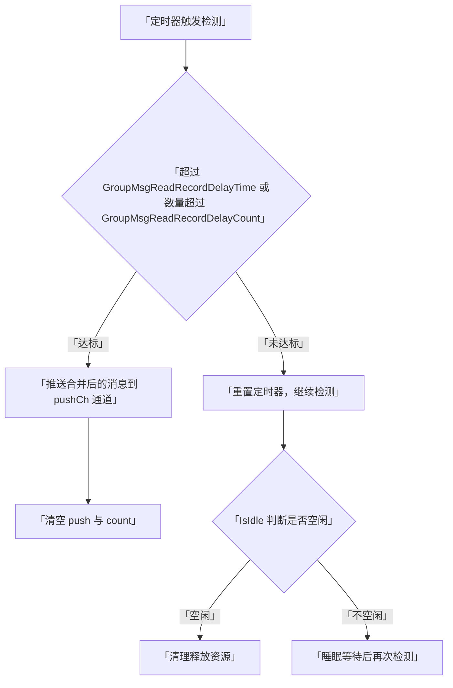

现在处理群聊，也就是下面这一段内容。首先还是判断当前这一段是否开启合并：如果不开启，push 就可以直接 push，没必要处理那么多额外的事务。

如果开启了，就不一样了。首先加锁，用完再释放锁。因为群聊消息是合并的，所以它的发送标识怎么统一呢？不清空也不填充。然后再判断：如果它在会话记录中存在，说明已经有消息，就要合并，把记录合并进去，再把 push 放进去；如果没有记录，就创建出来。创建好新的消息之后，再给它加一个 info 日志打印，标明属于合并消息。

接下来完成最后一个核心方法，合并之后的检查，这个方法比较关键，功能与之前在 WebSocket 中提到的那个心跳检测机制相似。检测中有两个核心：一是超时发送，二是超量发送，所以其实有两个发送的时机。

先定义定时器。定时器的时间取 GroupMsgReadRecordDelayTime 的一半，具体时间要看自己的业务，也可以在配置文件中对 MsgReadHandler.GroupMsgReadHandler 额外定制一个参数做检测，没有一定之规。

第一步增加一个退出的可能：done 通道结束的时候把它退出，这个不能少。然后是定时器被触发时的检测。检测时肯定要得到上一次推送的时间，再得到一个时间差，即 GroupMsgReadRecordDelayTime - time.Since(pushTime)，然后得到要推送的数据，这几个都需要。

先判断：当前还没有超时，并且数量没有超过最大的等待数量 GroupMsgReadRecordDelayCount，同时数据还是空的状态，那么不需要任何处理，继续往下检测，这属于未达标。通过这一段判断就证明达标了，就要推送：通过 m.pushCh <- push 把合并后的消息发送到通道，记录下新的时间（因为要推送了），然后设置 m.push = nil、m.count = 0，把数据清空，毕竟这一次的数据已经推送出去了。再增加一条日志输出：超过合并的条件，推送。

其他情况下做什么？也就是默认分支，同样加一把锁来保护共享资源。分支中主要判断数量是否符合要推送的量级 GroupMsgReadRecordDelayCount，如果是就推送出去。这就是默认时达到推送点后进行推送。

但如果它可能没有达到推送条件，还可以通过 IsIdle() 判断当前运行状态是否空闲，空闲的话就对它进行清理，释放资源。释放要找谁来释放？找到 MessageReadyTransfer，由它来释放。因为它有一个特殊的处理：群对象的创建是由它进行的，自然由它释放最好。此时只要向它发送消息，它会判断上面的流程不符合条件、往上走这两段判断也符合，进到这里判断会话存在且是空闲状态，就会调用 m.groupMsgs[push.ConversationId].clear() 去清空。所以在这里给它推送新的消息代表要释放资源，同时记录一下群的会话 ID，把会话 ID 传递好，此处就可以跳过。

如果会话记录不为空，要做什么处理？可以让它稍微睡眠等待一下，稍后再进行。定义一个临时的睡眠时间，以当前的时间来算，如果超过了 1 秒钟（上限），就把临时睡眠时间设为 1 秒。简单来说，睡眠时如果发现它都没有问题，就给它设置一个延迟的睡眠时间，让它缓一下。

到此，超时发送、超量发送这两个处理逻辑就写好了。合并检测的发送条件如下：

接下来测试。在 test 中查看配置。一开始测试时间可以设置得稍微长一些，这里选择 1 秒为单位的时间，即设置为 1 分钟：1 分钟内超过时间就发送，或者超过两条就发送。

还有一个小细节：在此处应该将数量改为 1，因为已经添加了一个消息，所以它应该是 1。

重启所有服务来测试。服务启动之后，进到 API POST，连接所有的客户端，发送一个消息。消息发送出去之后可以看到其他客户端没有接收到；稍微等待一点时间，也一直没有返回结果。为什么？因为代码里缺少了一个事情：未超标的时候要重置定时器。这就是问题原因，把定时器重置补上，就能解决问题。

这里也要重置定时器。先修改时间缩短一点，设置为两秒钟，重新启动。启动之后重新发送消息，定时器触发了，触发两次：第一次还是没有通过，第二次通过了。

再看发送的消息。这次连续发送两次：连续发送两次之后可以看到，它没有触发定时器，而是直接基于合并就发送了，说明没有问题，并且合并之后只有一条，不是两条。功能实现好了，程序得到了优化。

总体来说，本节的内容是实现群聊消息的优化处理，最重要的思想在于合并：把一定的数据信息合并起来再发送。这种情况在其他业务程序中也可能用到，学习此处时还有一个重点是理解这个思想，并运用这个思想在自己的项目中做优化。
