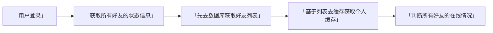

本节分析用户的在线和离线状态，从三个环节展开讨论：先理解用户在线离线的业务，再讨论用户的好友与群分别在在线和离线时是什么状态。

关于用户在线离线的业务：用户登录的时候，他的好友那边就可以看到该用户。如何分辨用户是否上线呢？主要看用户的头像，头像从灰色变为彩色，说明这个用户已经上线了；反过来，由彩色转为灰色，用户就离线了。这很容易理解。

再来看好友状态，主要有这几个点：第一，用户登录和退出的时候，他的状态要怎么处理。第二，用户登录的时候，他自己要获取自己全部好友的在线状态。第三，当用户 A 的好友 B 状态发生改变时，用户 A 如何知道。第三点和第一点最相似：自己离线、在线，对方需要知道我的状态；而我的好友离线、在线，我也需要知道好友的状态。如何获取，就是好友状态的主要问题。

先看用户登录和退出时候的处理。用户登录时，服务器会把用户信息记录下来，可以记录在缓存中；退出时把这个信息从缓存中清空，就相当于用户已经离线了。所以可以在此处增加一个缓存，分布式的缓存，用于处理用户登录和退出的状态信息。

用户登录时要获取自己全部好友的在线状态，流程如图所示：用户登录之后，获取所有好友的状态信息，进入服务中去获取。服务怎么获取？因为用户登录后会把信息写入缓存，所以只需去缓存中获取与该用户相关的各好友的缓存。但这个缓存不能随便获取，用户很多，所以第一步先去数据库中获取该用户的好友列表，再基于这个列表去获取个人的缓存，这样就可以判断出所有好友的在线情况。

用户登录后获取好友在线状态的流程如下：

但这个流程只解决了登录时刻的获取。登录之后如果状态发生了变更，该如何处理？这里有两种方案。

第一种：用户登录之后，将自己的状态信息通过 WebSocket 推送给好友，只要登录，就推送一次给好友。第二种：由用户的客户端按需拿取好友的状态。两者的区别在于：第一种是主动的，实时性更高；第二种是被动的，按需拿取当前最新的好友状态。两种方案都可行，各有什么优缺点呢？

先谈第一种。用户登录之后由服务端将自己的状态信息推送给好友，就要用到 WebSocket，实际上是用户的 API 服务去调用 WebSocket 进行推送。它的特点是实时；缺点是登录频率较大、用户好友量较大的时候，会有较大的扩散问题：好友越多，要扩散推送的消息就越多。

第二种方案由客户端自己主动拿取，相当于定时请求服务端，看当前用户的好友状态有没有更新。这种方式可以减少发送扩散带来的压力，但存在一定的延迟。课程中主要采用的是第一种方案来实现。

再讨论群成员的状态。群成员状态的处理同样可以有三种方案。第一种还是通过 WebSocket，但它的扩散量级就成了整个群，一个群有多少人，扩散量可想而知，所以这种方案的问题非常明显，量级比较大。

第二种由客户端定时拉取，不符合场景需求：实际中用户加入的群很多，但真正关注的往往只有几个，有一堆群，实际上只看那么一两个群的消息，其他的次等甚至基本不看。所以这种也不太符合。

因此可以采用第三种：按需拉取或延迟拉取。用户进到群、打开群会话时，根据他处于这个会话窗体的时间，按需地拉取，这样能大大减少不必要的拉取。甚至可以在打开的时候就拉取一次。具体按自己的需求来定。但建议：打开会话之后，间隔一定的时间，对当前会话拉取用户的在线状态，这样最合适。

以上就是如何维护用户的在线状态。
