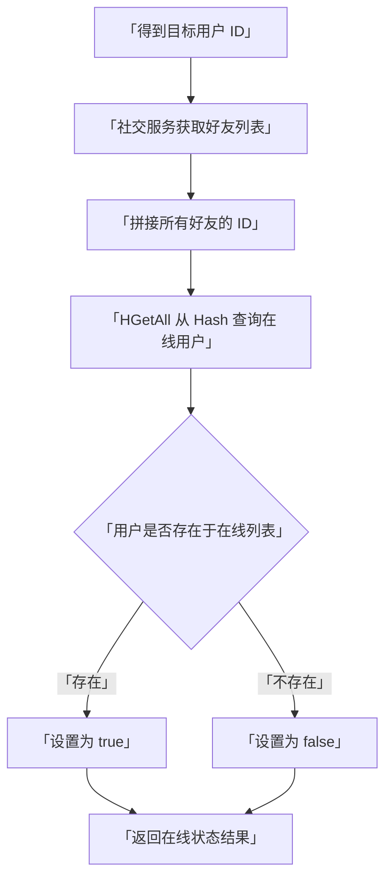

本节的内容有两个环节：第一，在用户登录的时候进行相应的处理；第二，完善群与好友在线状态的查询功能。

先看用户登录后的处理。会基于一个分布式缓存，用户登录和退出的时候都会更新其中的相关信息，它记录的就是用户登录的相关信息。要实现它，先要解决一个问题：缓存中用什么数据类型更合适？答案是 Hash。通过 Hash 表来存储这些用户，Key 就是用户的 ID，Value 就是用户的相关信息。查询某一个用户时，直接根据 Hash 中的 Key 就可以查询，所以此处用 Hash 来存储。

接下来编写它的 Data。编写之前先定义一个常量，这个常量就是 Redis 的 Key，作用是记录在线的用户。

定义完成之后，回到 ServiceContext。接下来要进到用户的 API 中，因为 API 向 RPC 发起登录请求，登录请求成功之后，相关的业务也由它来完成，所以放到登录的业务里处理。

先看当前的 ServiceContext 中有没有引入 Redis 的配置信息。目前没有引入，需要配置对 Redis 的支持：先定义一个 Redis 配置结构，这是 Redis 的配置信息；再定义配置文件，把配置文件中的相应段落复制过来，配置文件就定义好了。再进到 ServiceContext，增加对 Redis 的支持，创建出 Redis，这样就没问题了。定义完之后回到业务中使用它。前面已经提到使用的是 Hash 类型，所以要用 Hash 的设置：第一个参数是 Context，第二个参数是具体的 Hash 的 Key。注意：这一项是 Redis 的 Key，这个才是 Hash 中的 Key，后期用用户登录的 ID 作为它的值。

可以看到此处的返回中没有 Redis，在这里增加对 Redis 返回的支持。执行之后它就支持 Redis 的返回了。然后设置一个值，目前改个 1，实际要根据业务来设置。

进到登录业务中，到这里登录成功，由 API 返回出去。用户的处理到这里基本完成，很简单。注意，这个处理还要根据自己的业务进行调整。登录逻辑的代码如下：

```go
func (l *LoginLogic) Login(req *types.LoginReq, resp *types.LoginResp, err error) {
    loginResp, err := l.svcCtx.User.Login(l.ctx, &types.LoginReq{
        Phone: req.Phone,
        Password: req.Password,
    })
    if err != nil {
        return resp, err
    }
    // 处理登录成功后的逻辑
    // 例如：将用户信息写入 Redis 缓存
    // l.svcCtx.Redis.Set(...)
    return resp, nil
}
```

接下来完善群与好友在线状态的查询接口。它属于接口，目的是查询群中的用户在线还是离线、好友在线还是离线，所以应该在 API 中定义。目前 API 中有相关的接口定义，因此需要在接口定义文件中增加对需求的支持：提供一个查询在线用户的方法，即查询好友的在线情况，然后设置好传参。传参中应该定义什么内容？我们是查询一个已登录用户的好友在线情况，用户自己登录了，他的 ID 可以直接获取，所以请求不需要传递参数，只要在响应中返回即可。响应中的在线列表提供一个 Map，根据 Map 来区分好友列表中哪些好友在线、哪些好友离线。除此之外，关于群也需要在线和离线的区分，再复制一份，创建关于群的在线用户和离线用户。

关于群就需要传参了，必须知道群的 ID，所以这个参数必须有。然后在下面定义对应的方法，即查询群在线用户的方法。定义完成之后要重新加载 API 文件，加载之后接口就有了。接下来完成里面的业务。

这段业务要做的事情并不复杂。第一步得到目标 ID，要知道是谁想查询自己的好友情况。得到之后，通过社交服务中提供的获取好友列表的方法进行查询，传递 UID，就得到了用户的好友列表。再做数据验证，如果列表为空，直接返回。接下来要查询了：从哪里查询？从 Hash 中查询在线的用户。因为是基于 Redis 的 Hash 存储，可以一次性根据 ID 列表，把所有的 ID 拼接起来查询在线的用户。此处也没有 Redis，给它定义一个 Redis，从社交服务中复制一份，复制一下配置文件，再进到 ServiceContext 中创建出来，就可以使用了。通过 HGetAll 的方式查询所有的用户，如果返回不为空，接下来就是处理。

处理中需要判断当前用户在这个列表中是否存在：存在设置为 true，不存在则为 false，然后返回结果。

好友在线状态的查询流程如下：



```go
type FriendsOnlineLogic struct {
    logx.Logger
    ctx context.Context
    svcCtx *svc.ServiceContext
}

func (l *FriendsOnlineLogic) FriendsOnline(req *types.FriendsOnlineReq, resp *types.FriendsOnlineResp, err error) {
    // 获取好友列表
    friendList := l.svcCtx.Friend.GetFriendList(req.UserId)
    uids := make([]string, 0, len(friendList))
    for _, friend := range friendList {
        uids = append(uids, friend.FriendId)
    }

    // 查询 Redis 中在线用户
    resOnlineList := make(map[string]bool, len(uids))
    for _, uid := range uids {
        online, err := l.svcCtx.Redis.HGet(constants.REDIS_ONLINE_USER, uid)
        if err != nil {
            continue
        }
        resOnlineList[uid] = true
    }

    // 构造响应
    for _, uid := range uids {
        if resOnlineList[uid] {
            resp.OnlineUsers = append(resp.OnlineUsers, uid)
        }
    }
    return resp, nil
}
```

返回就没有问题了。群的查询其实和这里一样，唯一的区别是查询对象：上面是好友列表，这里属于群的列表。通过社交服务查询群成员列表，后面的处理基本一致，复制过来再更改里面的返回结果和上面这一段即可，写法一样，也不难。到此群的查询也写好了。

接下来测试。已经重新启动了三个服务：user-rpc、API 和社交的 API。更改配置文件，将参数指向本地，保存，请求，查看 Redis 中的信息，可以看到确实进来了。

再看在线的好友情况：给它增加一个接口，查询在线的好友情况，把这一段复制放在这里，更改请求的 URL，请求。目前它有三个好友都不在线。现在登录一个好友，再查询，可以看到有一个好友在线了。然后看群：查询群的在线情况，把这一段复制过来，更改 URL。请求的信息需要选择 UID，发送，可以看到信息有点问题。检查代码，问题在这个地方：它一直写入的是群自己的 ID，应该写入用户 ID。重启服务，刚刚写的是群 ID 而不是用户 ID，重新发送，这一次没问题了，说明功能已经实现。本节实现的就是用户在线状态的维护。
