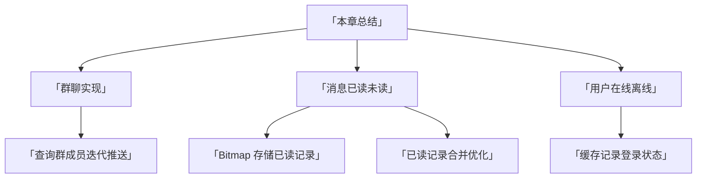

本章的核心话题其实只有三个：实现群聊、消息的已读与未读、用户的在线离线。

本章三大核心话题的关系如下：



先总结群聊的实现。它的业务其实并不复杂：客户端向服务端发起请求时通过 push；在 push 推送的时候，它会去数据库中查询群的成员，获取到相关的 ID，围绕这些 ID 迭代推送给对应的客户端，推送本身并不复杂。与私聊的主要区别在于：当前推送的目标需要从数据库中获取，然后再根据 ID 迭代性地推送。

需要主要注意的是群聊推送过程中的两点。第一，群的会话的创建是在什么时候：在加群和创建群的时候，会触发用户与群的会话的建立，同时也包含了群本身的会话建立；而发送消息的流程与私聊保持一致。第二，实现群聊时有很多细节要注意，其中就包含群聊推送过程中的并发推送。并发推送在项目中采用了 GoJuice 提供的现成包来解决，通过它发起并发的推送。除了并发以外，推送的整个队列也需要了解：先从会话处进行推送，再经过 Task 进行转化，最终回到 Push。在 Push 中分了群聊和私聊两种推送方式。如下是私聊：

```go
func single(srv *websocket.Server, data *ws.Push, recvid string) error {
    rconn := srv.GetConn(recvid)
    if rconn == nil {
        return nil
    }
    return srv.Send(rconn, websocket.NewMessage(data.SendId, &ws.Chat{
        ConversationId: data.ConversationId,
        ChatType:       data.ChatType,
        SendTime:       data.SendTime,
        Msg: ws.Msg{
            ReadRecords: data.ReadRecords,
            MsgID:        data.MsgID,
            MType:        data.MType,
            Content:      data.Content,
        },
    }))
}
```

如下是群聊：

```go
func group(srv *websocket.Server, data *ws.Push) error {
    for _, id := range data.Recvids {
        srv.Schedule(func() {
            single(srv, data, id)
        })
    }
    return nil
}
```

群聊采用了并发进行推送。

实现群聊和私聊之后，后面围绕消息展开了消息已读未读的功能。已读未读在流程上以分析群为主，因为私聊其实并不困难。客户端向服务端发送消息，告诉服务端自己读了某条消息；服务端接收到记录之后，会获取该群的用户，并分别向对应的用户推送某个用户已经读了消息，必须告诉对方，否则对方无法更新自己当前的消息已读状态。所以消息的已读未读也涉及 WebSocket 推送：实际实现中，在 WebSocket 中增加了消息已读的接收处理方法，同时在 MQ 中也增加了对消息已读未读的处理。

处理已读未读的过程中需要注意优化。存储上采用了 Bitmap，因为 Bitmap 的特点是非常小，创建一个足够大的 Bitmap，作为群的消息已读记录的存储。用户对某一条消息已读之后，只需把 Bitmap 中对应的位更改为 1，代表已读。客户端也需要根据这个 Bitmap 展示哪些用户已读、哪些用户未读，由用户自己点击查看。值得注意的是，并不是推送之后客户端就立马显示，这是两个概念：一般业务一定是点击，客户端角落下面会有个已读，点击它之后才能看哪些用户已读、哪些未读。点击之后才会读取这个 Bitmap，所以这个业务不会影响查询的效率，只是把数据推送到客户端，客户端会存起来。

另外是对消息的优化，主要优化在群：短时间内服务端可能会收到很多人对同一条消息或一批消息的已读未读记录。这时可以把短时间内用户对某些消息的已读未读信息采取合并策略，在后台进行合并：消息先经过 MsgReadTransfer 服务，判断是否为群消息，再由 groupMsgRead 依据 cid 进行合并。合并有两个条件：一是超时，二是达到上限。合并之后再推送给相关的客户端。这样做的好处是：一条消息发到群中，如果有 10 个用户在线，就会收到 10 个用户的已读记录；如果不采用合并，10 个用户在一秒内看到，意味着要推送 10 个已读记录的消息。但最终的时间节点是最后推送的时候，结果是一样的。采取合并之后再推送，可以大大减少推送的量和次数，减少网络的消耗，这就是合并带来的效果。

这个思想在很多场景中都有用到，典型例子就是马斯克、比尔兰格日志写入到磁盘，其中就用到了这个思想，有兴趣可以去看一看，除此之外很多地方也用得到。

最后讲用户的在线和离线状态。从业务角度上讲，就是用户的头像从彩色变成灰色，或者从灰色变成彩色。从用户的效果来说，用户登录或退出之后，他的状态需要发生改变。用户登录时，他要拉取自己好友的在线状态；并且当好友登录退出发生变更时，也需要向用户推送相关的状态，否则用户会一直认为这个好友一直在线或者一直不在线。

实现上，首先在登录环节增加了一个缓存，采用哈希实现（可以用分布式缓存）。用户登录时将自己的信息写入缓存；之后新用户要查这个用户是否在线，只需从缓存中读取判断，速度非常快。用户退出时，会从缓存中删除这条记录，那么这个用户就离线了。用户登录之后，首先进到服务器中查询好友的在线状态：从数据库中获取好友列表，再根据好友列表以及缓存中记录的在线情况计算好结果返回给用户，他就知道自己的好友是否在线、是否离线。同样，获取群的在线和离线也是一样的道理，只不过查询的条件不是用户的 ID 而是群的 ID，查询的数据是群的用户列表，处理过程是一样的。

在业务上对好友与群这两个用户列表的更新，可以根据客户端来定：好友可以定时拉取在线状态，群可以按需拉取，这样能大大减少不必要的消耗。这是课程中采取的策略，也是本章重点讲到的内容。
