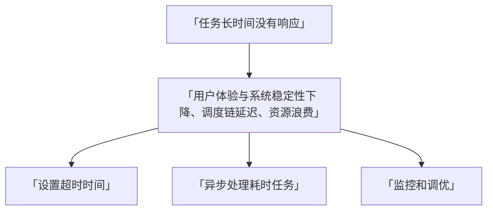

从本章节开始，我们针对微服务中任务所存在的重试、超时、幂等这三个话题来展开讨论。

## 任务长时间没有响应会带来什么问题

微服务中如果一个任务长时间没有回复，会存在什么样的问题？

第一，长时间得不到回复，从整体项目的角度来说，用户体验、系统的稳定性肯定是会下降的。同时，在整个调度链来说，也会存在一定的延迟，并且资源也会较为浪费。

为此可以做一个简单的演示：在项目的社交 RPC 服务中，找到获取群用户这个方法，假设它延迟五秒钟。这个延迟是因为任务可能存在一些异常情况，发生了超时的问题，所以导致了延迟。

填好之后启动所有相关的服务：社交 RPC、社交 API 以及 IM API。然后通过 API POST 分别测试刚刚调整之后的内容，也就是社交服务中获取群用户的相关接口。

比如在 IM 中，我们需要获取群消息的相关记录，这个消息是属于群的，把请求的地址改为本地，可以看到这里抛出了一个异常。再看获取群用户（列表）这个接口，同样也是超时的，抛出了异常。

通过这个例子可以简单地了解：在微服务中，当服务超时，它可能会影响到整个相关的系统，特别是对该系统设计的调度链，一定是会影响的。

## 业界常见的解决策略

既然已经存在问题，在我们的项目或者业界中，该如何去解决呢？

首先第一，是设置超时时间。这一点，Go-Zero 已经帮我们做好了。在刚刚的请求中，如果仔细去看日志，可以看到它的等待时间只等了两秒钟。但其实社交 RPC 是延迟了五秒钟，所以它本身是有超时机制的，默认就配置好了，不需要我们自己再额外去设置。当然我们也可以根据自己业务的需求来稍微调整。

其次是异步处理。异步处理主要是针对于本身就存在耗时任务的情况采取的。

最后就是监控和调优，就是对刚刚所存在的一些问题进行总结，并找到问题进行调优。

这就是微服务中超时会存在的问题，以及可以采取的策略。这些策略不仅仅只在微服务中，很多项目中都会用到。
