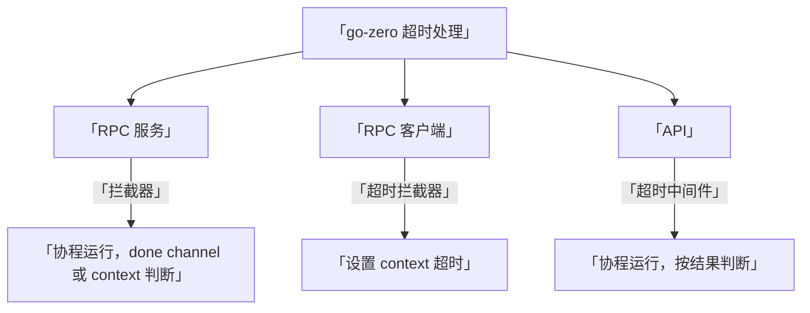

通过上一讲，我们已经简单了解了在微服务中超时会带来的问题。那么在本讲中，我们来了解一下 go-zero 是如何去应对相关请求超时的。

其实对 go-zero 的应对，可以从三个方面来看：第一就是 RPC 的服务，第二是 RPC 的客户端，第三是 API。这三者都有设置超时。

先来看 go-zero 在 API Server 中的处理。进到源码中找到 zrpc，它的 internal 目录包含了对于整个 zrpc 的核心处理。简单地回顾一下调度的过程：server.go 本身是去启动所有的服务，启动的时候有一项就是设置 go-zero 自定义的一些拦截器，在这些拦截器中，其中一个就是去设置超时的。这个超时处理就定义在刚才提到的目录下面，是 go-zero 所定义的超时处理方法。

这个方法中的过程并不复杂。它首先会得到一个超时的设置。这个时间从哪里来？从配置中得到的。而这个配置就是我们在 env 中所定义的一系列相关配置。平时所定义的配置主要是 Server 中的配置信息，也包含了监听的相关信息，而关于超时的配置就在其中。目前目录的设置是 2000，单位是毫秒，所以实际上是两秒的延迟。

在运行中，它会通过协程去具体运行实际执行的方法。运行之后下面有一个 done channel，用来接收结果：如果它关闭了，说明程序执行没问题；上面是错误的分支；但如果 context 的这一项关闭，说明是超时的配置。所以整体它的超时处理是不复杂的。

RPC server 看完之后，接下来看 RPC 的客户端是如何处理的，同样看整个流程。此处属于 RPC 客户端的创建：直接创建 gRPC 客户端，然后设置好相关的拦截器。其中就定义了超时的拦截器。这个超时的拦截器因为是属于请求，并不需要像 server 那样自己处理，它只是设置一个 context，然后传递到任务的处理中。gRPC 本身会从 context 中判断是否设置了超时，如果设置了，就会采用超时的处理，如同前面 RPC server 的那一段一样。这就是关于 RPC 客户端超时的设置。

接下来看 API 超时的处理。在看之前再回顾一下 RPC 客户端：它的配置层在 RPC 创建的时候就设置了超时的配置，此时也是在配置文件中自己可以定义的。

API 的处理也并不复杂，主要是通过中间件来解决的。进入它的启动方法，在里面会设置相关的中间件：绑定路由的下面就是绑定相关的中间件，其中包含了超时的中间件。在这一处定义了很多相关中间件，超时的就在其中。这套配置从哪里来？它定义了很多相关配置，有判断是否设置超时，所以是有定义的，默认就已经设置好了这些相关的配置。针对 API 服务定义的相关配置中就有一个超时项。再往下就是它的中间件，超时任务的中间件就在这里，其中处理超时任务的关键是这一段：它和 API Server 的处理是一样的，也是通过协程去运行相关的任务，运行之后根据返回的结果来判断是不是超时或者结束。

到此，我们对三种情况的超时处理已经基本了解。在实际使用中，只需要配置好相关的配置参数就可以很好地使用，它已经定义了一些超时，不需要我们再额外做相关处理。
