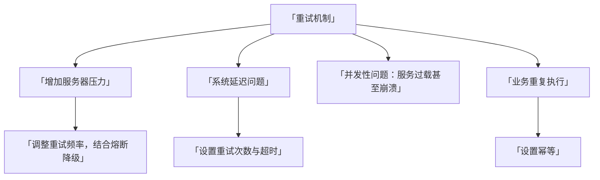

在本节中我们讨论一下：在微服务中，如果一个任务它多次重试，会出现什么样的问题。针对这个问题，我们会先通过一个事例来演示到底会存在什么样的问题，然后对存在的问题进行总结，以及该如何去解决。

首先来演示一个事例。在课程例子中我们选择社交服务来做整体演示。社交中有一项就是创建群。进到社交创建群的业务中，在这一段业务中，在其后增加一个延迟，假设它因为一些偶然事情发生了延迟，延迟时间设置为两秒钟。

设置完之后，接下来更改它的配置。前面的课程已经讲过，在 go-zero 中，可以通过在配置中配置它的超时，它就会去监控整个程序的运行，如果超过一定时间，就会超时。默认的方式是两秒钟，我们改为一秒钟超时。然后再选择社交的 API，在社交 API 中也要更改一下，因为社交 API 要去请求社交 RPC，为了一个更好的效果，将它的服务超时时间改成 10 秒钟。社交请求的这个服务 RPC，超时也改成 10 秒钟。改完这两处配置后，回到代码中，选择社交 API 服务，在社交 API 服务中增加对重试机制的加载。值得注意的是其中这一项，即这个是在超时的时候抛出的错误类型，给它设置好，然后再把它设置进去，设置社交 RPC 客户端的超时处理，也就是当它出现了超时的情况，就让它再重新地重试一次。

准备工作就完成了，并不复杂。需要注意的是，在部署的机器上面要把社交的这个服务器停止，因为要在本地测试。然后把社交的 API 服务启动好。准备工作做好之后，进到 API 服务中来测试，主要做的事情是对群创建的测试。这里是本地的机器，登录一个用户，登录好之后在这里创建群，等待一下，它抛出了一个超时的异常。

现在打开控制台，在控制台中看 RPC，可以看到它执行了两次，很明显它重试了。然后它创建了不止三个群，实际执行了几次。再看一下数据库，同一个用户，统计下来总共创建了五个群。这五个群的创建，都是因为重试机制导致的。

可以重新再来一次验证：把记录删掉，再请求，刷新后可以看到它确实又重新创建了几个群，说明这个重试机制产生了影响。

当前的错误可能是由于一些偶尔的情况导致一个延迟问题，并不是一种常见的业务情况。但因为重试机制，它不得不进入到程序中重试，所以会重试几次，造成一个问题：原本这个地方应该返回正常的结果，但实际已经重复执行了。

总结一下微服务中重试机制的问题。对于微服务中请求失败之后，它的重试会增加服务器的压力，通过调整重试频率来解决。当然可以结合熔断降级，这一点在 go-zero 中已经设置了，所以后续重复的执行是不起成效的，它就不会再去请求刚刚的服务了。继续请求就会出现熔断的错误，多次请求就可以看到。然后是系统延迟的问题，可以通过设置重试次数以及超时来解决。同时它也会带来并发性的问题，多个服务同时访问同一个服务，会导致服务的过载，因此也可能存在一定的崩溃。另外就是会使得业务重复执行，产生误差，这一点可以通过幂等来解决。

那么问题这么多，业务中不能用重试吗？不是的，还是根据自己业务需求来设置重试，这是可以设置的。功能上是支持的，业务需求上也是支持的。只是在使用过程中要注意它所带来的问题。重试虽然能够让业务重新去访问，解决一定的访问问题，但不能滥用，一定要注意好它所带来的问题。其中一定要注意对于方法一定要设置好幂等，因为这样可以避免误差。刚刚在程序中，这一段业务其实没有设置幂等，所以导致的问题就是重试之后，它仍然还是去执行这一段业务，重新创建了一个群。

这就是本期重点要讲到的内容：理解重试失败的问题，一定不要滥用，要注意好它所出的问题，然后再针对这些问题进行解决。
