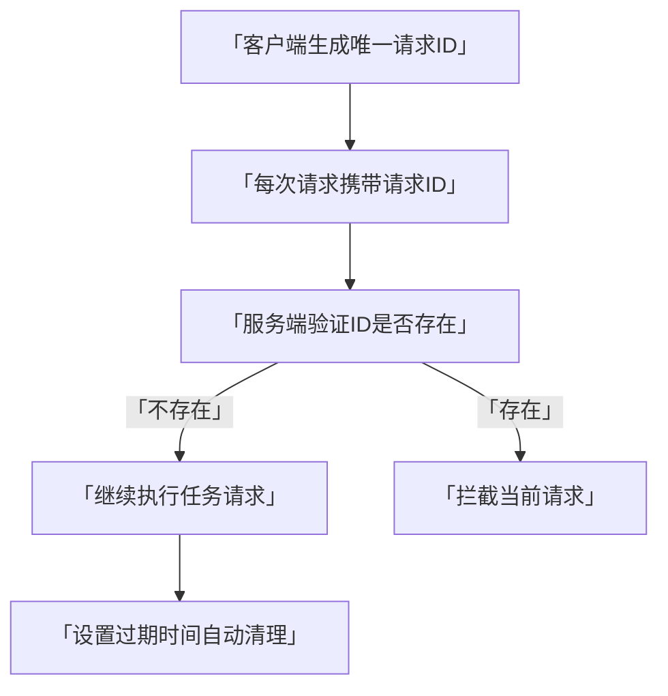

通过上一讲，我们已经理解了重试机制所存在的一些问题，也了解到可以通过幂等的方式，去解决重试机制中对业务重新执行的问题。那么在本节，我们重点讲解幂等实现思路的方式。这里有四个内容：首先理解什么是幂等性，然后是幂等性的实现方式，其中两种，基于 Token 的实现和基于唯一标识的方式的实现，这两种方式都是可以的，我们在这一阶段都有应用。

先理解幂等性。对于幂等性，它其实是对同一个操作多次执行，产生的结果和影响，我们只需要一次结果。比如在抢购商品的时候，你可能同时会点很多次按钮。作为一个客户来说，你只会买一个商品，只是抢这么一次机会，不论你点多少次、购买多少次，买的只有一个。这就很好地解释了幂等的一个特点：你重复进入多次，但我们只需要一次结果。

理解之后，幂等主要体现的方面，在于避免重复的操作，然后提高容错性。因为在网络中有很多不确定性的故障问题，可能会导致一些突发性的错误，然后我们会有重试，所以在过程中要避免因为这种特殊性的重试导致业务多次执行，提高容错性。第三点就是提高系统的可靠性，因为对幂等来说，它是允许系统出一些故障的，即允许故障、中断、错误这些情况，然后进行重试，所以它可以提高系统的可靠性。

关于幂等的应用，比如表单请求就是一个比较典型的幂等性场景，我们学习的时候也经常提到表单重复提交的问题。第二个是秒杀，也是同样的道理。然后在请求超时的情况下面，也是可以用幂等性的。至于幂等性，它并不仅仅是微服务的话题，在单体项目中也会用到，比如表单请求就是单体项目中最常见的功能。所以幂等不能只认为它是微服务的，但要把它的思想理解好。

接下来理解幂等性的实现方式。实现方式其实有很多种，比如 MVCC 多版本的控制，这个也是一个幂等的控制，以及乐观锁，然后可以去创建一个去重表，Token 为标识，以及防重，这些方案在业务中都常用到了。MVCC 就是基于 MVCC 多版本的控制去实现幂等的。

现在来看一下 Token，它比较适合在业务中做 Token 的方式。可以看这个流程图：客户端首先会先从服务端中获取一个 Token，然后服务端会返回一个 Token。客户端在请求业务的时候，会把这个 Token 带进来。这个 Token 的作用，是对当前这一次请求的标识。也就是说，客户端在界面中已经获得了这个 Token，再次请求时也会发送同一个 Token。那么在服务端中，它会将这个 Token 存储在 Redis 中，然后判断一个 Token 是否存在。本身它在生成的时候已经在 Redis 中存了，所以肯定是存在的。此时它就会将这个 Token 删除，再去处理任务。当下一次请求的时候，它会带同一个 Token 进来，这一次访问的时候不存在，那么就相当于说这个请求可能已经被执行完了，所以它就会忽略当前的这一次请求。因此它只能保证一次请求进来。这就是 Token 的方式。

在业务中，哪些地方会用到 Token 这个方式呢？比如表单的重复提交，这里就会用到了 Token。

了解到 Token 之后，接下来看一下唯一标识。看这个图：客户端不需要再向服务端请求一个 Token 了，可以由客户端自己去生成一个请求的 ID，而这个 ID 它是唯一的，可以根据任务的标识及请求的时间来生成。生成之后，客户端每次都会为当前任务带上这个 ID，这个 ID 与 Token 是具有相似性的。在服务端中，我们可以去验证这个 ID 是否存在。服务端第一次的时候，它肯定是不存在的，因为服务端不是自己去生成的，而是由客户端生成的，所以服务端肯定没有存。既然它不存在，自然就可以继续往下走，去执行相关的任务请求。但如果它存在，说明一个事情：这个任务正在被执行，所以这里就会拦截当前的请求。那么这个标识什么时候被清理呢？可以设置过期时间，让它自动清理，比如说在这一段时间内，这一个请求只能请求一次。这是 Token 和唯一标识的方案，目前之中多是能用到。

那么在课程中用哪一种方案呢？我们用唯一标识的方案来实现幂等性。

本节重点就是理解幂等性的实现。
