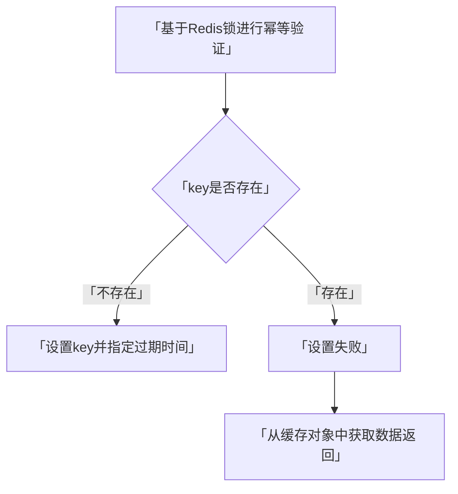

第一个获取请求的标识。这个请求标识，主要由客户端来获取，即在客户端的拦截器中这里去获取。它获取的方式，是根据 Context 及方法的名称来获取。它主要是通过 Context 获取，所以这里通过 Context 来获取任务的 ID。在获取之后，可以让其生成请求 ID。生成方式就是根据任务它的编号标识，再基于请求 ID 的方法去生成：第一个就是请求 ID，第二个就是方法，用这种方式去生成，再传进来。这就是一个请求的标识。

请求标识定义完之后，接下来定义第二个方法，即是否支持幂等。是否支持幂等很简单，因为目前的方式使用 map，所以直接根据 map 的方式查找一下就可以了。第二个方法也就定好了。

接下来完成第三个幂等的验证。第三个方法需要注意，因为它要考虑一些细节。我们可以基于 Redis 的锁来进行实现。这个方法的作用是：在设置这个 key 的时候，它不存在的时候才能去设置，然后再给它设置一个过期的时间。所以如果这个 key 存在，那么一定是设置失败的。我们改个 1 就好了，再给个过期的时间。此处如果说存在异常，那就 return，设置是失败的。应该从下面这里去判断，因为它的返回结果是一个 bool，是否设置成功，还有异常。所以在此处判断一下，如果它为 true，说明设置成功，return true。如果 bool 为假，那肯定是失败。那么从设置中，可以去获取数据，从缓存的对象中获取一下数据，返回结果。

这一段，默认幂等性的设置就完成了。之后再来执行保存结果。保存结果的执行不复杂，只需要调用缓存的设置就可以了，然后 return 一下即可，这个异常就没保存了。

默认幂等性实现完之后，接下来去写中间件。在中间件中要做什么事情呢？在这里定义一个公共的中间件，以便让更多的程序能够使用到。定义一个公共的 Middleware，定义幂等的中间件的对象，再定义 Handler 方法，创建好请求执行的方法，再 return。完善一下它的内容，其实主要是去设置了这个 key 就可以了，因此它的内容并不复杂。再用前面所定义的拦截器的方法，创建好 Context，目前就设置完成了，再执行任务。一个简单的中间件就定义好了。

然后再让它在 API 中能够被支持使用。找到 API 中创建群的这个方法，就是下面的这一段。需要在这个方法组中使用刚刚所定义的中间件，然后再生成这个 API 的代码。定义完成，这里就会去使用这个中间件。我们需要在 ServContext 中能够引用它，定义中间件。定义完成之后，接下来创建好这个拦截器，将这个方法复制起来，回到这里更改一下：按照这个包的引用，这个包的引用并不符合实际需求，改成这样。现在 API 的处理就完了。

接下来处理 RPC 这一段，然后就可以进行测试了。在 RPC 的处理中，首先是 API，在 API 的 ServContext 中，已经增加了对这个拦截器的支持，也增加了对它的重试处理。然后在这个地方，再增加对拦截器的支持：让它增加对 gRPC 幂等拦截器的支持，这样就定义好了。

再回到 RPC 中，也同样要支持这个拦截器。要注意，在服务当中它要传递参数；在客户端当中可以不需要，因为它只要设置编号就可以了；而在服务当中则是需要的，它要传递出这个 Redis 的配置信息。服务端也设置好了。

现在进行最后的测试。重新启动好这两个服务，一个是 RPC 一个是 API。进行测试，可以看到没有生效。看一下代码，这个地方要加个 bool，因为当前是验证这个方法是否支持幂等，所以刚刚要加 bool。重新再来一次请求，可以看到它进来了，然后它抛出的错误是：其他程序正在进行。重点看的是数据，这里是否正常。这里有多次之前测试的结果，可以先将其删除，最后只剩一个群。请求。执行完成之后，再看数据库，可以看到它只生成了一条。再看 RPC 的打印信息，可以明显发现任务有进入幂等，任务只执行了一次，其他任务是在幂等里面。这一项说明，幂等是成功的。

为此可以再请求一次。执行完之后，再看数据库，里面也只生成了一条，幂等的操作也只执行了一个，说明任务是正常的。总体来说，幂等就已经实现好了，功能并不复杂。它的主要作用就是保护程序，让它只执行一次，如所看到的，业务只执行了一次。之所以这次还是返回出这个错误，是因为它执行之后，超过了当前这一个程序的执行时间，所以它还是会保留这个错误，超过了这个程序的等待时间，因此还是保留了错误。总体来说，任务是没有问题的。

本集核心内容，也就是实现这个幂等性的功能。
