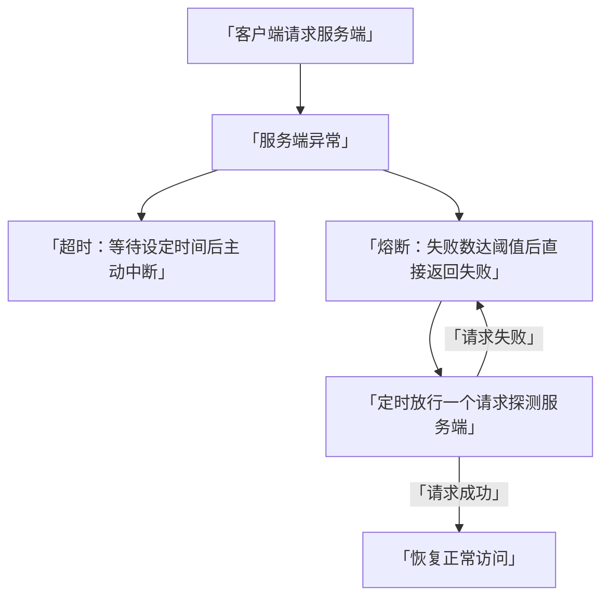

通过前面讲的课程，我们已经理解了熔断、限流、降级这三个话题。这里再补充一个话题，就是熔断与超时有什么区别点。从两个方面来讲：第一是相互之间它们的目的，然后再简单地讨论一下它们的相同点与不同点。

先来看相互之间的目的。比如当前有客户端和服务端，先看超时。对于超时来说，当客户端向服务端发送请求的时候，这个服务端存在异常，导致客户端要陷入等待的时间。那么客户端为了不让程序一直等待，就会主动地去中断超时，主动地中断对服务端发起的请求。这个主动中断过程中，其实是设置了一个时间的，会等待请求一定的时间。但有一个特点：它下一次请求也还是一样，这个服务端如果还没好，它也还是会等待一个时间，然后又中断请求，再下一次请求也还是一样。所以对于超时来说，它的作用主要是让程序不进行一直的等待这个结果的返回。

那么熔断的目的是什么呢？同样还是服务端和客户端。在这个过程中，第一次客户端请求的时候，它还是会存在异常，但存在异常之后，后面的处理是怎样的？此时客户端如果开启了熔断的开关，那么客户端在业务中去请求服务端的时候，其实底层的逻辑是没有去直接请求服务端的，而是主动地直接性地返回输出，抛出异常，客户端已经把这个返回失败。然后下一次请求也还是一样。当然在过程中，也肯定会放出一个请求去访问服务端，如果 OK，那么就正常的访问。这就是两者的区别。

超时它的主要目的，是在程序访问目标的时候，不让这个过程等待太长；而熔断是在访问目标的时候出现了问题，然后主动地让这个访问在一定时间内不去进行。这就是两者的目的。

讨论完目的，接下来看相同点和不同点。先看相同点。相同点是都是系统保障的一种策略，它们主要是去保护整个程序，用于提高整个系统的可用性和稳定性，这是两者都具有的共同特征。

但不同的也很明显。第一，功能是具有区别性的，前面已经强调了它们的功能。第二是处理方式：超时和熔断两者之间应该是配合起来去使用的，而不是单独使用，往往都会配合起来。当请求服务端的时候，它超时，那就让这个程序中断一段时间，让它不去再访问这个目标，所以这两者之间可以结合起来使用。然后处理条件也不一样：超时是请求超时，任务发起请求之后，它会设置一个时间，当这个时间到了就触发；而熔断是请求数和失败数，它会去计算，达到一个阈值就触发，所以条件也不一样。最后就是作用范围也是有区别的：超时机制对于系统，往往是针对某一个请求或者操作去进行限制，只影响到当前的这个请求；而熔断会影响到整个服务或者整个接口，它会设置一个时间。所以这两者的作用范围明显就有区别。

到这里，基本上已经对熔断和超时做了一定了解。
