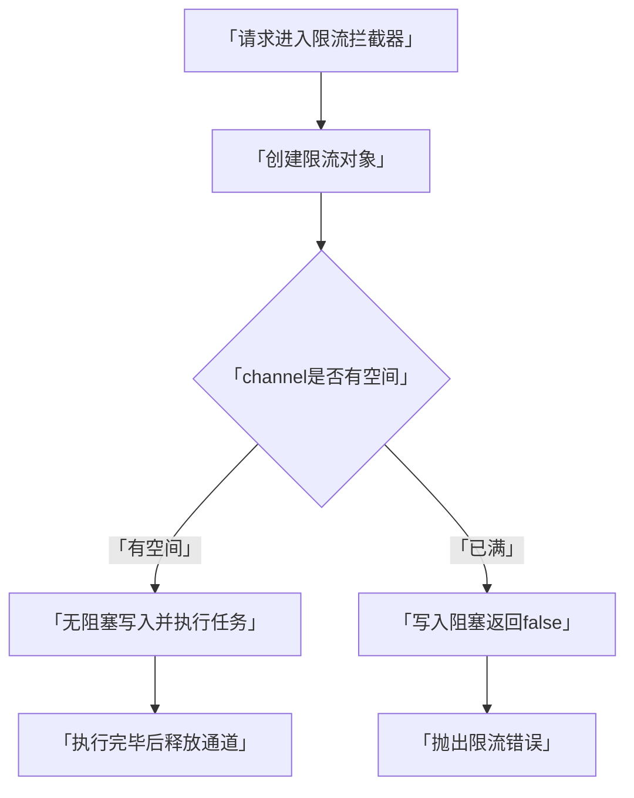

在理解了限流的实现方案之后，基于社交服务群功能，进一步学习 go-zero 的限流。本节先简单了解 go-zero 中提供了哪些限流实现，再分别用 go-zero 中的 limit 包和 go-zero 核心代码中的 limit 进行限流。

go-zero 对限流提供了两个包：第一个是 limit 包，第二个是 go-zero 核心代码中的 limit，两者都可以用来限流。先来看 limit 包的限流。

对于这个包，go-zero 中也提供了相关的示例：Rest 的限流是先定义配置，再通过配置的判断去进行限流，这里不去讨论它。主要来看 RPC 服务，其下定义了 limit 的应用，对服务定义了如下这个限流的拦截器。功能并不复杂：首先创建出限流对象，再使用限流对象去进行限流。

接下来根据这个示例，简单地创建拦截器并进行应用，加到 API 以及服务的拦截器中，创建一个文件进行限流，然后创建该方法。方法的参数中需要传递当前要控制的并发数量，这里定义一个变量 MaxCount int，代表允许最大通过的并发数量。返回结果是 gRPC 的拦截器。在这个拦截器中不需要编写太多代码，直接从这个用例中复制过来：第一步创建限流对象，第二步使用限流。这段代码的主要作用是判断当前是否进行了限流：如果没有限流，就进到程序中执行任务，执行完任务之后进行释放；如果限流了，就会抛出错误。

看一下它是如何限流的。limit 中定义的是一个 channel 通道，限流实现的关键就是这个 channel 通道，采用有缓冲的通道来实现。其下定义了两个核心的方法，一个方法的作用是向通道中写入信息：如果通道有空间，可以直接无阻塞写入；如果没有容量，就会写入阻塞，执行对应分支返回 false，即已经限流了。而释放则是从通道中获取数据。所以它的实现原理并不复杂。

现在进行测试。测试前注意进到自己的业务中，因为业务中这里有增加延迟的代码，先把这个延迟注释掉，以免影响测试结果。重启服务，在服务启动之后，执行压测命令。关于命令，这里有提供，这个就是用来压测的命令，工具的下载地址也在这里有提供。把命令复制过来执行。值得注意，执行的目录是在社交 RPC 下，与社交 proto 是同级的目录。然后是调用方法，调用格式为：社交的 proto 文件名、社交服务及方法、此处是传参，后面是指定访问量及客户量，即模拟的客户量和访问量。

目前请求是正常的，因为没有去使用这个拦截器。接下来就使用它：进到社交的入口中进行使用，传递允许最大并发数，暂时定为十个。待服务启动好之后，执行压测命令，这时就起到了限流的效果，抛出了限流的异常，通过的请求数是十八个。明明限流的是十个，实际却通过了十八个。之所以有这个结果，是因为创建通道的时候，它有十个的空间，但在压测过程中任务是执行的，执行完之后通道会释放，就立即有新的容量可以被使用。实际上这里的结果一般在十到二十之间，绝大部分情况会出现限流错误，所以可以明显看出限流生效了。

实行完 limit 限流之后，接下来看核心代码中 limit 的限流。limit 的限流在 go-zero 中提供有多种方案：进到 go-zero 的核心代码中，找到 limit，它的实现有两种，第一种是通过滑动窗口的方式进行限流，第二种是通过令牌桶的方式进行限流。这两种的使用都提供了对应的单元测试，也可以根据单元测试来理解其限流功能的使用。

简单看一下。首先定义的是限流中会用到的一些常量。以令牌桶为例，定义了当前令牌数，即生成的一个数据，即桶的数量，那么就要再定义好，由此创建出一个令牌桶的工具。然后在其下，就是从桶中去获取数据，如果能获取，它就会 OK，如果不能获取，那就失败。所以它的使用是非常简单的。

因此可以结合来使用。这一次定义在中间件中，定义一个 limit 的限流中间件。在参数中注意，它要求传递 Redis：要获取 Redis 的配置信息，然后再得到 limit 的限流，创建对象是令牌桶的这个对象。之所以要求传递 Redis 的配置信息，是因为令牌桶本身在底层是基于 Redis 来实现的。

接下来定义中间件方法。当前定义的是 token 限流的方法，在参数传递中，要求传递限流的数据以及桶的容量，然后返回出中间件的方法。在这个方法中，第一步先创建好限流对象，参数中要求传递数据及桶的容量，然后是 Redis 的连接，将 Redis 配置传递进来。最后一个参数是一个 Redis 相关的 key，这个 key 用于存放使用过程中的 token。到此就创建好了 limit 的限流对象。创建完成，下边就是使用它。里面的应用并不复杂，主要做的事情就是获取令牌，通过 context 方式获取：如果能获取成功，就执行任务，否则是被限流了，抛出一个状态码。这样，就定义完成了。

接下来进到程序中使用它。首先进到 api 中，在 router 处，将当前的限流注释掉，现在需要看的是令牌桶的演示情况。在 api 中此处进行增加，然后让程序重新编译，编译之后再引用它。进到 ServiceContext 中，把上面的程序注释掉，然后在这里定义对 limit 的引用，创建出对象，要求传递配置信息及 Redis 配置信息。这两个参数的作用：一个是数据，即指在程序中 go-zero 间隔多久去生成一个令牌；另一个是桶的数量。现在在代码中定义一个值，让它以一秒的数据来生成一个令牌，该桶的容量为 100。这样定义完之后，接下来定义一个值，就要进行测试。

测试值得注意，一定要在 Linux 上运行，因为在 Windows 上可能会存在一些意料之外的问题，所以尽量在 Linux 上运行。

接下来去 Linux 上运行，其中的服务包含 user RPC、社交 RPC 以及社交 API。在 user RPC 中，之前在业务中进行测试的时候，这里是直接返回异常的，把它改为一个空，不返回异常。各个服务都启动好之后，就要进行压测。压测的时候，一定要把 header 中设置好这个配置信息，否则在 API POST 中也可能压测不了。

现在进行压测，一键压测，开启压测服务，并发数为 100，测试时间一秒。可以看到，压测结果成功数为 100，其他的都是失败的。主要来看成功数，成功数 100。这很合理：一开始的时候有 100 个令牌，还多出一个令牌，是因为速率是一秒生成一个，所以还会额外生成一个令牌，因此目前成功数为 100。这说明这个限流起到了效果。从整体功能来说，它的使用其实是不复杂的，直接就是引用 limit 这个限流工具，然后去引用下面的方法，就可以起到限流了。同样的，还包含有像滑动限流，也不复杂，可以根据这个示例去实践一下，并使用 go-zero 中的限流。至此已经使用了 go-zero 中的两大限流功能，一个是 limit，一个是 go-zero 核心代码中的 limit。

本节就讲到这里。
