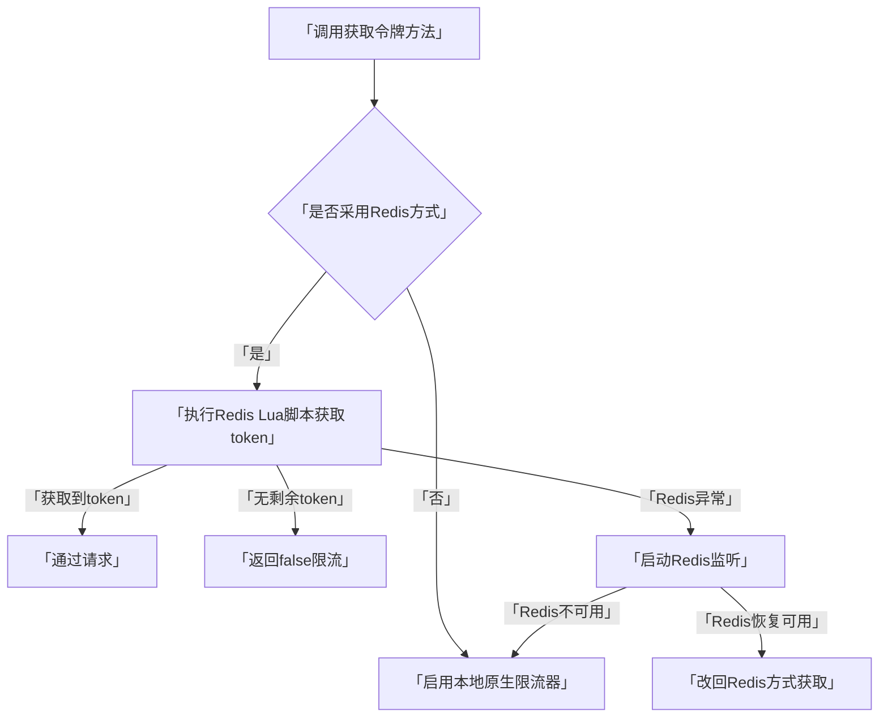

前面的内容对 go-zero 中的限流器有了初步了解，本节深入探究 go-zero 中限流器的实现原理。

本节内容总共探究它的三种限流实现：

第一种是 limit 限流；

第二种是令牌桶限流；

最后一种是滑动窗口限流。

## limit 限流

首先是 limit 限流。

limit 限流的实现非常简单。打开它的源码，进入对应的包，在下面有一个另外的模块，这个模块就是实现限流功能的。它的主要实现是基于 channel（通道）来进行的。

当请求进来的时候，通过下面的这个方法，尝试向 channel 中去写入数据。如果 channel 有空间，那么写入是无阻塞的；如果 channel 已经满了，那么就无法写入，此时就会直接返回一个 error，也就是被限流了。

所以，limit 限流的方式就是通过 channel 来实现的，在实现原理上是非常简单的。

## 令牌桶限流

接下来看令牌桶限流。

对于令牌桶的实现，在 go-zero 中需要进入对应的模块，在这里就是令牌桶的具体实现。其实它的整体实现核心有两个地方：

第一是这里的一段 Lua 脚本；

然后是获取令牌的方法，这个方法就是去获取令牌的。在程序中，调用上面的这个方法的时候，它就会去调用下面的逻辑，来判断当前这个桶是否能够获取到令牌。

下面从源码来理解它的执行过程。

首先需要先理解的是这一份 Lua 脚本。在脚本中，它的前面的参数分别是：

第一个参数，传递的是当前一秒以内生成几个令牌，也就是令牌的生成速率；

第二个参数，主要是指令牌桶它的最大值，也就是这一个桶能存放的令牌最大是多少个；

然后是当前时间；

当前时间下需要获取的 token 的数量；

最后是填满这个令牌桶需要多久的时间。

拿到上面的参数之后，再来看执行流程。在这个流程中，它主要就是去获取当前的令牌桶还剩余多少个令牌。如果是第一次进来，那么此时它就会将当前这一个桶设置为令牌的最大值，即有这么多 token 是没有被使用的。然后在底下，它会去更新上一次 token 的获取时间。然后在后续的流程中，它会通过当前的时间与上一次更新的时间这一个跨度，以及 token 的生成速率，来计算出新的 token 数量。如果超过了最大的桶的数量，那么多余的 token 会被丢弃。这一段主要是去生成 token。那么在最后，就会去更新当前 token 的数量以及更新的时间。

在整个 Lua 脚本执行之后，它的主要作用就是返回是否能够获取到剩余的可用 token。

它的执行关键就在获取令牌的这一个方法中。首先第一行，它的主要作用是判断当前的类型，是采用 Redis 还是采用系统默认的（本地）方式。因为它有两套机制：

第一套是基于 Redis 来去生成 token；

第二套是自己内部本地去生成 token。

这里分有两种方式，在这个判断中就是判断采用哪一种方式。

go-zero 要提供本地的方式，主要是去进行兜底。因为万一 Redis 出现了异常，那么还有本地的方式在这里运行，所以它的可靠性是比较高的。

在下面，前面已经介绍了 Redis Lua 脚本的执行内容，那么在此处它就会调用上述的 Lua 脚本，去获取剩余的 token。如果能获取到，那么就会返回结果，或者返回异常。这个异常是有判断的：当前如果为空，那么说明是没有剩余 token，因此它会直接返回；第二种情况就是超时，因为 Redis 超时，所以也认为是限流。

当前面这两种都不符合的时候，注意，此时它有可能是 Redis 本身存在错误。先不着急看这里，再往下来看，就是对 token 去进行验证。如果 token 正常，那么能够获取到令牌。

而在这里，它是针对 Redis 或者 token 获取存在异常的情况下面，会采用本地的限流器来进行限流，这是本地的实现。同时它还会去开启一个监听，这个监听的主要功能，就是监听 Redis 的活动状态。如果 Redis 又重新可以使用了，那么此时又会将当前限流器的方式改为 Redis 的方式。

因此结合整体流程来看这一个图，这就是获取 token 的方法。首先它会去判断当前是否采用 Redis 方式的获取，如果不是，就启动本地原生的限流器；如果是，那么就会执行 Redis Lua 脚本来获取 token。如果能够获取到 token，那么就通过；但它可能不存在，那么就返回 false。另一种情况，就是 Redis 可能出现异常，此时它会启动 Redis 的监听来监听 Redis 的状态，如果监听到 Redis 能够存活，那么它会将 Redis 又设置成可使用状态；反之，就是启用原生的本地限流器。

这是整个 go-zero 中令牌桶的限流方式。

## 滑动窗口限流

了解完之后，接下来看滑动窗口限流。

对于滑动窗口限流，先简单回顾一下理论。它的理论就是在一定时间内，它的请求数量是约定的一个固定值。然后以一定速率对这个窗口进行滑动，而这个速率是根据时间的计算。在移动的时候，它会对不在这个窗口以内的数据进行剔除，这些数据是已经结束的请求；而新来的请求，它会放在最新的窗口里。这就是滑动窗口限流。

结合代码来看。在代码中，它的关键其实就是这一份 Lua 脚本。对于滑动窗口限流的实现，在 Lua 脚本中其关键性的命令就是这一行命令，同时配合这个过期的时间，就可以去实现滑动窗口限流了。

因为当一个请求进来之后，它会去更新当前这个 key 的值，而这个 key 的值一旦更新之后，它的数量是会发生变化。那么此时它会返回更新后的结果，然后会去进行验证。如果是第一次访问，那么它会去设置当前这个 key 的过期时间，因为只是限制一段时间内的访问次数。然后在其后，它会根据当前这个 key 设置之后的结果，并返回相应的常量，而这些常量在后面的信息中都有定义，分别的作用主要是代表：超过了容量、刚好能够访问（刚刚好到达了阈值）等一些其他的状态。

所以其实在滑动窗口限流这一块的实现，其关键的核心就是这一份 Lua 脚本。因此，在实际上来说，都是基于 Redis 来实现的。

到此，基本上就已经对 go-zero 的限流器做了一定了解了。可以根据实际项目中的业务需求，来展开应用。
