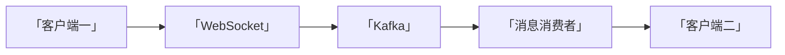

本节重点讨论一个问题：im 服务在发送消息之后，如何定位问题。

先看流程：客户端一向客户端二发送一条消息，底层是客户端一将消息通过 WebSocket 转发给 Kafka，再由 Kafka 的消费者进行处理，将消息转发给对应的客户端。

消息的传递链路如下：

现在客户端二接收消息失败，没有收到客户端一发送的消息，问题出在哪里？

出错原因其实有很多种：客户端一发送时没有指定好发送目标，会影响结果；消息消费者推送不正确，也是问题；WebSocket 本身的发送过程失败，同样有可能。所以问题因素是很多的。

如何定位这类问题？讨论之前先明确程序中常见的错误类型，这里列举一些场景：程序、系统、用户、环境等方面的错误，也包括第三方安全性的错误。这些错误因素都可能导致程序无法输出结果。对一个系统来说，问题因素很多，问题定位就显得尤为重要。

问题定位可以通过如下几种方式。

第一种是日志与监控。在服务中加入日志，根据服务在请求过程中框架、数据库等输出的运行信息进行分析；同样可以结合监控，对程序性能和一些参数指标进行监控，作为一种问题的发现方式。

第二种是基于分布式跟踪，这是后面会重点讲的话题。前面例子涉及的服务比较多，调用链比较长，因此对请求的跟踪非常重要。把请求跟踪好，执行到哪个环节出现什么错误都能定位清楚，就能很好地发现问题。

第三种是自动化测试，属于开发层面，通过丰富的单元测试及集成测试等相关测试来发现问题。

回到前面 im 消息传递过程中的问题，定位手段就是分布式跟踪：跟踪请求的调用链，看到底是哪个环节出了问题。

本节的重点是了解业界中程序问题的出现形态，以及可采取的定位方式，即微服务中问题出现之后该如何定位。
