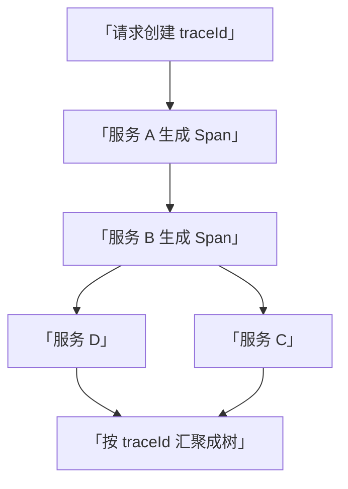

服务中可以基于跟踪的方式实现问题定位，本讲主要理解链路跟踪的实现思路。

当前系统基于微服务架构，部署了多个服务，各服务有各自的业务，相互之间能够协调调度。当一个请求在过程中出现问题，基于链路跟踪会将该请求的过程记录下来，再进行相关分析。所谓链路跟踪，就是把每一个请求所走过的路程都记录下来。

链路跟踪有如下作用：故障排查、性能分析、监控和报警，以及服务的依赖分析。

故障排查与性能分析比较容易理解：跟踪了整个链路，链路环境中哪个地方出现问题、哪个地方耗时较多，都很容易分析出来。

监控和报警，是在链路跟踪过程中，把请求执行的一些数据信息收集起来再做处理。

服务的依赖分析比较重要。微服务项目前期规范相对良好，但随着服务扩展，越来越多服务相互集结，调度频繁，可能出现循环调用。因此服务与服务之间的依赖分析尤为重要，链路跟踪正好可以实现这个功能。

理解链路跟踪还需要掌握几个核心数据概念，查资料时都会遇到。首先是 Trace（任务），链路跟踪可以看成是一个 Trace；Span 是任务过程中的某一个事项，比如数据读取、对结构的请求，都可以称之为 Span。traceId 是给当前整个链路任务定义一个 ID；parentSpanId 则是 Span 在当前节点记录上一级 Span 的 ID。

目前的业界中，链路跟踪有两个比较热门的实现方案，都有实际应用且都很优秀，本讲不去比较它们的优缺点。go-zero 中这两个方案都有实现。课程采用第二种 Jaeger 方案，它是一个开源的分布式跟踪程序，go-zero 中也有它的官方使用示例。

下面分析链路跟踪过程中的流程。图中的例子是一个任务请求：请求开始时创建一个请求 ID，叫做 traceId。之后请求进到第一个 Span，作为一个任务节点。当前服务（A）中也有一个任务节点，它会调用服务 B 相关的业务，同时在传递过程中传递 traceId，也就是 spanId 和 parentSpanId：traceId 是任务 ID，spanId 是这个节点事项的编号。

B 接收到信息之后，自己也要调用两个业务，一个是 D，一个是 C。调用过程中它同样会把链路跟踪信息传递给 D 和 C 这两个服务。传递过程中 traceId 永远不变，因为它代表的是一个请求；spanId 则会更改，因为它会记录上一级的 ID 和当前 ID。每一层都传递自己的 spanId，好处在于：最终汇聚时按 traceId 汇聚，再围绕 traceId 展开成树结构，以此对整个调度链进行分析。这就是链路跟踪的传递过程。

链路跟踪的传递过程如下：

整个链路跟踪的几个关键处理是：生成任务 ID（traceId），再根据节点生成 spanId，然后将信息传递给下一个任务，逐级传递；传递过程中把信息记录到日志中，最终通过工具生成可视化界面来分析。这就是链路跟踪的流程。

本讲的重点就是理解链路跟踪的实现关键点。
