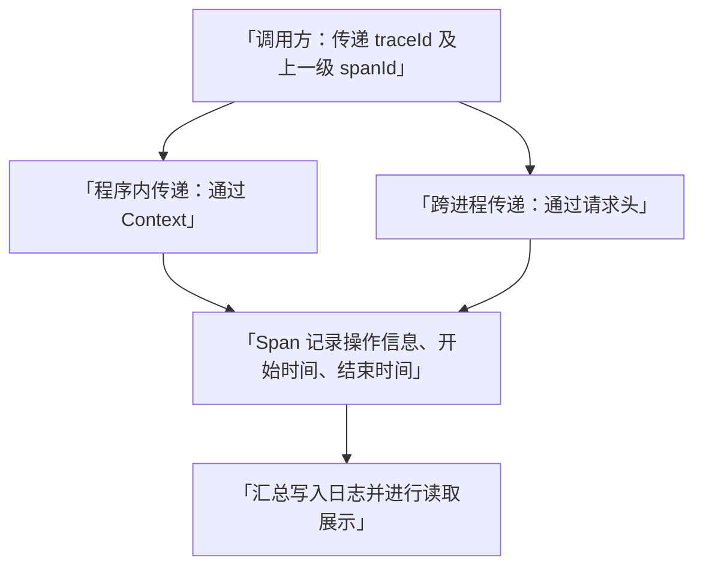

前面已经对 go-zero 中链路跟踪的设计思路做了一定的应用，本节来探究 go-zero 中链路跟踪的设计思路具体是如何实现的。

课程内容：先针对设计思路进行分析，然后分析具体的技术实现，最后展开源码分析。

## 链路跟踪的设计思路

设计思路前面已经讲过：一条链路要跟踪下来，会包含请求当前程序内的调用以及程序外的调用。信息传递中传递 traceId 及上一级的 spanId，有这两个信息，只要一直传递下去，整个链路就能跟踪下来。

就像图中所展示的：传递 traceId，然后是 spanId，下一级再把自己往下传。把这些信息汇总写到日志中，再进行读取展示，最终就构建出流程图。

设计上主要遵循 OpenTracing 规范，即 OpenTracing 中的定义、设计模型和跟踪关系。传递过程中，内部传递通过 Context，外部传递通过请求头。每个 Span 会记录操作信息、开始时间、结束时间等相关信息，并基于 Span 的 Context 作为上下文，这就是整个链路跟踪设计的思路。

整个链路跟踪的设计思路可以归纳为下图：

## 技术实现的两个关键问题

接下来讨论设计思路的具体技术实现。技术实现中有两个非常关键的问题：一是代码尽可能少，最好无入侵；二是信息在内部及外部程序中如何传递。

第一个问题可以通过 AOP 思想以及切面的方式解决。业界常用的方式是中间件，利用中间件来解决这一项问题；除了中间件以外，代码的封装（然后再调度）也可以。这两种方案在业界多有应用：中间件的封装主要针对入口，也就是跨进程的时候；代码的封装主要是内部程序相互之间调度时的封装。

还可以使用埋点，在某一处代码编写好；内部传递通过 context，跨进程则基于请求头。下面具体看源码，进一步了解。

对源码的理解分两步走：第一步是对组件的应用，了解内部用哪个 trace 组件、如何使用，以此更好地理解内部实现；然后再分析这个组件的源码和它的使用。

## 组件应用：进程内的调度

先做组件应用，这个组件就是 trace。进到之前的测试中来进行测试，将原来那份代码注释掉，然后首先定义对 trace 的初始化。

初始化时定义一个 trace 整个项目的属性 key，这个属性 key 通过 OpenTracing 来设置。它在 go-zero 中有自己的默认属性名，这里定义为 tst.trace.test 作为描述。go-zero 的 trace 提供了一个初始化代理对象的方法，在前面分析配置时已经调用过它。接下来传递好配置信息：先写好名称，再定义其他相关参数，配置就定好了。

已经有初始化方法了，接下来进行链路跟踪，提供一个测试方法，先进行 go-zero trace 的初始化。

然后要得到 Span。传递 Span 名称，调用它的初始化方法，传递 context，给当前这个 Span 定名称 A。再来设置 Span 的状态，并把要打印的信息输出一下，打印 Span 的信息。这个信息打印的是当前这个 Span 是否存活，也就是编写的 Span 是否正常工作。

接着执行任务，定义一个任务方法。方法中传递测试对象，用来输出信息、做调试；再传递 context 及 Span 名称、描述等信息。

在这个任务方法中，首先要得到一个 Tracer，可以通过 context 获取。因为目前的方式是内部方法之间的调度，所以直接通过 context 得出 Span 的 key。然后通过得到的 Tracer 创建一个新的 Span，并设置好属性。设置好之后再设置 Span 的状态，也是一个 ok 的状态。

前面这一段主要就是对 Span 进行处理，即创建 Tracer，然后给当前任务定义一个 Span。理论上可以把这一段封装起来，就不用每次都重复写。后面才是真实的任务处理，即任务的执行。这样 Span 就结束了，接下来就是把信息刷新（Finish）出去。

处理任务过程中，可以把 Span 的 ID 打印出来，通过 Span context 来获取。前面已经讲了，Span context 作为整个链路工具中的上下文，所以通过它能获取到任务的 ID 以及当前 Span 的 ID，测试就写好了。

之后在上边调用它，给 Span 任务加一个描述。这其实是实实在在调用组件包中的处理：通过这个组件包得到 Tracer，再通过后面的方法得到 Span 及 context；这个 context 是基于 Tracer、Span 处理的。所以在内部就会给予这个 context，比如这里是子级任务，子级任务基于 Tracer、Span 得到 Tracer 之后，再得到属于自己的 Span。

后面的结束方法主要是将任务进行刷新，递交到服务器上。注意它的处理是异步执行的，因此想让它提交出去，后面要加一个 for（循环）来等待，这样才能看到效果。

运行之后有输出信息：traceId、spanId。进到界面中刷新，可以看到自己定义的任务。不过目前这种方式属于程序内的调度，即当前自己服务程序内的调度。

## 跨进程的 Span 传递

如果想让它跨服务调度怎么办？这个问题也可以解决。停止之前的测试，在代码中添加跨进程时 Span 如何传递的处理。

根据前面的分析流程，任务的关键是 traceId 和 spanId 这两个信息，只要拿到它们，就可以设置好传递方式，所以现在需要先得到这两个 ID。当然可以继续在后面添加，只要能确保前面测试所用的那个 ID 能获取。重新进行一次请求，此时会有一个新的任务，以它作为示例来演示跨进程的处理。

这个新任务需要在后面继续添加。先把上面那一段注释掉。跨进程自然就需要增加新的任务。加的过程其实和前面的处理是一样的，只是当前 Span 名称要改一下，做第二个。

现在重新运行，关键在于得到 traceId 和 spanId。这里需要调用一个方法，该方法属于 Jaeger 包，由于包名与上面的包名有冲突，所以需要先定义一下。包中有一个方法，可以把请求头中传递的信息解析成一个 SpanContext 并返回。当前的 traceId 就是这里提供的 traceId，将其取出做相应处理。然后再通过同样方法获取 spanId，取出之后做一下错误的处理。

处理完之后，就得到了上一级整个任务的 traceId 及上一级 spanId。后续处理中需要给自己重新定义一个 SpanContext，基于刚获取的整个任务 ID 及上一级 ID 来定义并初始化，就得到 SpanContext。

得到之后，用 SpanContext 得到当前任务的 Span。当前任务的 Span 需要通过 Tracer 创建，因此上面还少了一个被 Tracer 创建的过程：先创建出 Tracer，然后通过它来创建 Span 和 SpanContext。

创建过程中的处理和前面那一段不一样：前面默认的 Context 是空的，但现在有了自定义的处理，不能为空。此时要调用内部提供的方法，重新更新 Span Context，把自定义的 Span 传递进去。这样就可以根据当前任务及上一级 Span，创建自己目前子任务的 Span。

后面的流程处理一样：设置状态 OK，再执行任务。执行任务时也可以发起向 RPC 的请求，这里就不发起了，直接结束。

再来测试。有一个地方：第 65 行这个 Context 还没有被使用，那就不需要了。重新运行可以看到，自定义的 Tracer 已经加进来了。也可以在当前 Tracer 中发起 RPC 请求，示例中已经提供了这一段代码，可以参考示例发起请求并进行测试。课后测试可以看到，整个链路会被完整记录下来。

## 源码分析：go-zero 中的实现

到这里基本上对 go-zero 的 trace 有了解了。过程中我们做的事情是利用 go-zero 的 trace 组件发起请求。但底层实现的关键，并不是基于我们定义的 Jaeger 客户端使用，而是使用了另一个包。这个包的特点是封装了 Jaeger 以及其他一系列开源链路跟踪程序的实现，所以集成更丰富一些。

在调度过程中，它首先对当前的 Tracer 进行初始化，初始化之后下层就得到这个 Tracer，如果有相应的 Span，就通过它的 ID 来获取，最终再重新设置，这就是它的执行流程。

此时再来看 go-zero 中的代码，看到的（grpc）拦截器代码里，就是初始化，然后创建 Span，这一段属于任务的执行；这一段是状态及属性处理，处理完之后就发送完了。Span 初始化时做的事情很多，比如先得到 Tracer，与前面那一段流程一样。理解了这段流程，再来看 go-zero 的这段拦截器及中间件的处理，就更容易理解它们所做的事情及代码的执行。

提前介绍这个使用示例，主要就是为了通过它理解 go-zero 对这些组件在拦截器中是如何调度的。

了解过这一段之后，接下来进入源码分析。源码分析并不难，因为它的关键因素就是基于这一个扩展组件来实现的。进到代码中，先看启动相关的 trace 代码。go-zero 在 trace 包中对 Tracer 进行初始化，启动这个代理。在代理的创建过程中，它会根据当前传递的类型分别创建对应的处理对象，然后再设置到包中进行处理，原理并不复杂。

在应用上，前面已经看了拦截器的应用，除此之外在数据库处理时也有应用。比如在当前的模型中看它的查询方法，查询方法中就设置了 Span，然后又把这个 Span 结束，所以它的应用是非常多的。

代码中涉及两个地方：如果是程序间跨程序的时候，拦截器的应用比较合适，因为拦截器会捕获相关的设置信息，也就是传进来的 traceId 和 spanId；如果是内部处理，比如当前数据库模型这里属于内部处理，就通过 context 直接获取对应的 traceId 和 spanId。

这正好符合前面讲到的两个话题：一个是通过 AOP 思想，第二个是代码封装及埋点处理。当前的这段处理属于代码埋点，就是埋在某个地方来执行的。

## 课程总结

本讲的重点是了解 go-zero 中 trace 的应用。了解过程中一定要先搭建好这样的测试，理解 go-zero 中 trace 的使用技巧，这样看源码的时候就能更容易理解代码的调度过程。文中提供了相关示例，可以根据文档示例及课程过程来进行测试。
