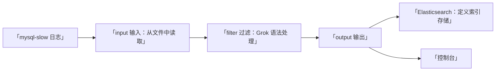

本节基于 Docker 来构建 ELK 架构。

课程内容分为两个环节：第一先构建好 Elasticsearch 与 Kibana，第二构建好 Logstash。

之所以这样分开是有原因的。从整体架构来看，Elasticsearch 主要做数据的记录以及数据的分析；Kibana 做数据的可视化；Logstash 做日志的搜集。

抛开架构不谈，单纯从 Elasticsearch 与 Kibana 这两者来看，它们本身就可以结合起来应用，因为 Kibana 本来就是针对 Elasticsearch 提供的可视化界面。所以先将它们构建好，再通过 Logstash 采集好日志信息，推送给 Elasticsearch。这就是课程的流程。

## 构建 Elasticsearch 与 Kibana

Docker 构建方面，文中已经提供了相关的 Docker Compose 配置信息，将其在项目中引用。引入之后，下一个环节要注意配置好它们的信息。

这里是 Kibana 的配置信息，也需要配置一下。在这段配置信息中，这一项使用的是 Elasticsearch 容器的名称，因为 Kibana 启动时会与 Elasticsearch 进行连接，所以能够直接通过容器名称进行访问。

Elasticsearch 启动时还有一点值得注意：需要对数据目录增加好权限，否则它会抛出异常。这里已经提前对目录增加好权限了。

现在启动服务，将整份代码同步到服务器中，执行 Docker Compose。从执行情况看，过程中没有抛出异常，整体执行正常。接下来进行测试。

Elasticsearch 容器启动时定义了对外访问的端口 9100，通过 HTTP 方式访问这个端口。第一次访问没成功，是因为 Elasticsearch 还在启动过程中，目前只是看到这个时间点没有抛出异常，不代表它启动完成了。第一次访问失败、第二次访问能看到信息，说明 Elasticsearch 不出错。

接下来看 Kibana，访问它对外开放的端口 5601。能看到这个界面，基本上就可以确定 Kibana 安装好了。至此 Elasticsearch 和 Kibana 构建完成。

## 构建 Logstash

接下来构建 Logstash。它的操作与前面有点区别：Logstash 的主要驱动依托于 Logstash 的配置信息。它的主要功能是收集日志。收集日志时需要考虑几个问题：日志的来源在哪里、采集之后要不要过滤、过滤完之后输出到哪里，这些信息都可以通过配置文件去定义。

所以一开始要先定好一份 Logstash 需要的配置文件，告诉它采集的数据、要对数据做什么处理以及输出到哪里。使用 Logstash 的第一步就是定义好这份配置文件，指定刚刚提到的三个操作。Logstash 启动之后，根据配置文件的指示进行相应的任务处理。下面看它的配置文件。

配置文件已经提前放到了目录下面。配置文件怎么得到？可以直接下载它的安装包，安装包里就有配置文件。这里有一份基础型配置文件，它指定了三件事：日志的源从哪里得到、日志得到后要做什么处理、最后日志输出写到哪里。因此这个配置中有三段定义：输入、过滤、输出。这就是 Logstash 的配置文件。

Logstash 配置文件的三段处理流程如下：

本次课程采用 mysql-slow 日志作为示例：让 Logstash 采集 mysql-slow 日志并进行相应处理，然后推送给 Elasticsearch，或者直接输出在控制台中。

mysql-slow 日志也提前准备了一份放在目录下。这个日志信息主要输出 select 语句的执行记录。关于 mysql-slow 日志怎么处理，上面也有命令，执行该命令可以动态设置 mysql-slow 日志，并设置对执行多长时间的 slow 日志进行记录，以秒为单位。

了解完之后，配置 Logstash 配置信息。它总共分为三段，配置内容并不难。可以将其引入到项目中。但不会把整个配置文件进行共享，因为默认 Logstash 容器启动时还有其他配置，为避免与容器中已配置好的信息冲突，通常会把这份配置文件单独提出来放到目录下，只需要配置这个文件即可，也就是指定 Logstash 的工作。

配置文件已经提到项目中了，来了解一下它是怎么执行的，看里面的参数信息。先看 input（输入）。配置文件上面的这一段是日志的输入源，即日志从哪里输入。定义文件类型代表日志从文件中读取；除了文件读取以外还有其他方式，比如通过 Beats 工具、通过控制台输入，方式很多种。目前因为 MySQL 的慢查询日志在本地，所以采用文件读取方式。读取类型是对当前 MySQL 慢查询日志信息读取之后定义的自定义参数，这个参数放到后面会有应用。

其下指定了当前 MySQL 慢查询日志配置文件的地址，以及从什么时候开始。第一次打开时，默认从最开始的位置读取日志文件。读取完之后它会在内部记录一个偏移值，当 Logstash 发生故障、下一次重启时，就会依据记录的偏移值往后读取数据。但如果在这里指定，那每一次都会从最开始的位置读取。

再下面这一段是定义多行（multiline）处理的。MySQL 的慢查询日志是一条多行的日志信息，所以要在配置文件中定义多行的处理。配置参数主要定义哪些内容？看这个日志信息：第一个是多行分割，需要分割出哪一段是一块日志。分割需要有一个关键性的方式，可以根据 type 来分割，因为它是固定写法，其他标识会变动：type 之前的算上一条日志，其后的算当前日志。所以此处有这两个配置。最后一个配置就是将多行的信息合并在一起进行输出。这就是整个 input 的输入。

再提一下 filter（过滤）。过滤中有一点需要注意：这里用到了一个语法，是 Grok 语法，它和正则很相似，写法本身与正则具有相似性。对于这个语法，编写时还提供了一个平台，可以帮助解释所写的语法是否正确：把语法复制放进去，再复制 MySQL 慢查询日志，平台就能解释出这个 Grok 语法是否正确。因为这是访问国外的网址，响应会慢一些，但可以通过这个网址来检测匹配情况。

最后是输出。目前是输出到控制台。到此 Logstash 就定好了。

Logstash 定好之后，接下来启动它，看是否采集到期望的 MySQL 慢查询日志信息。启动有两个方式：第一通过 docker run，第二通过 Docker Compose。建议开始时先不着急用 Docker Compose，需要先确认当前的配置文件是否正常、配置信息是否正确，不检查会有一些误差。因此先通过 docker run 来验证没有问题。在这个命令中，需要更改的就是慢查询日志的文件名，然后注意它的运行目录。

启动好之后，它读取到了 MySQL 慢查询日志并展示出来了。信息中可以看到对 SQL 的记录，还有对耗时（持续时间）的记录，说明刚刚所做的配置没有问题。

现在配置验证没有问题了，就把日志推送到 Elasticsearch。怎么推送？当然是定义 Logstash 推送的目标，改为 Elasticsearch。其下有对应的配置信息，并不复杂，将其引入到项目中。另外有一点需要注意：上面的注释要用 # 号来注释，双斜杠（//）是不行的。

其下就引入了 Elasticsearch。引入方式同样通过容器名。引入之后把数据推送给 Elasticsearch，它需要定义索引来存储数据，所以在这里定义了一个索引。

定义好之后，自然就要构建好 Logstash，把 Logstash 的 Docker Compose 配置信息引入到项目中。引入后还需要修改里面的参数，其中参数包含：对 MySQL 的目录指定，这个可以不用改；另一个目录要更改一下，其他方面没有要更改的。

把当前运行的 Logstash 停止并删除，然后把这份 Docker Compose 重新同步到服务器中启动。执行完 Docker Compose 之后要稍微等待一段时间，因为 Logstash 本身是通过 Java 开发的，启动需要一定时间。等待过程中可以对 Logstash 进行日志监听，查看它目前的启动状态。初始化之后开始启动，等待一段时间后可以看到启动完成、进入正常状态，并且能够重新读取到慢查询日志，说明配置没问题。

然后回到 Kibana 中，打开它的开发工具（Dev Tools），填写好相关的查询命令并点击，可以看到它能够查询到前面定义的那个索引。能查询到数据，说明 Logstash 已经将数据推送给了 Elasticsearch，Kibana 中读取到了 Elasticsearch 的数据。

## 多日志源的采集

到这里已经对 ELK 这套架构做了一定了解，但还不够。问题在于：目前对日志的采集是针对单一的，只针对 MySQL。但业界中需要采集的数据有很多，如何针对多样化的信息进行采集？目前的配置还做不到。为此 Logstash 也提供了配置来解决这个问题。课程中已经提前准备好示例：拿 MySQL 慢查询日志结合 Nginx 来作为示例。Docker 容器启动时就已经指定了 Nginx 的配置文件地址，这就是 Nginx 的访问日志。

应该怎么配？也不复杂。整个配置文件中有一个非常关键的信息：type（字段），它是根据日志类型自定义的，不属于日志中的信息，相当于给这个日志打一个标签，后面再基于 if 的方式判断这个 type 是否等于自定义的类型，如果是，就进行下面的流程。这样就可以做到分类处理。

示例的配置已经写好了，直接引用进来，因为过程并不复杂。主要了解里面的配置信息：上面这一段是 MySQL 的，原样没有更改；下面增加了 Nginx，对它的处理同样打一个标签，以及日志文件的地址。不过需要将此处注释掉，因为已经从起始节点读取了，如果再去就成了重复读取，这个地方要注意。

其下就是刚刚提到的判断：利用 if 判断它的过滤方式，如果不打上 type 标签，那么全部都会输出。下面的是输出方式。整体上看，配置并没有那么复杂。

将这份配置文件同步到服务器中，重新启动服务，再进行 Docker Compose 启动。启动之后通过日志监听可以发现它已经采集到了 Nginx 中的日志信息。再看 Kibana 中能不能查到这个索引，能查到就说明没问题。可以看到能查到，此时多日志的采集也实现了。它的关键因素就是通过 type 这么一个键来做区分的，所以整体没有那么难。

本节的核心重点是构建好 ELK，同时加强对 Logstash 的使用，主要在于配置文件。操作过程中一定要注意配置文件的指向不要错了，这个地方一旦指定错，就会发现不生效。另一个就是 Grok 语法，要结合官方文档和平台工具两者来编写。实际上一般来说互联网上都会有相关的事例，也可以通过 AI 去生成。
