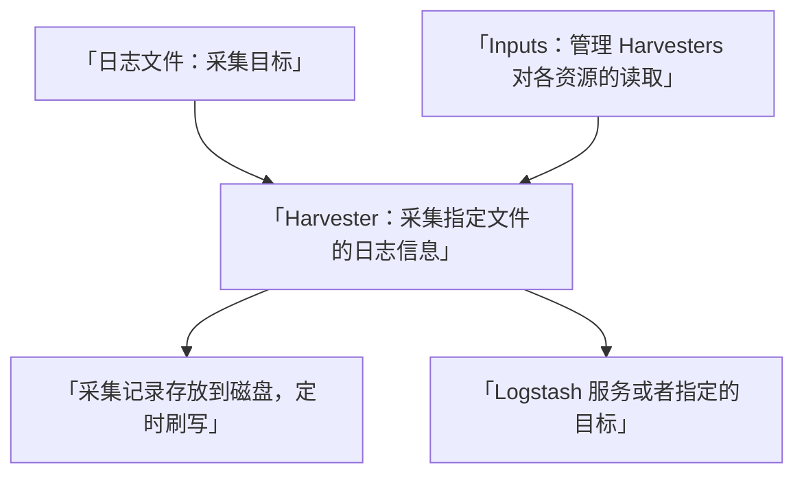

ELK 已经理解并构建好了这一套架构，本节基于 Filebeat 来收集各个服务的日志信息。

课程内容分为四个环节：第一，了解 Filebeat；然后对 Filebeat 进行应用；再了解 Filebeat 的工作过程；最终使 Filebeat 与 ELK 进行结合应用。

## 了解 Filebeat

之前的课程已经了解，Logstash 可以采集本地日志，也可以采集多个日志。既然已经可以采集，为什么还要通过 Filebeat 再采集？

针对这个问题，就要讨论 Logstash 的缺点：Logstash 由 Java 所开发，启动过程比较缓慢，并且所需要的资源也比较多。如果把它放到实际运行的程序中，与业务服务在同一个服务器中运行，势必造成资源的竞争，弊大于利，此时还不如不要这个功能，因为它会明显影响到整个程序的运行。

于是就有了这样一个需求：需要一个更加轻量级的采集工具。Beats 系列因此出现。Beats 这一系列是针对各类信息采集的一套方案，可以采集日志文件，也可以采集系统的运行数据。这里讲的是针对日志采集的 Filebeat，它采集之后将信息推送给 Logstash。

因为 Beats 是轻量级的，所以它牺牲了数据处理能力，数据处理需要交给 Logstash 来完成。

了解完 Filebeat 之后，接下来对它进行应用。应用并不难，先通过命令下载。Filebeat 是由 Elastic 开发的轻量级工具，安装好之后可以进行测试，能看到效果就说明安装没问题。

安装目录下面有一个配置文件，里面预定义了很多操作相关的配置，比如 Logstash 输出、Elasticsearch 输出等等。

为了更简单地理解 Filebeat，将里面的配置信息精简，只使用最朴素的方式：采集本地的日志信息，将它输出到控制台。这里已经提前准备好了一份：采集的是 Nginx 的日志信息，类型是日志类型，最后输出到控制台，这就是采集的数据。

接下来应用它，推送到服务器中。应用方式非常简单：执行 Filebeat 命令，加上 -e（关闭 Filebeat 本身日志的输出）和 -c（指定配置文件）参数，执行速度明显比 Logstash 快很多。

执行中它会输出很多关于当前服务的信息，可以通过这些信息进行排查。它会输出当前要监听的日志文件的地址，以及对日志信息的监听，这里就有 Nginx 的日志信息，说明当前配置成功，Filebeat 程序也正常启动了。

## Filebeat 的工作过程

接下来了解 Filebeat 的工作。它的工作主要有两个部分：Harvesters（收割器）负责采集各个指定文件的日志信息；Inputs 则负责管理 Harvesters 对各个资源的读取。两者相互配合工作。

可以简单看一个图。这里有两份日志文件，是 Filebeat 要采集的目标。Filebeat 采集的方式是开启一个 Harvester，对这些日志信息进行采集。采集的时候，它会将采集之后的记录定时刷写到磁盘中。具体来说：在 root 数据目录下会有一个 Filebeat 创建的 data 目录，用于刷写数据到磁盘。刷写的目的是记录它对日志信息读取的节点，这样下一次启动时就不会从零开始读取。读取的信息可以送给 Logstash 服务或指定的目标，工作过程相当简单。

Filebeat 的工作过程如下：

## Filebeat 与 ELK 的结合

了解 Filebeat 的工作之后，接下来让 Filebeat 与 ELK 结合。结合的关键处理就是配置信息，在 Logstash 中主要有两个地方：

第一是 Logstash 的配置信息，增加对 Filebeat 信息的监听，定义一个端口 5044，这基本上是 Filebeat 的默认端口。然后将其他配置文件注释掉，只留这个 Beats（输入），后面的不用改。再修改一下这个 index（改个 Beats）。修改是为了验证它的来源是 Filebeat 读取的。

然后复制下这个类型，进到 Filebeat 中要更改两个地方：第一是输入来源，目前此处没有定义日志的类型，但后面需要这个类型的字段，所以要从 Filebeat 中去处理。在 Filebeat 中，要求读取的日志增加一个字段，这个字段就是 type，并且要求这个字段放在配置的顶层，这个 Beats（输入）一定要有，否则它就不会识别这个字段了。

定义完之后，接下来定义输出：输出对象是 Logstash，定义 Logstash 的访问地址、端口。至此两个 Beats（配置）就定好了。同步到服务器中之后，分别启动这两个服务：先停止 Logstash，再执行 Docker Compose，确认启动完成后再启动 Filebeat。

现在它没有采集到新的日志信息，主要原因是 Nginx 的日志信息已经被 Filebeat 采集过了，没有新的数据。所以需要通过访问 Nginx 产生新的日志：访问一下 API 的网关，让它产生出访问日志，然后进行测试。访问之后能得到新的数据，可以看到这边有日志的输出，说明目前 Filebeat 有将日志推送给了 Logstash。

再看 Kibana 中是不是能得到这个索引。能得到这个索引，说明整个流程走通了。

到此已经了解了 Filebeat 这款工具，并且使它与 ELK 进行了结合应用，本讲的核心内容基本到此结束。

课程内容中重点就是理解 Filebeat：先理解它大致的意义，主要是解决 Logstash 存在的缺点。然后在应用中注意好配置信息，过程并不难，主要是细节。

操作时容易产生的问题：Filebeat 向 Logstash 推送时或许推送成功了，但是 Kibana 中没有得到索引的信息。这个问题一定要仔细排查：配置文件中的配置信息是否正确，该注释的是否已注释、该关闭的是否已关闭，各处配置是否正确。可以先不着急推送给 Logstash，先把它注释掉，先向控制台输出，验证当前采集的信息是正确的，然后再排查是不是 Logstash 的问题，一步步排查。
