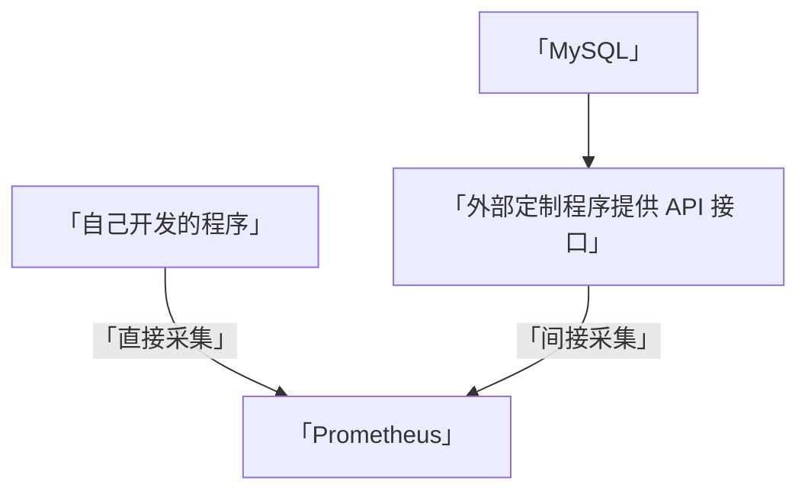

本节内容总共有两个话题：第一，应用 Prometheus；第二，Prometheus 与 Grafana 进行结合。

## 应用 Prometheus

首先对 Prometheus 进行应用。前面已经了解，Prometheus 主要做的事情是收集各个程序中的数据指标，然后来进行分析。

在过程中，它对信息的采集主要有两种方式：第一，直接采集；第二，间接采集。

直接采集主要应用于自己开发的程序，或者其他程序对 Prometheus 有支持的情况，就可以通过直接采集的方式，采集服务器运行过程中的相关数据指标。

间接采集主要针对已经成型、成熟的相关程序，比如 MySQL。MySQL 已经运行了好多年，早期并没有对 Prometheus 进行支持，所以对 MySQL 数据信息的采集，就需要通过自己的方式，在 MySQL 这个服务之外开发一个程序。这个程序会监测 MySQL 中的信息、各项指标，然后对外提供一个供 Prometheus 访问的 API 接口，通过这个 API 接口来获取 MySQL 的数据。

所以 Prometheus 的采集方式主要有两种。课程中主要采用第一种方式：在自己的应用程序中对 Prometheus 进行支持，并在合适的地方对某些数据指标进行标记，以便供 Prometheus 采集。

两种采集方式的对比如下：

了解完之后，接下来要安装好 Prometheus。这里有一份 docker-compose 的配置信息，将其引入到自己的项目中，引入之后再同步到服务器中。同步完成，接下来应用 Prometheus。

对 Prometheus 的应用前面已经分析了，课程中采用直接采集的方式来采集数据指标。因此需要做的事情是：第一，开发一个服务；第二，在这个服务中对 Prometheus 的采集进行支持，并给它提供一个 API 接口，供它访问采集。

在完成这些工作之前，还需要安装好依赖包，这里已经提前安装好了，接下来就可以开发这个程序。

还有一点值得注意：在这个 docker-compose 的配置信息中，指定了 Prometheus 的配置信息。这份配置文件有什么作用？前面分析过：Prometheus 采集可以通过直接和间接的方式，但它要采集的目标在哪里？访问的地址又是怎样的？这些信息并不明了，因此需要通过配置文件告诉 Prometheus 要采集的服务及目标在哪里。此处就定义了一份关于 Prometheus 的配置文件信息。

在这个配置文件中，定义了几个关键属性：这是采集的配置；其下定义了对一个服务的采集；这是采集的任务名称；然后是采集请求的 URL 地址；其下则是具体访问服务的 API 和端口地址。这样就定义了一个要采集的服务信息。

定义完之后，接下来针对这份配置文件所定义的信息来创建该服务，让 Prometheus 采集这个服务。

进到此处，创建一个 Prometheus 的测试用例。需要知道要采集的目标有哪些。采集目标分为两种：

第一类是运行时运行的相关数据指标，比如内存的使用、线程数，这些在下载 Prometheus 相关的库的时候，内部就已经完成了，所以此处不需要再做额外的处理。

第二种是自己要自定义的采集信息，此处主要讲第二种，因为第一种它已经自己实现了。

这种方式就需要定义一个 Gauge 类型的指标。创建一个 Gauge，然后设置 Gauge 信息，即当前要采集的信息、指标的名称以及帮助信息。比如当前称之为 test_gauge，给个描述。定义好要采集的指标之后，把这个采集的指标信息注册到 Prometheus 中，此处就定义了一个自定义采集的数据信息。

在 Gauge 中，它抽象出一个接口，这个接口主要针对 Gauge 在执行过程中数据变化信息的调整。

定义完之后，再定义一个简单的处理。可以定义一个任务，这个任务是死循环的，相当于一直在进行这一项工作处理。处理过程中对 Gauge 进行加 1，比如它处理一次，就记录一次。要考虑的是：实际在数据指标添加的时候，并不会每一次都一定添加，可能因为某些条件才添加，所以可以在此处定义一个 int，相当于每执行两次，就让它添加一下。同时再给它一个递增的计数，相当于任务的次数。这样我们就定义好了一段任务，并且在这个任务中体现了对该指标信息变化的记录。

定义完之后，还需要对 Prometheus 定义一个 API 的接口。这个接口的地址信息在这里已经描述了：这是请求的路径，然后是运行的方法，之后再开启 Prometheus 的监听。至此服务就定义好了。

服务定义好之后，进到服务器中，先执行 docker-compose，把 Prometheus 安装好；再将这份代码放到远程的机器中启动运行。在远程机器中执行 go mod，加载相关的依赖包，这里已经加载过了。进到 Test 中运行 prometheus.go，看 Prometheus 是否正常运行，可以看到它正在运行。

服务启动好之后，访问这个端口就能够看到此处的界面，确认是否正常运行。然后在远程的机器中运行所定义的 Prometheus 测试服务，让它跑起来。

回到此处，怎么检测自己运行的服务是如何被检测到的？可以看到这里有个信息，这个信息就是定义对哪一个服务进行信息采集。目前可以看到它已经上线了，这里有个 target 上线。接下来看这里面的信息，点击之后直接查询 test_gauge，在此处就有前面所定义的监听的指标，说明刚刚做的事情没有问题。可以看到，Prometheus 也采集到了所定义的这个服务的数据指标信息。

我们也可以通过 Prometheus 提供的可视化界面，对刚刚的数据进一步分析。可以看到这里就是一个可视化界面的图，因为目前执行时间不是很长，变化不是特别明显。将时间节点缩小，就相对明显一点。通过调整合适的时间范围，可以看到数据的变化。

现在 Prometheus 已经安装好，并进行了简单的应用，进入下一个环节。

## 与 Grafana 结合

Grafana 结合的时候可以先直接进行结合，先去安装好。这里提供了 Grafana 的 compose 的配置信息，将其引入到项目中，再同步到服务器中。除此之外，其下还提供了对 Grafana 所定义的配置信息，在这里指定了配置信息。看一下它的信息内容：信息里定义了它的数据源。数据源有很多类型，目前定义的是 Prometheus 的数据源、Prometheus 名称、请求地址等相关的信息。

进到服务器中把它加载起来，启动之后看一下，启动没有问题。Grafana 启动之后，访问这个地址，即它的 Web 界面地址。进入 Web 界面之后，首先进入初始的登录界面，用户名和密码默认都是 admin，配置新的密码，配置完成。

接下来可以进到此处，这里有一个 Dashboard，可以通过它创建一个 Dashboard，这就是 Dashboard 的可视化信息。点击此处来创建，选择 Prometheus，选择之后就会看到这么一个界面。

在这里该如何使用？Grafana 主要做的事情是将数据更好地可视化并进行分析，而它的数据源则来自于 Prometheus。Prometheus 的数据主要来自于此处所采集的目标。在这个目标信息中，它包含了 Go 运行时类似的一些服务信息，也包含了自己自定义的数据信息。在这里可以选择分析自定义的数据信息，输入自己要分析的指标名，点击，它们就能分析了。可以将时间范围缩小，更直观地看得到信息结果。比如将这里改为一小时，结果就会更加明朗清晰。

在此处它支持 PromQL 的语法，比如说像这样，统计当前的这一个指标在一小时内的数据信息变化，运行，这就是一小时内的数据运行变化。

基本上，目前就已经是 Prometheus 与 Grafana 进行结合了。Prometheus 主要的事项是采集各项数据指标，汇总起来进行分析；而 Grafana 则为 Prometheus 提供了一个更好、更简洁、更明了的可视化界面，通过它可以更直观、更精细地分析相关的数据。所以这两个组件在应用中往往是结合应用的。
