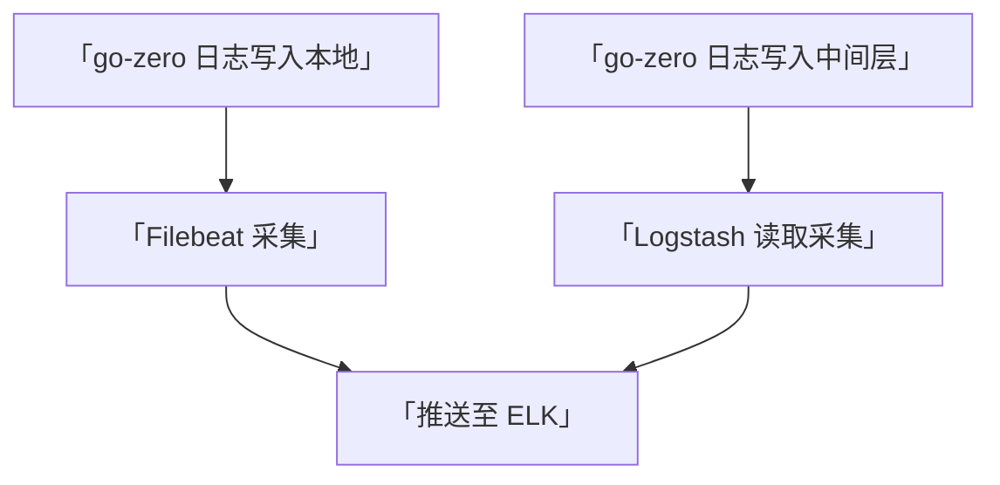

前面的课程已经构建好 ELK，并且基于 MySQL 的日志进行了应用实践。本节讲 go-zero 与 ELK 的结合。

课程内容总共分为五个话题：首先对这两者的结合进行分析；然后具体实践，基于本地日志该如何结合；基于自定义的输出方式该如何结合；再分析 go-zero 的日志该如何扩展；以及在业务情况下如何优雅地处理。

## 该如何去结合

先讲该如何去结合。

对于 ELK 的日志结合，从本质来说，都是 go-zero 将日志写入到某一个位置，然后 ELK 采取监听或者推送的方式来进行结合。

第一种是 go-zero 把日志信息写入到本地，然后通过 Filebeat 来推送；

第二种是 go-zero 将日志写入到某一个地方存储起来，而 Logstash 会去读取这一个位置的数据。

go-zero 与 ELK 的两种结合方式如下：

### 基于本地日志的方式

先来看第一种基于本地日志的方式：go-zero 将自己的日志信息写入到本地，写入本地之后通过 Filebeat 采集本地的日志信息，并推送至 ELK。

现在实现第一种方式。进到程序中，在这个目录下面创建一个日志的测试文件。

使用 go-zero 日志的时候，第一步就是调用 logx 的初始化方法进行日志的初始化，然后传递好日志的配置信息。配置信息中主要传递四个信息：

首先第一个是日志的名称，即服务的名称；然后是日志的存储模式，采取文件模式（另外一种是输出到控制台）；日志的编码，JSON；然后是日志文件存放的路径，存放在 go-zero 的日志目录下。

接下来编写一些日志信息，这是测试 go-zero 日志、推送日志等。

假设目前要写入的日志信息是这些。go-zero 中日志的写入是基于异步来完成的，所以我们在推送之前还要做一个事情：通过一个阻塞让它能够切换到日志，并完成写入的动作。

执行一下，可以看到有这个目录，也有日志信息，并且确实将日志写进去了。现在已经得到了 go-zero 的日志信息，即项目中的日志信息。

得到之后，自然就要通过 Filebeat 将该日志信息推送到 ELK 中。第一个事情是修改 Filebeat 的配置信息：此项配置将其注释掉，复制一份，更改里面的内容，主要更改监听 go-zero 的日志这一项。更改好之后，接下来要填写 Logstash，将这一份 Logstash 复制一份，修改原有的这一份 Logstash，这里已经提前修改好了：将原有的配置清空写进去，此处肯定要更改的，将其清除，里面的信息也要更改一下。

仔细看一下，这是 go-zero 输出的日志格式。将这一份日志格式复制一份，进到之前提到的 grok 调试网站中，编写 grok 的匹配规则。

该怎么编写？保持前面的这一些属性不变，因为只要获取的是它们的值，key 基本上是一致的，前面的语法结构是不变的，key 位置其实也不会发生改变。一直到这一项数据，这个版本号，然后 date 给它定一个 key。定义完这个 key，再加上一个符号，写完之后，它就能匹配到第一项值。

执行一下，可以看到是不是匹配的。后面没有匹配，是因为还没写完，要继续完成后面的内容。按照同样的道理，格式基本一致：date，然后 key，再执行。此时可以看到，第一项匹配到时间。后面继续写就可以了，可以根据这个过程去写。

直接复制一下，在客户端写这一份，更改，上面的这里都删掉，下面的这一项输出将其删除，保留输出的控制台，因为需要去进行调试。

写好之后，将其同步到服务器中。同步完成之后，重启 Logstash。Logstash 启动了之后，要通过另一个窗口来监听 Logstash 的日志信息，因为 Filebeat 要把信息推送至 Logstash，Logstash 会把推送的信息打印出来，所以这个地方的监控很重要。

服务器已经做好了，自然就需要 Filebeat 来对日志信息进行采集。进到 Filebeat 的配置目录中，给命令一个权限，再重新执行采集命令。执行完之后，它就开始采集日志信息。可以看到在 Logstash 这里，就已经输出了采集好的日志信息了，并且也将其处理好了格式，证明第一种结合没问题。

### 基于自定义的方式

这种方式结合成功之后，接下来看第二种方式，就是基于自定义的方式来进行结合。这种方式是 go-zero 将日志信息写入到指定的中间层，这里以 Redis 为例，再通过 Logstash 去采集日志中的某一个 key。Redis 在这里充当一层中间件，来存储日志信息。

这种方式有什么好处？Redis 在这个过程中是中间缓存和中转的角色，正常是发布订阅的模式。go-zero 将日志信息推送至 Redis 之后，就不需要在本地开辟更多的空间存储，因为本身在 ELK 中也会存储一份日志信息。前者是在本地会存储一份，后者是直接通过缓存推送到了 ELK 中。

但这种方式要注意，ELK 要保证可靠性，Redis 也要保证可靠性，反之会有日志信息丢失的问题。当然，这只是一个例子，因为不一定推送到 Redis，也可以推送给 Kafka，这些都是可以的。

讲解完之后，接下来实践该如何推送。因为需要 go-zero 把日志推送到 Redis，所以本身来说，需要扩展 go-zero 的日志信息编写。

进到代码中，在这里创建一个日志扩展的文件。go-zero 对日志扩展的方式有两种，先直接使用第一种，叫做简单方式。

在此处创建一个结构体的对象，在这个对象中建一个信息，就是存储推送的 key，以及 Redis 对象。给了一个工厂方法，创建的参数是 Redis key、key 以及 Redis 的配置信息，返回的是 logx 的 Writer 接口，所以它要实现 logx 的这个接口，很重要，这是扩展 go-zero 日志的一个关键的地方。具体分析会放到后面分析。

创建 Redis 对象，然后再实现该接口。该接口主要有一个方法需要实现，就是这个 Write 方法，里面就是将日志推送至对应地方。注意，这个日志是已经处理过的，只要进行日志的写入就可以了。因为目前需要将日志写入到 list，所以直接用 Redis 的 list 这个对象来进行写入就可以了，采用异步的方式。

目前基于 go-zero 的方式，扩展就完成了。扩展完之后就要使用它，使用并不是很难的事情，还是以之前的这个测试为例。首先得到刚刚的对象，该 key 指定一个，配置文件信息是 Redis 的连接信息：端口以及密码，类型是 Redis 的节点，密码要给上，其他可以不用写。现在就得到这个对象了。

得到这个对象之后，接下来把它设置到 go-zero 中，让它能够支持自定义的扩展。调用它的 SetWriter 方法，以参数的方式设置进去。此时 go-zero 会将日志信息通过它设置到 Redis 中。可以在这里增加一个打印。接下来将前面的信息再复制一次，同步到服务器中进行执行。可以看到，已经触发并打印出来了。接下来让它自然地推送到了 Redis，检测一下是不是在 Redis 中，这里就有写入的日志信息，上面是正确的。

接下来要让 Logstash 能采集到 Redis，自然就要修改 Logstash 的配置信息。在此处增加对 Redis 的采集：首先定义 data type，这个 data type 是指 Redis key 的数据类型，因为使用的数据类型是 list，所以说它是 list；然后指定 Redis 中的 key、host，即 Redis 的连接地址，要复制一下这个端口 16379、数据库。当前为 Redis 的采集开辟几个并发线程，可以改一下，开辟两个并发线程。再定义一下 input 类型，到此就填写好了。

同步到服务器中，重新启动 Logstash，启动完成了。在此处监听 Logstash 的日志信息。这里出现一个异常，是因为没给它配置好密码，增加一下密码的配置，重新执行一下监听。可以看到这里采集到了日志信息了，推送过来了，说明前面所进行的：把 go-zero 的日志信息推送到 Redis，Redis 在这里充当一个中转的角色，然后 Logstash 就会从 Redis 中采集。这样的流程就已经实施好了。

到此，ELK 和 go-zero 的结合就已经打通了。

## go-zero 日志的扩展方式

接下来扩展一下，关于 go-zero 它是如何对日志进行扩展的。其实它的日志扩展方式有两种：第一种是实现 logx 的 Writer 接口；第二种是基于 io.Writer。目前所使用的是基于 io.Writer 这个方式，这个方式会比较简单，代码量比较少；第一种方式要写的代码量就会更多一点。可以看一下文档，并不是很难。

第一种方式需要实现一个接口，这个接口在 logx 这个目录下面，它的日志核心 writer.go 中就一个接口。在这个接口中，先把这些方法都实现好。先把它的实现示例拷贝过来演示一下，然后再进行相应的分析。

在上边这个地方，将其引用到项目中。这里还有一个方法要注意：定义一个输出方法，这个方法的作用主要是将当前代码的这些信息打印出来。通过这个方法，能了解这份代码它所做的事情。

在这个代码中，整体并没有想象的那么复杂。先来看一个地方，这是 go-zero 的源码，进到它的 logx 中，在 logx 中这里有一个 writer.go，就是实现这个接口。

对于整体的这一份内容的理解，只需要先理解这个接口就可以了，这个接口做了些什么事情，这是整个日志核心实现的关键。

前面所定义的测试用例，这里所创建的对象，也是实现了刚刚所提的这个 Writer 接口。因此，到这个地方先不谈内部的核心代码分析，单纯从代码的结构上来说，这一行代码，它的方法的意思就是设置写入动作的，然后它设置写的动作要求，会去传递一个 Writer 的接口，也就是刚刚所提的接口。而目前所附着的这份代码，其实就是实现了这一个接口。

因此，在此处这个接口，其实就是指定对于 go-zero 日志写入到哪个地方的操作。只是这个接口要实现的方法是比较多的。

而在这里，它在接口选定之后，就会把它进行存储，存储到这里了。下面有一个 SetUp 的方法，SetUp 是初始化工作。仔细看一下，它初始化工作的过程中，下边这里又判断了一个模式，有文件模式和其他的模式，但你会发现它这里所做的事情，都是调用了这个 SetWriter。因此基本上可以确定，SetWriter 最后就是设置 go-zero 日志写入处理。

这是第一个非常关键的信息。因此，这一个实现其实是一个原生的实现，就实现了这个 Writer 接口，这一下就不难理解了。

在整体实现方法中，就实现了下面比如说关闭，然后 Debug 的情况，再通过下面自己创建的一个 output 方法，将信息写入到目标位置。目前这里是写入到 Redis。上面是对日志属性处理的。

那么这种方式会有什么特点？它的特点是：在完成写入动作的时候，写什么信息就输出什么信息，没有其他附带的信息。附带信息有哪些？要看一下之前写入的日志信息。这里指的附带信息就是，比如日志输出的时间、日志输出的位置，和日志的级别。目前它只有日志信息，所以只有日志信息。

为此可以在此处增加一个输出，就是日志输出的信息，这里是日志级别，这里是一些自定义的字段。然后再看一下这个 level，level 也在这里输出来，再进到这里，把它注册。

现在将这一份代码复制一份，然后要创建的是这个对象……
