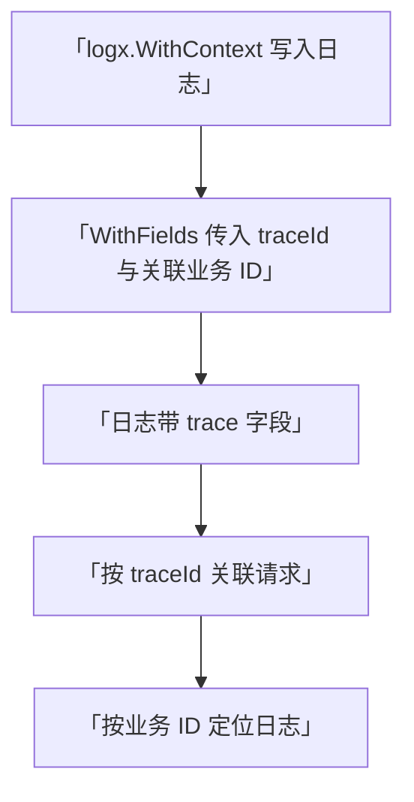

本节继续讲解 go-zero 与 ELK 的结合。上一节通过自定义 Writer 把日志推送到了 Redis，本节先对这一实现做进一步完善：默认推送出去的日志内容比较单薄，缺少时间、代码执行位置等信息，与本地文件日志相比存在明显差异，因此还需要在推送端对日志内容做一些加工，丰富日志的内容。

## 完善日志内容

先来看测试代码。通过 `logx.NewRedisLogWriter` 创建一个用于将日志写入 Redis 的 `Writer` 对象，在 `redis.RedisConf` 中配置好 Redis 的连接参数（Host、Type、Pass、Tls、NonBlock、PingTimeout 等），再调用 `logx.SetWriter(io)` 将该 Writer 设置为全局日志写入器，后续所有的 `logx.Info(...)` 调用都会通过这个 Writer 输出。

```go
func TestRedis_logx_ioWriter(t *testing.T) {
    io := logx.NewRedisLogWriter(
        redisKey: 「redis.io.writer」,
        redis.RedisConf{
            Host:     「192.168.117.24:16379」,
            Type:     「node」,
            Pass:     「easy-chat」,
            Tls:      false,
            NonBlock: false,
            PingTimeout: 0,
        }
    )
    logx.SetWriter(io)
    logx.Info(「test file log」)
    logx.Info(「这是测试go-zero日志」)
    logx.Info(「将日志推送至elk」)
}
```

运行测试，重点观察输出的信息。可以看到，通过这种方式输出的就是默认的日志内容；再来看本地文件日志的输出，可以看到还有其他的信息，比如时间、代码执行位置等，而这些在默认推送中都是没有的。这是两者在信息处理上的差异性。

因此，如果我们基于 logx 的插件 Writer 来实现，那么还需要在后面增加一些处理：需要把整体的、不同级别的日志的输出内容都定义好，对它的输出内容也进行处理，也就是丰富日志的内容。

这里定义了一些 key 来丰富它的内容，同时定义了一个用于获取代码执行位置的方法。重新运行之后可以看到，输出的格式和前者相差无几了。不过只是在数据格式上总还是存在一定的差异性：这里获取的是代码执行的路径，而本地实现获取的是文件及行号，这是两者的一个区别点。

## 基于 io.Writer 的实现原理

综上所述，go-zero 的日志扩展方式有两种：第一种是基于 logx 的插件 Writer，这种方式在实现的时候，需要把整体的、不同级别的日志的处理都定义好，然后对它的输出内容也要进行处理；第二种方式是基于 io.Writer，这种方式只需要处理好输出的位置就可以了。这是两者的一个差异点。

第二种方式借助了 logx 内部自己的处理逻辑。看一下它的实现：logx 中有一个 info 方法，点击进去，再点击这个 writer 的 info 方法，如果设置了 Writer，那么就会去使用设置的值；如果没有设置，它就会使用默认的这一项，也就是默认输出到控制台。再来看这个 info 方法的接收者对象，这个对象就是使用 io.Writer 方式时，logx 自己创建的对象，创建时使用的就是刚刚指定的这一个对象。

在这个对象中看一下它的方法：这是它的一个 info，以及 writer 方法，点击进去，可以看到它确实是进行了对应的处理。而在处理的时候要注意，它最终写的时候，这里有一个 writer 写入的方法，它会获取自己的 io 对象，让 io 去写。这里会获取自己的 io 对象：这里有一个 writer 方法，然后它会把自己的 io 对象设置出来，在前面这里进行设置，它其实就是我们自己添加的 io 对象，然后在这里设置好。所以到这里，logx 的日志该如何扩展，基本上就已经理解了。除了推送到 Redis，也可以推送到 Kafka，这也是可以的。

## 与业务结合：如何通过日志定位问题

了解完日志该如何扩展之后，接下来讨论与业务的结合。与业务的结合，实际上是希望能够更好地在项目中去定位问题。讲之前先看一个业务中的问题。

项目上线运行之后，以目前的项目来说，在运行过程中肯定会出现一些工单问题。所谓工单问题，就是项目运行过程中产生的一些 bug。目前是一个 IM 的项目，所以经常出现的就是：某一个用户加入到某一个群的时候出现失败，或者退出群的时候这个用户还在群中，这些都属于工单问题。

这类问题出现之后，就需要排查这一类信息。在前面所学到的知识中，可以通过链路跟踪来定位，但链路跟踪主要针对整个调用链路，比如在整个调用的过程中哪一个服务间出现了问题，可以在链路的过程中查到。但如果问题出在数据层面，很显然这是业务问题，业务问题直接通过链路跟踪其实很难评判，或者很难找出关键的问题所在。此时就需要结合日志。

但日志信息往往并不如意，因为日志有一个问题。看这里的日志信息：日志是按天完成文件切分的，每一天的日志单独存放。如果这样的日志文件有成千上万个，那么此时出现的这个工单可能是在 4 天前，那怎么能够根据这个工单中所提供的日志信息，去找到与其相关的日志？这是一个很难的事情。

因此如果要去找，找的方式就是先通过时间进行筛选，筛选出该事件的日志信息，再筛选与该事务相关的日志信息；筛选完之后，再筛选它的描述内容以及执行的行号，来定位具体的日志信息。但仍然无法做到百分百确定该事项所对应的相关日志，只能是评估。这是目前传统日志在项目运行过程中仍然存在的问题。

那么怎么去更好地优化，以便在项目中去定位问题？go-zero 中为此做了一项处理。首先，go-zero 中增加了 LogField 的日志字段机制，这是可以自定义的。这个属性可以在进行日志操作的时候增加某一个 key；这个 key 可以自己去扩展，比如用户 ID、群 ID，以及关联的业务 ID。这样在进行日志查询的时候，就可以根据这一个定义的 key，也就是这个自定义字段，定位到日志了。这是一种技巧。

但只获得关联的业务 ID 还不够，还需要获得整体，也就是整个请求的 traceId。因为目前只是获得到关联的业务 ID，还需要做到整体链路的关联。整体怎么办？这里有办法：logx 中有一个接口，这个接口非常关键，来看一下实现这个接口的对象。在这个对象中有一些方法，其中一个方法是 WithFields，这个很关键。可以看到它做了一个事情：通过 ctx（context）获取到当前请求的 traceId，然后设置了一个 trace 字段，就知道这个日志是属于哪个请求的。这就是整个问题的关键：能够把请求整体关联起来。

所以可以将日志这么改：需要能够得到请求相关的 traceId。编写一下：先从 go-zero 的上下文中输出请求的 traceId，给它去个别名，然后调用 WithFields，把 traceId 与业务关联 ID 作为字段传入，再结合 logx 的 WithContext 来写日志，这样就把 traceId 放到了 logx 的 context 中。

然后执行上一段的日志。要注意当前的调度方式：复制另一份日志。第一份是通过 WithContext 传递的 Logger 这个对象来完成写入，第二个是原生的。写入之后，把上一份日志输出，放到控制台中。可以看到两份日志输出是不一样的：第一份明显写了一个 trace 字段，而且每一个 traceId 是一致的。这样就能匹配到具体的这个请求了，请求和日志就关联起来了。同时再基于前面提到的那个字段，就能把请求和业务数据关联起来。这就是在业务中可以优化的方式。

traceId 与关联业务 ID 定位日志的方式如下：



不仅在 go-zero 项目中可以有这样的操作，很多项目中也都有类似的实践。还有一点：在 go-zero 中这样的操作，或许会觉得繁琐，因此这里提供了一个上层应用的封装，大家可以将其引用到自己的项目中。它主要做的事情就是完成这个 traceId 的处理，以及关联业务 ID 的记录。这里是一个应用示例，下面是应用示例的运行结果：它会记录 traceId，还有关联业务的 ID，这两个 ID 就会被记录下来。这是基于刚刚那个机制实现的一个方案，也就是 go-zero 实现的一个方案，可以将其引用到项目中。

然后进到测试中，增加一下刚刚的测试。这个应用会简单一点：首先通过调用引入的组件 Telango，然后调用它的 traceId 启动的方法，传递 context。传递进去之后，就可以应用它了，调用 Info。这里面有个 TelangoInfoContext 这个方法，它做的事情并不复杂，有两种方式：第一个是传递一个 context 的方式，第二个是不传递。传递 context 就是指定跟这个请求挂钩，不传递就不挂钩。第二个参数是关联的业务 ID，因为项目的功能中会用到相关的业务 ID，可以说是用户 ID，也可以是订单 ID，或者某一个支付的 ID，这些都是可以的。

然后是原始的测试，它还没有跟这一项结合起来。因为这里采用硬编码的方式，所以先用 Info 注入一下，重新运行。运行之后可以看到，它就会有关联 ID 和 traceId。

## 封装组件与 go-zero 的集成

接下来让它与 go-zero 结合。可以这样应用，集成的方式并不复杂。首先第一步，需要把它设置到 config 中。config 中有一个方法可以扩展，也就是一个 Writer，初始化在 Writer 初始化中。看一下它的配置：上面的都不用改，重点改 Writer 这一项，它也是一个日志 Writer。这一项采用的是 Redis 方式，因为在有些业务场景中，日志可能有多项输出。这一项传递的就是 Redis 配置。这里有一个演示：调整了一下，增加了一个字段，更改一下这里就可以了。这样就设置好了。

做完之后，就是设置了这个 config，它跟前面 go-zero 这一套是具有相似性的。做完之后，就需要去使用它，使用的方式也并不复杂，直接用这些日志就可以了。使用的是 config 中的这一套日志写入的方式就 OK 了。

然后需要得到一个 traceId，从 go-zero 的 context 中来获取就可以，目的是获取这个 traceId。如果 traceId 不存在，就让它置为一个空；而且有可能它就是为空的，所以只需要去设置这个 config，把 traceId 传递就可以。如果 traceId 存在，那么可以这样子改 config：传入 traceId，然后传入业务 ID，就是调用了不同的方法而已，下面的不用改。

运行，执行这一个测试用例。执行之后可以看到，它使用了 go-zero 的模式，在日志中可以看到它记录了请求的 traceId 和关联 ID，这里都有记录。那么可以通过它们定位到具体的日志，排查相应的问题。

## 本节总结

整个课程的核心就是讲解 go-zero 与 ELK 的结合，一定要理解它的两种结合方式：第一是基于本地日志，第二是基于自定义的推送方式。课程中采用 Redis 来作为 go-zero 与 ELK 之间的中间件，当然也可以把 Redis 换成 Kafka，这是可以的。

另外，go-zero 中对于日志的扩展，方式有两种：一种是基于 go-zero 所提供的 logx.Writer，另一种是基于 io.Writer，通过这两种方式进行扩展。大家可以根据自己的实际情况来进行调整：第一种方式会更加灵活，需要实现的功能会更多；第二种只需要考虑将日志推送至某一个位置。

另外，关于自定义字段与 traceId 关联日志这一点，它并不是课程中必须要掌握的，但理解了之后对之后的工作实践是很重要的，这个实操对很多操作有帮助，可以更快地定位问题，以及这个组件的应用也是如此。
