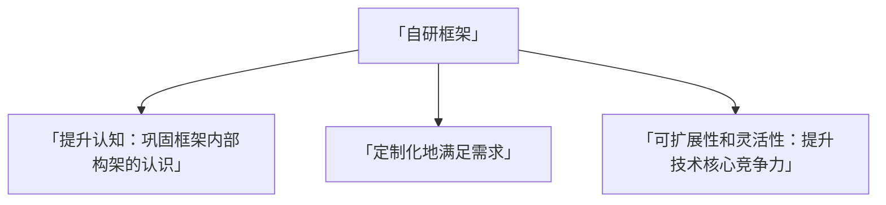

本章主要依据之前所学习到的微服务知识、go-zero 框架，结合起来自制一款微服务的框架。

这个时候可能有一个疑问：目前已经有很多成熟的框架在市面上运用了，为什么还需要自制？比如成熟的框架有 Go Micro、trpc、go-zero 等等，这一系列框架有很多，为什么还要自研？

针对这个问题，来看目前列举的这六款框架，它们都在行业中多有应用。为什么会有这么多的框架？其实有很多关键性的因素，比如公司的需求：trpc 与 Dubbo Go 就是比较典型的。trpc 主要是依托于腾讯 trpc 这套体系而设立的框架；Dubbo Go 是阿里基于 Dubbo 这一套体系构建的微服务框架。它们都是因为自己的需求而去开发的。

而 go-zero 是吸收了目前业界各个框架的应用情况以及项目的开展情况，从而提出一款更为简单、能够缩短项目开发周期的框架。从这一点可以看出，框架本身的诞生目的、需求或背景会不一样，这也决定了是否需要自研。

那么，自研框架本身能带来哪些帮助？

## 自研框架的帮助

第一点，就是提升认知。前面的课程重点分析了框架的内部实现、内部流程，但主要讲的仍然是理论，只有当理论落地于实处，才能知道这过程中有哪些细节、哪些问题。自研框架可以帮助更好地巩固前面所学的课程知识，提升对框架内部构架的认识。

第二点，定制化地满足需求。前面讲的 trpc 和 Dubbo Go 这两款框架，其实就是典型的定制化特点。trpc 就需要依托 trpc 这一套体系：因为它的体系庞大，有很多业务会基于 trpc 的这套体系，所以它基于 trpc 和 Go 语言开展了这个框架，来满足自己公司内部的需求。同样的道理，公司越大的时候，对定制化的需求就越多。在业务之中，开源的框架往往只是针对大众化的功能，但极细微的需求，就需要自己去额外扩展。所以定制化的需求，对于个人、对企业来说都是非常关键的因素。

第三点，就是可扩展性和灵活性。毕竟是自己所写的框架，自己改起来很轻松，扩展起来也更加方便，灵活性也更加高，并且可以提升自己的技术核心竞争力。在写自己的框架的时候，不仅仅是去写一个框架，还需要参考其他框架的实现，了解其他框架，然后以此吸收并融合起来，分析为什么要这么做，从而融入到自己的项目中，再结合自己的业务需求来定制。在这个过程中，既提升认知，又能够提升自己本身的技术。自研框架对自己而言、对企业而言，都具有一定的价值。

自研框架的三点帮助可以归纳为下图：

但是有一点还是要指出的：并不是说自研框架就一定很好，要依据自身的实际情况。如果有足够的时间，建议大家可以去尝试一下自制框架、自研框架，对个人来说是非常有帮助的。对于企业来说，注重的是项目的稳定性，但当公司发展到一定的水平的时候，对个性化定制的需求就会更大，这个时候就可以考虑自研框架这么一个话题。
