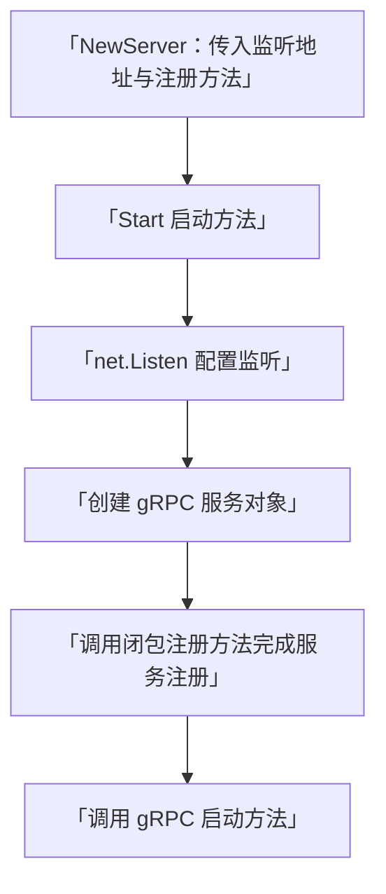

已经构建好了框架的核心结构，接下来完成框架中的 RPC 服务。

对于 RPC 的服务开发，主要基于 gRPC 来实现。开发的时候，先对服务的构建进行分析，然后再具体实现。

## 服务的构建分析

先看服务的构建。服务的构建主要关注两个话题：第一，内部服务该如何实现；第二，指定的服务将如何注册。

在自己编写的微服务框架中，先看内部服务该如何实现。

对于内部服务的构建，课程中会基于 gRPC，以这个框架为基础来构建。之所以选择它，是因为在目前的业界中 gRPC 的应用非常广泛，可以更好地切合项目的需求。当然也可以选择 Go 标准库中的 net/rpc 包，或者自己去实现，都是可以的。课程中会基于 gRPC 来构建框架，供上层应用使用。

对于服务的注册，来看具体流程：框架首先会进行初始化，然后对自定义的服务进行注册，再启动这一个框架，而自定义的服务在这个环境中注册进来。

先看一下 gRPC 服务的代码是如何编写的。这里采用的是之前所讲的方式：在示例中这里就有一个服务，然后一个 proto（文件），在 proto（编译生成的文件）中就包含了 gRPC 所生成的库文件，在这里定义了许多的接口，其中包含客户端的接口以及服务端的接口。自定义的服务会实现这个接口，然后通过调用下面定义的注册方法来完成注册。

这里是注册服务的入口：首先配置好监听，然后创建好 gRPC 的服务对象，再完成服务的注册，并启动 gRPC 服务，这是代码的执行流程。

在整个代码的执行流程中，这一行（注册服务的代码）是可变的，不同的服务定义的方法不一样，进行的操作也就不一样。所以可以看到，自己所写的微服务框架就需要考虑如何解决这个问题。

为此可以看一下设计，这是设计的流程图。图中首先看这个地方：这里定义的是一个约定（接口），它里面定义两个信息：第一是注册的方法，这个方法是用于给外部的程序去调用的，让它自己基于 gRPC 的服务对象来完成自己的服务注册；然后在其下定义一个 Server，这个 Server 就是具体自己框架的服务对象，它只有启动和停止这两个方法；然后这里是自定义的服务，是针对刚刚定义的这个接口来进行实现。

重点看的是这个服务对象：在服务对象中定义了一个属性值，这个属性值就是记录注册的方法，然后在创建的时候要求传递进来，这样就可以很好地解决自定义注册的多样性问题。

具体调用如下：在创建这个服务的时候，把这个注册方法传递进来；在这个注册方法中，由上层应用自己去完成自己定义的服务的注册。这样是不是就可以解决自定义服务多样化的注册问题？把这样的一个操作封装成闭包，传递到这个服务的对象中，在启动的时候调用这个方法就可以了。

这就是要进行的设计。

## 编写 rpc_server 代码

了解完设计之后，接下来编写代码。回到程序中：首先针对当前的项目通过 go mod 进行初始化，初始化完成后再引用相应的包，准备工作就完成了。

现在来完成这个服务的方法。在这个方法中，需要将这个接口约定引用到项目中。接口引入之后，来定义服务（结构体），设计这个服务，实现这个接口。在设计中定义一个属性，这个属性是当前服务要监听的地址；第二个成员是注册的方法。并完成提供的方法：NewServer（创建服务），传递要监听的地址以及要注册的方法，返回 Server 对象。NewServer 接收参数，目前初始化方法就完成了。

还需要针对这个接口完成下面两个方法。定义这两个方法：启动（Start），返回错误，这里定义一个空的错误；然后再定义停止（Stop），同样输出错误，也给它一个空。目前服务初步就定义好了。

主要关注的核心就是启动中要做什么事情。根据前面分析的流程，它是先创建好服务对象，然后再调用启动方法。所以在启动方法中，先定义好监听，通过 net.Listen 来监听，把错误返回出去；得到监听之后，创建 gRPC 的服务对象，服务对象创建完成，再注册服务，用这个闭包方法把 gRPC 服务对象传递进来，之后再调用 gRPC 的启动方法。启动的流程中代码就写好了，目前服务基本上构建好了。

启动流程如下：

但还不太完善，因为像服务启动过程中可能还有一些其他的设置、操作等等，在目前情况下是没有定义或传递的。所以为了扩展性这一块，还要进一步优化。可以在整个项目的这一层定义一个 Option。Option 在前面的课程中已经提过，可以把它理解为一种配置，或者一种操作设置。在服务的初始化动作中传递 Option，用 Option 来完善整个服务后续的相关事项，这在很多框架中都有应用，gRPC 此处就有应用。同样，这里也可能需要直接设置 gRPC 的相关操作，所以也要考虑对它的支持。

现在来定义对应的 Option。Option 定义分为两个部分：第一是 Option 的方法，即闭包方法，这个方法的定义是用于设置 Option 属性的；第二个是 Option 的具体对象，在这个对象中将定义具体的属性，比如名称，或者 gRPC 的 Option。然后再有 ServerOption，提供给上层的方法。在这个方法中，先创建 Option，Option 创建好之后设定一些默认的属性：当前项目的名称，以及 Micro.rpc（服务名称）；然后围绕 ServerOption 以及传递的参数，设置相关的参数值，把 Option 对象传递进去再返回出去，初始化就成了。再围绕这些属性，定义这些属性设置的方法。

先定义一个设置 gRPC 服务 Option 的方法：把 Option 传递进来，在方法中进行 gRPC Option 的设置，返回出这个方法。完成对属性的设置，设置完成。没有其他方法了，就在这里跳过了。

Option 定义完之后，就要在服务中使用它。在服务中，要将这里的属性引用进来，所以在此处定义一个 Option，然后在这里把 Option 作为参数传递进来，注意用可变参数（...），设置到这个属性中。属性设置之后自然就需要使用。在这个 Option 里面定义了 gRPC Option，把它在这里引用起来，这样就可以在外部去扩展这个服务的操作了。对于其他操作，将在后期课程中继续完善这里面的内容。但目前而言，一个服务基本上就构建好了。

对于服务的测试，还需要 RPC 客户端的完成，才能更好地验证服务的核心功能。一定要先分析好服务注册的流程。
