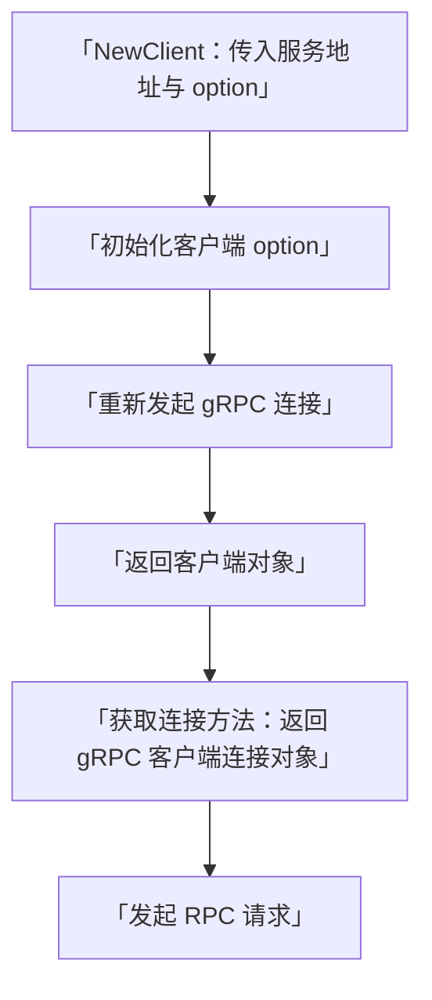

对于 RPC 的客户端构建，先分析客户端的构建过程以及连接的存储问题，然后再具体实现。

## 客户端的构建分析

先分析客户端的构建。对于 RPC 客户端的构建，因为是基于 gRPC 的情况，流程来说并不复杂。先看这些代码中的调度。

这里是库文件，而这里是 RPC 客户端的入口方法。首先得到的是 gRPC 的客户端，得到这个客户端之后，会通过它去发起 RPC 的请求。那么自定义的微服务框架在此处该如何编写？

对于自己的微服务框架来说，主要去封装 gRPC 的连接客户端，因为在调用过程中这里的变化是比较多的，这一点很难在自己的框架中定义，这是存在的问题。能做的就是封装这个客户端。

可能有疑问：在框架中既然只是封装一个客户端，那框架又做什么事情？这一点和框架后续的课程有关系。框架会围绕这一个客户端去封装设置客户端的一些属性、一些操作，所以框架其实只是帮助节省一些动作。

对于这种客户端的调度，目前 go-zero 以及 go-micro 对客户端的调度都还做了一个适配操作。当然其实也包含了服务端，也做了适配的操作，这属于上层应用的。

这一点可以看之前的代码，打开之前的 easy-chat，选择任意一个服务以 user 为例。在 RPC 服务中，这里有一个 user 的客户端，到这里就定义了关于这个服务调用的客户端。这个客户端是通过调用工具生成的，它其实属于代理，过程就是发起一个 RPC 请求：先得到 gRPC 的客户端对象，再通过这个客户端对象得到 gRPC 的连接，然后完成对应的 RPC 请求。这就是它做的事情。

所以在此处它是做了一个适配，帮助去调用这个库中的方法。目前我们在上层应用中没有做这个适配，也可以去写一个这样的工具去生成。

接下来看这个图，这个图是对于客户端实现以及使用的示意图：这是定义对于客户端的接口，然后通过这个实例对象来进行实现，同时还定义了一个 option，用于指定设置客户端的一些相关属性值。下面是如何调度：创建客户端，然后再通过库文件的方法来完成 RPC 的请求动作。

## 编写 rpc_client 代码

回到代码中。先来写客户端代码：先定义好接口，提供一个方法，这个方法主要是获取 gRPC 的客户端。接口定义完之后，可以先定义一下 option，客户端来说肯定也需要 option，所以下面来定义 RPC 客户端的 option。将其上面的内容进行复制，在下面进行引用，更改一下名称，这里会使用客户端的名称，也就是服务的名称。把下面的这个方法更改，将这个方法中的 option 对象更改，那这一段就完成了。然后下面这个方法要更改，把传参进行更改，目前就更改完成了。

在这一段的初始化动作中，我们在建立 gRPC 连接的时候有传递一个 option 的操作，那么现在把这个 option 的操作也作为当前客户端的默认配置，在这里传递给另一个初始化，在初始化中进行引用。目前 option 就定义完成了。

定义客户端的具体对象。在对象中，首先定义一个属性存放地址，这是服务端连接地址；然后是客户端的 option，以及 gRPC 的客户端连接。首先是关键的方法：NewClient（创建客户端），传递服务的地址以及 option，返回客户端的对象。初始化中，先初始化客户端的 option，在此处要做的事情是重新发起 gRPC 的连接，它会得到一个连接对象，把参数传递进来，这里会有错误，所以需要将这个错误也返回出去。最后返回客户端对象，把返回值处理好。客户端的初始化就完成了。

客户端的构建流程如下：

接着对这一个客户端的对象再定义客户端的方法：一个获取连接方法，返回 gRPC 的客户端连接对象。目前的工作就完成了，客户端就定义完成。

## 编写测试示例

接下来自然就要去测试，结合上一节定义的客户端来测试。测试时先把它写成一个示例，以示例的方式来测试客户端，再定义服务。定义一个目录，在里面定义一个示例，然后在这里定义一个客户端。

首先完成这个 proto 文件的内容，这个文件的内容在文档中已经有提到，将其引用到项目中，其实并不复杂。同时在这里还提到了命令，这个命令就是根据它来生成对应的项目、生成对应的库文件。进到目录中执行这条命令，就会生成对应的库文件，里面就定义好了相关的服务。

现在来完成 server.go 的内容。这里肯定是要定义服务，提供一个服务方法。第一步先定义好自定义的注册：在这个自定义的注册方法中，它的请求参数是 gRPC 的 server，依据 gRPC 的 server 来完成注册，再用库文件中的注册方法，把这个 server 对象传递进来。但这里还有一个问题：服务还没有定义好。所以在这里定义服务的对象（结构体），实现这个接口，接口中还有一个嵌入引用，在这里引用一下，然后再定义这个接口的方法，这样就实现了对应的接口。

接着完成这个接口方法的内容：在方法中打印请求参数，然后响应，响应这个 response，还有一个 error，在里面给它回复个信息 OK。目前一个服务就定好了。

回到 server.go 中，在这里对刚刚所定的服务进行初始化，并传递到框架中来完成注册。目前服务注册的方法就定好了。然后再创建自己所定义的服务对象，传递监听地址，把注册方法传递进来，再启动服务。启动之后，如果服务不运行了，那么自然停止服务。到目前为止，这个服务的代码就写好了。

接下来完成客户端的代码。客户端这一块的设定也并不难：在客户端的 main 中，使用 main 包，然后定义 main 方法，创建好服务对象，传递请求的服务地址，然后后面的消费等操作到时候就不处理，把错误处理一下。当客户端得到之后，就要去发起 RPC 请求。发起 RPC 请求自然还是需要调用库中的方法，将客户端传递进去，在这个创建的客户端对象中把 RPC 的连接对象传递进去，然后再调用接口方法，传递好参数：request 请求对象，这样就完成 RPC 的调用了。

现在运行代码，进到服务的目录下面运行，然后再进到客户端的目录下面运行，调用这个服务。服务启动了，再运行客户端。可以看到一个 OK，说明目前两方的构建是没有问题的。

客户端的构建并不复杂，核心在于先分析好构建思路，再依据分析编写代码。
