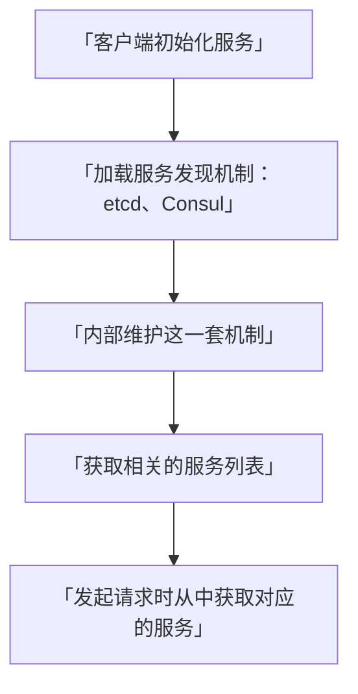

已经构建了框架中的服务和客户端，并且也针对这两者构建了基础的应用示例。接下来针对框架来集成服务发现机制。

课程内容总共四个话题：先分析对服务发现机制的实现，然后加载 Consul，因为课程计划采用 Consul 来做服务发现。之所以选择 Consul，是因为在构建中，它已经选择了 etcd，并且为 etcd 构建了相应的机制，先来讲一讲 Consul。然后在 Consul 加载之后，就要实现服务注册以及客户端的服务发现。

## 服务发现的功能分析

先看功能实现的分析。对于功能分析，重点主要关注在客户端，服务端要做的事情相对简单一点，它只要把这些信息注册到微服务治理中心就可以了。而此处主要看到的是客户端的服务发现流程。

在这一段内容中，以前也分析过：流程上，客户端首先会初始化自己的服务，然后会去加载服务发现机制，这里服务发现机制有很多种，etcd、Consul 都是比较常用的。然后在自己内部会去维护这一套机制，这套机制主要做的事情就是获取相关的服务列表，以便于在发起请求的时候，能够从中获取到对应的服务，完成任务。

客户端的服务发现流程如下：

对于功能的实现，它分为两种方式：第一种是基于 gRPC 的核心机制来进行实现，在 gRPC 中，它另外有提供针对服务注册、负载均衡的这一套扩展机制，而 go-zero 也是基于这套机制来实现的；另一种方案就是不用 gRPC 的，而是在自己的框架中，上层再写一层这样的机制。这两种方式都是可行的。

课程中选择第一种，因为 go-zero 已经有写，自然就用 go-zero 的这个核心机制，会更为简洁。

## 加载 Consul

接下来加载 Consul。对于 Consul 的加载，文中提供了这一份 Docker Compose 的配置，课程中就不演示了，已经提前将它加载到服务器中并部署好。

接下来是服务注册与服务发现，来看这里，这是针对前面分析的流程的一个代码上的示意。

首先看这里，这里是 gRPC 对要扩展的程序定义的接口，这个接口属于服务发现的接口，下面会构建一个服务发现的机制。这个接口在此处就定义了一个新的接口，这个接口属于框架内部的接口。在这个接口中，它有哪些工作？第一是注册服务，它定义了一个方法用于注册服务；第二是实现 gRPC 的这个接口，同时再提供了一个注册服务的方法。而在这个接口的下边定义了一个方法，这个方法主要是去获取 resolver 的。关于 resolver 的获取，这里将引用 go-zero 中的 resolver 的包装方法，来获取系统服务的 resolver，可以看 go-zero 的源码，比较简单，在这里进行调用。

到目前为止，我们就定义好了自己要实现的服务注册发现机制的接口。根据这个接口的描述，有服务注册的、有服务发现的，也有注销的，那是不是就能满足应用的需求？所以在框架中，在服务端和客户端会基于上面的这个接口来完成注册和发现的动作。

然后在此处，这里就对刚刚提到的服务注册发现机制进行实现。在这个实现中，就实现了里面的方法，并且还对外实现了这么一个 resolver.Builder（的接口），这个接口是 gRPC 所需要的，它负责解析我们自己启动的服务所传递的信息。我们会采用这样的结构去完成服务注册和发现的功能。

## 代码结构设计

在功能和结构分析完之后，代码结构也做了一点了解，那么接下来就进入到开发的工作中。这里有一个核心目录，会定义在这个核心目录中，作为服务发现注册的机制；然后再定义 Consul。如果自己还想写其他的机制，同样的在这个目录下面定义就可以了，比如说 etcd。然后在大层面定义一个统一要求实现的接口，再定义一个服务，这一个服务就是要注册的服务，因为信息相对说不复杂，可以从此处引用就可以了。然后还需要在此处再定义一个 register（的目录），内容也不复杂，从这里引用进来就可以了。

引用好之后，现在还需要定义一个辅助的包，这个包的主要作用是帮助获取系统的 resolver 相关代码。对于它里面的内容，因为是直接引用 grpc-go 的内容，还是有点多，已经将其放到了文档中，代码也不复杂，将其引用到自己的项目中。它的主要功能就是获取系统服务的 resolver 相关代码。关于代码可以看这里面的内容，那么准备工作基本上就差不多了。

这下就要定义整个服务的接口。对于这个接口，这里其实也有一个现成的选项，因为这个接口已经定义了，所以也将其放到自己的程序中。里面的内容就是定义了一个注册方法、一个注销，然后基于 grpc-go 定义的一套服务发现的机制。接口就到这里定好了。下面的这个方法的内容也是直接引用 grpc-go 的，同样把它放到文档中，也引用到自己的程序中。到这里的话，基本上这些准备工作就做好了。

这里还有两个环境变量，这个环境变量是怕它在传递的时候 host 是不是 0.0.0.0，这个是环境变量对于 IP 的一个设置，将其在这上面定义好环境变量。

## 定义 Consul 的 option

现在重点的核心就是完成 Consul 中的内容。在完成它的内容前，先定义一个 option，option 就是设置在 Consul 中会用到的一些操作。目前先定义一个配置，这个配置就是 Consul 的访问配置。给这个配置定义一个默认信息，这里定义一个默认配置，访问本地的 8500 端口。定义完之后，再返发出结果，给它提供一个设置的方法。目前的话，option 就定义好了。

再定义 Consul 结构体，在这个 Consul 中，就要去实现在外层所定义好的接口。
