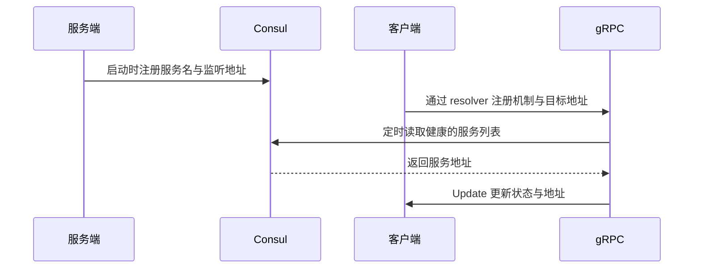

现在来完成 Consul 中的内容。在 Consul 中，先定义 Consul 连接的客户端：

```go
type Consul struct {
    client *ap
}
```

然后定义一个服务注册 ID，这个 ID 是用于 Consul 服务注册的时候来使用的。接着定义一个初始化的方法：NewRegister，传递好 option，还有相应的配置信息就是 register 的配置，还有一个是错误。

先得到 option，然后再定义 Consul 连接的配置信息，目前主要定义的是 Consul 的连接地址。再定义 Consul 的客户端，将配置信息传递进来，做好异常的处理，创建 Consul 客户端，并设置好客户端。如果没有异常，定义完成，初始化方法就定义好了。

然后去让它实现这个接口，将接口的方法引入进来，让 Consul 实现这些接口的方法。目前，定义一下它们各个方法要返回的结果。现在 Consul 就实现了 register 中所有方法。

## 服务注册与注销

目前先做的是服务的注册。服务注册工作就从这里开始。在服务的注册中，第一步需要先得到服务的连接地址，创建服务的监听地址；然后再得到服务的注册信息；之后再发起服务的注册工作：通过得到的这个客户端对象，注册到 agent 中，再用服务注册。

在这个方法中，自然还需要传递好配置信息，其中第一个信息就是服务注册的 ID，服务注册的名称，然后再是服务监听的地址。基础信息就写好了。

再提供一个注销的方法，注销方法也不是很难，通过调用这个 agent，选择注销服务，然后传递好要注销服务的 ID，这样就能够实现服务的注销了。

注销完成了，那么在这个服务启动的时候，要将自己的服务信息注册到 Consul 中。那么要修改一下服务中的这个 server option，在 server option 中要接收服务注册的 register，然后再围绕这个 option 定义一个设置的方法，设置好 option 中的 registered 属性。在客户端当中它其实也是需要的，那么也可以把它在客户端当中写好。客户端也写好了，重点是服务端。

完成之后再进到服务中。服务这里启动的时候，就引用 option 中设置的这个 registered，在服务中定义好这个 registered 属性，然后在初始化中设置好 registered 属性。在启动的时候，下面是注册服务。服务注册完之后，再把整个系统的服务进行注册：首先先判断这个 registered 是不是为空，当它不为空的时候，就可以去注册，调用注册方法。

在注册方法中，它要求传递服务信息：服务名和地址。服务名从 option 中获取，地址就是本服务监听的 addr。如果它的返回值不为空，那就返回错误。这一段就是对服务的注册。

这一段写完之后，在示例中就先得到服务注册的机制，直接获取 Consul 的这个服务注册机制，创建好配置信息，也就是 Consul 的连接地址，做好异常的处理，然后在这里就要去设置，再用设置的方法来进行设置，把 registered 传递进来。这里没问题之后，就要去启动服务。

打开控制台，运行 go run，启动服务，可以看到服务已经成功地注册进来了。

## 服务发现的实现

接下来实现服务发现的这一套机制。在服务发现中，前面流程中已经分析了，重点就是实现 gRPC 中的这一个 resolver.Builder 的接口的方法就可以了。所以回到代码中，进到 Consul 中，写一下下面的代码。重点核心就在这个地方，来完成这里面的内容。

在这里面的内容中该如何去写？其实这个地方需要理解它要做什么事情。服务的发现机制这一套主要做的事情是获取服务的地址，获取服务连接并返回这一个连接列表。所以在程序中，在这个地方，就要定义好对程序的状态更新。

首先先定一个定时器，这个定时器的作用就是设置多久去检测一次。假设目前以每秒为单位去检测并更新。然后再定一个写入的方法，在内部通过 for 来循环，这个时间点进行一次。在里面，首先先要做的事情就是去读取服务，它读取的肯定很多服务，读取的可能是之前就已经有的，也可能会读取到最新的，反正它都会得到我们认为健康的服务。在服务中它传递一个信息，就是服务的名称。

那么这个名称从哪里来？这个名称是基于 gRPC 内部所调用的，而 gRPC 它会传递一个目标（target），在这个目标中它有一个 url，这个 url 又是后期的关键。对于这个 url，它有很多的设置，对这个 url 的设置和解析，可以看 gRPC 的文档就能够了解。

这里对它来做一点处理，在这一层增加一个方法，这个方法就是处理这一个 url 来进行解析的。定义，将后面传进来的 url 地址放进来，然后再做一次解析，通过 url.Parse 方法来进行解析。但实际上很多学员对这个地方还会有些模糊，可能已经忘了，建议在此处同时增加一个打印的信息，打印这个 url。因为可能已经忘了之前的分析过程，所以在这里再增加一个打印的信息，以便在启动程序之后运行，再根据这个打印信息来分析。

这个具体的分析在第三章节中有重点分析。然后在此处就把解析后的 url 地址信息传递进来，把 url 地址信息再返回，做好异常的处理。接下来定义在 gRPC 中要添加的属性设置，通过迭代的方式来赋值。会得到一个 host，然后将地址拼接起来，将地址设置进去。

设置完之后，再给它提供一个更新的方法，再用 gRPC 的 Update 方法来进行更新，将状态信息放进来，然后把得到的新的地址设置进去。这一套方法就写好了，整个方法是基于 gRPC 的设置、获取服务地址、适配更新。

这里定义好之后，进到客户端中。在客户端当中该如何引用？在 gRPC 中，其实最关键的问题就是在客户端的这个地址解析，因为在这里传递的这个目标信息，在后面它会调用它自己的解析方法，所以对这个目标地址要做解析。看一下这个方法，然后在下面，它会根据传递的信息来进行解析。对于解析我们不去讨论，重点关注的就是这个地址该如何编写，这是真正要关注的重点。所以它这里面，就是要通过这个 resolver 能够得到一个目标，能从里面获取到服务信息。

根据之前所分析的原理过程来说，它解析完这个地址之后，根据这个地址就能实现服务发现的这些动作。所以现在要怎么写？写的话，在这个 resolver 需要增加一个方法，也就是要调用自己定义的这个方法，它要传递对该接口实现的对象，然后还有服务信息，这个信息要传递进来，那么它最后封装的就是解析后的目标地址。当然在 resolver 中把自己注册的服务注册进去，注册完成 return 即可。

这些地址的写法要注意一下，这是固定的写法：第一个参数是服务发现机制名称，第二个参数是服务的监听地址，第三个参数是服务的名称，这是它的一个固定的写法。

这里定义完之后，回到客户端中，在客户端中它的事情就简单很多了，它只需要调用刚刚的方法就可以，事情的处理要放到上边，通过 resolver 来注册 get servers 做这个事情。判断一下它不为空，然后这里会得到地址，将注册机制传递进去，再传入服务信息：服务名称，然后服务的监听地址，这样就完成了。

再进到客户端这里，来做最后的测试。这一段它要做的事情就没那么复杂，首先先创建好这个注册机制，这个注册机制创建好之后，在这个创建的客户端的方法中来传递 option，把 resolver 放进来了，就可以了。然后再运行，没有问题，说明程序是正常运行的了。

服务注册与发现的整体交互如下：



这样我们就实现了服务注册发现的机制。可以看到它的日志，这里进入到了发现机制中，然后调用了这个 build 来进行初始化，最后输出了 url 中的信息。

主要在于要先回顾一下 gRPC 对于服务发现机制的实现，这样才可以更好地基于它的机制，实现整套服务发现的方案。课程中教学的难点主要是在服务发现机制中这个地址的获取问题。这一点就是要回顾第三章的内容，当对第三章内容回顾完之后，再来看这里，就能理解。

而其次就是在客户端当中，去得到一个用于获取和发现服务的请求信息，在此处再去发现请求的连接，然后去得到连接对象，再去完成请求。对于注册来说不是很复杂，注册只需要调用这个注册方法即注销对应的方法，就开始了。
