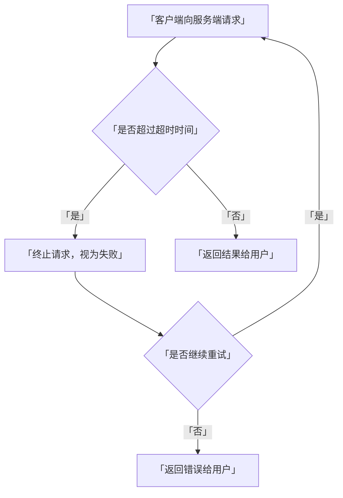

前三节已经将负载均衡机制集成到框架中。接下来针对 RPC 的请求调度，去设置重试和超时。

课程内容总共分为三个环节：添加超时、添加重试、再应用测试。

对于超时和重试这两者，在使用上是相辅相成的关系。比如这是客户端，这是服务端。当客户端向服务端发起请求的时候，如果服务端出现了故障，导致无法给客户端返回结果，那么对客户端来说，此时这个请求会一直阻塞。因此客户端为了避免长时间的等待，会设置一个超时时间，当超过了一定时间，就终止这一次请求，视为请求失败。

那么此时客户端的请求是得不到响应的，在这种情况下，可以添加重试机制，让客户端再向服务端发起重试。这一次结束之后，在一定时间后，客户端再向服务端去请求。当发现这里又一次请求失败了，客户端就会再进行下一次的重试。如果再一次是失败的情况，它就会把错误返回给用户；但如果请求成功了，就会把结果返回给用户。

在实际实现上，往往会结合拦截器来进行。

## 添加超时

所以现在来添加超时的处理。对于超时机制处理，并不复杂。在客户端目录下定义一个存放拦截器的目录，然后在它的下面定义客户端的拦截器。在这个目录下面，定义一个 timeout interceptor，即超时的拦截器。

timeout interceptor 在这个机制中，它接收的参数需要设置超时的时间（timeout），然后它要返回结果给下一个级别的拦截器。在这个拦截器中，需要完善里面的内容。它的内容实际上不是很复杂：首先第一步，就是验证当前的这个超时是不是小于等于 0，因为如果是小于等于 0，说明它是不设置超时的，直接就去执行具体的业务，直接调用业务就可以了。但如果说它是大于 0 的，那么说明要设置超时，接下来通过 context 来设置就可以了。在 context 中就有设置超时的方法，这里有个 context.WithTimeout，就是用来设置超时，这样就设置好了。然后再执行具体业务。

因为在 gRPC 中，它对这段任务的执行还是通过 context 作为上下文传递的，在里面它有一个 done 的 state 信号，然后在这个 state 里面，它就会有对结束这一段的判断。底层的写法是通过 state 信号：第一个分支是接收目前这个业务执行结果；第二个是监听 context 关闭的状态。这个状态就在执行上面的业务操作的时候，context 才是一个结束的状态，那么它就会进行下面的这段判断，就会结束上面的任务的请求。就这样的方式来进行控制。

由此，我们就设置好了超时的拦截器。

## 添加重试

接下来要设置重试机制。重试机制主要考虑重试的次数。在之前的课程中也讲过 gRPC 的重试方式，但这里我们是自己去写一个请求的调度机制，两种都是可以的。直接采用 gRPC 内部的方式是可行的，也可以基于自己的方式来实现。这里采用自己的方式。

首先先定义一个重试的方法，这一个方法主要是验证是否重试。首先传递 context，然后再给它传递已经重试的次数，以及错误。由它返回出是否进行重试，以及一个异常。这个方法的作用就是判断是否进行重试。

然后在下面定义重试的拦截器。在这个拦截器中，要定义重试的次数，然后重试的判断方法，返回的是 gRPC 的拦截器。在这一个重试的拦截器中，首先第一步就是判断重试它传递的参数是否正确，如果参数小于等于 0，说明它不进行重试，那么直接让它执行相关的请求就可以了。如果说它需要进行重试，那么就要设置重试，通过 for 来迭代运行，因为下标是从 0 开始，所以需要让它等于重试次数。

在里面，通过协程来运行自己的业务。那么协程在运行业务中，该如何判断什么时候才进行重试？只有当这个业务跑出异常的时候，才需要验证是否进行重试，所以需要有一个通道来接收这个错误。再用定义的通道来接收运行的错误，把这个错误写到通道中。写到通道之后，来判断：第一步判断的是目前有没有结束掉（context 是否已经 Done），如果它已经结束了，说明已经超时了，因为是通过协程先开始的，那么给它返回错误：在 RPC 调度的时候，发生了超时的问题。

第二个分支就是接收这里执行的结果。在这个结果中，首先先判断一下错误是不是等于空，如果等于空说明是没有错误，不需要进行重试；但如果说有错误，那么接下来就要判断当前是不是要进行重试，就需要调用下面的这个方法，调用它，传递 context，再传递重试进行的次数以及错误。有需要的话也可以把请求的这个 request 给传进去。它就会得到一个结果和一个异常。这里的异常属于重试的异常，它不是上面任务调度之后的异常。然后在此处判断一下重试的异常不等于空，就返回重试中的异常。如果它这里没有问题，那么再判断是否进行重试，如果不进行重试，直接返回这个异常。

目前就写好了。但还有一个情况：重试的次数已经超过了最大次数，那肯定要结束，也需要返回一个异常，返回的肯定是最终一个执行后的异常。这个异常怎么得到？在完成业务执行的时候，还定义一个变量，这个变量用来接收最终输出的异常，在这里统一结束。这样，重试机制就定好了。

## 在框架中应用

接下来需要在程序中进行引用，以及进行应用测试。应用测试的关键是客户端的编写。进到代码中，需要在这个 option 中进行修改。在它里面增加重试和超时的设置：首先增加超时时间，然后再增加重试的次数，以及是否重试的方法。这个方法属于框架内核中的回调，可能也要在上层定义这个方法。为了方便上层的使用，在客户端中来定义一个属性字段，在这里再进行一次定义，然后在这里来使用。这样做的好处是：用户不需要再深入到里层去调用对应的方法类型了，只要在上层就可以完成调度，也能够直接根据这个回调类型去定义对应的回调方法，这是方便于上层应用而设置的。

定义好属性之后，接下来定义对应的方法：定义 WithTimeout 方法设置超时。超时定义完之后，再定义重试的。重试有两个属性，将其引用到这里来，更改属性的指定。这一步完之后，就要在客户端中来定义对应的拦截器，通过 Option 的方式进行设置。要为它添加 gRPC 的拦截器：首先加载的是重试机制，传入重试的次数、重试方法的验证，这里还做个类型转化，然后再设置超时。此处客户端就填好了。

## 测试超时与重试

接下来进行最后的测试。首先进入服务中，在服务此处增加一下超时：在业务中设置它需要三秒钟才能返回，很显然一定会超时。然后在客户端中，接下来设置客户端的超时，设置一秒为超时，然后再设置重试机制，让它重试三次，再传递重试方法的验证，进行重试，同时输出结果和异常。

现在方法就写好了。重启运行服务进行测试。服务启动之后，进到客户端中来进行测试，可以看到它有进行重试，并且也超时了，跑出了一个超时的异常，说明目前超时和重试机制是没有问题的。

已经把超时和重试引用到项目中，并且构建了应用来进行测试，也就是把这两者架在框架中了。课程中的难点并没有太多，主要需要注意：这里是需要实现 gRPC 的拦截器，通过 gRPC 的拦截器来实现超时和重试。
